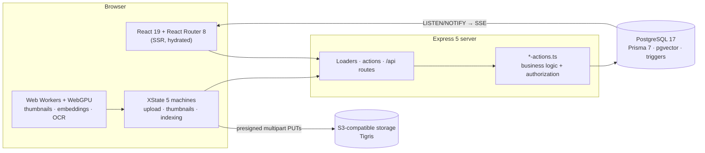

<div align="center">

# Stashly

**A self-hostable file platform: a personal stash today, team workspaces next.**
Upload whole folders straight to object storage, find anything with hybrid search, and keep every AI model in the browser.

[](https://github.com/dev-gvili/stashly/actions/workflows/ci.yml)


[Features](#features) · [Architecture](#architecture) · [Getting started](#getting-started) · [Testing](#testing-and-quality) · [Deploy](#deployment) · [Docs](#documentation)

</div>

> [!NOTE]
> Stashly is in private development and isn't a public service yet. The personal stash is the finished path; workspaces and a few other areas are still being built (see [In progress](#in-progress)).

## Features

### Files and folders
- **Drag-and-drop folder uploads** go straight from the browser to S3-compatible storage (Tigris) as multipart uploads, keeping the dropped folder tree. The server signs part URLs 100 at a time and resolves a folder upload's whole tree in one request.
- **Each new file appears in the open folder at once.** The create request sends back the card's row, so the page never reloads the folder to show a new file.
- **Trash, restore and permanent delete.** Each runs as one statement, whatever the batch size. Trash entries are stored, so a file you trashed before its folder stays in Trash when the folder comes back.
- **Move and copy** with guards: no move or copy into a trashed folder, and no folder moved or copied anywhere under itself.
- **Storage quota per drive:** a drive pays for what is on it, so a collaborator's upload counts against the folder owner's drive. Folder sizes and child counts are kept by database triggers, through a delta log while the database is busy.
- **Duplicates** and **storage** pages to find what takes the space.

### Viewing
- **Viewers** for images, video, audio (with ID3 tags), PDF, Markdown (GFM) and text or code. The code viewer runs Monaco, with go-to-definition across the files you uploaded.
- **Gallery layouts:** grid, river, waterfall and list, with view transitions into the item page and scroll restoration.
- **Progressive WebP thumbnails** made in the browser in 3 stages (blur preview, 512 px resize, saliency crop), and only for cards on screen.

### Search
- **Hybrid retrieval:** trigram (sparse) and pgvector (dense) results fused with Reciprocal Rank Fusion, over passages stored in `SearchChunk`, with evidence cards showing why a file matched.
- **Every model runs in the browser** on WebGPU through one priority queue: query and chunk embeddings, and PDF OCR (PaddleOCR PP-OCRv6, re-reading low-confidence pages with GLM-OCR).

### Organising and sharing
- Collections, favorites, pins, share links, invitations and per-item permissions (read, write, owner).
- Comments, locks and an activity feed.
- **Live notifications** pushed over Server-Sent Events from Postgres `LISTEN`/`NOTIFY`.

### Accounts
- OAuth sign-in with GitHub, Google and Microsoft (better-auth), plus a "Continue as …" card for the account last used on that device.
- Settings for profile, account, security, appearance, notifications and billing. Light and dark themes, with a phone layout.

### Operations
- **Errors and product analytics** through Vinktar on the server and in the browser. Events carry shape only (counts, sizes, kinds), never file names or other user content.
- **Structured logs:** one JSON line per event on stdout, each tagged with its request's `request_id`.
- **Prometheus metrics** at `/api/metrics` (optionally behind `METRICS_TOKEN`) and a health check at `/api/health` that answers 503 without a database.

### In progress
| Area | State |
|---|---|
| Workspaces | Routes exist (`/:me/workspaces/:workspaceId/*`); the personal stash comes first |
| AI Studio | An in-browser pipeline machine (detect language → transcribe with Whisper → summarize → tag); the page is a UI prototype with sample text, and `/api/ai` answers 501 |
| Version history | `/api/versions` can create, restore and delete versions; no UI calls it yet |
| Billing | Storage plans and quota limits work, and subscriptions are created and updated through the Stripe API; the webhook acknowledges events without saving them, deferred until paid plans go live |

## Architecture



Some conventions the folder tree doesn't show:

- **Actions own authorization.** Routes forward the user, and the `app/.server/*-actions.ts` functions check access and run the queries. No route calls Prisma itself, and a guard test fails any API route that skips `authMiddleware`.
- **The database keeps the counters.** Triggers keep folder sizes and child counts; a status change (trash, restore) writes each folder once through a statement-level trigger. Writers that put items into a folder lock it in id order, so they can't race a trash.
- **File bytes never pass through the server.** Uploads go straight to storage; the server signs URLs and records the result.
- **No inference server.** Every model runs in the user's browser, through `app/workers/ai-queue.ts`.

[`CLAUDE.md`](CLAUDE.md) lists the full set of conventions.

## Tech stack

| Layer | Technologies |
|---|---|
| Frontend | React 19, React Router 8 (framework mode, SSR), Tailwind CSS 4, shadcn/ui on Radix UI, XState 5, Framer Motion |
| Backend | Express 5, TypeScript 6 (strict), better-auth, Zod 4 |
| Data | PostgreSQL 17, Prisma 7 (`PrismaPg` adapter), pgvector, Postgres triggers |
| Storage | S3-compatible object storage (Tigris on Fly.io), AWS SDK v3, multipart uploads |
| In-browser AI | Transformers.js 4, ONNX Runtime Web (WebGPU), PaddleOCR PP-OCRv6, GLM-OCR, Whisper |
| Viewers | PDF.js 6, Monaco Editor |
| Payments | Stripe |
| Observability | Vinktar, JSON logs, Prometheus metrics |
| Tooling | Vite 8, Vitest 5, Playwright, Prettier, pnpm |

## Getting started

### Prerequisites
- **Node.js 24** and **pnpm**
- **PostgreSQL 17** with the **pgvector** extension
- An **S3-compatible bucket** (Tigris, AWS S3 or similar)
- An OAuth app for at least one of GitHub, Google or Microsoft

### 1. Install

```bash
pnpm install
```

`postinstall` generates the Prisma client into `app/prisma/`. It isn't tracked in git.

### 2. Configure

Create `.env` in the repo root (`app/.server/env.ts` loads it; variables already set in the environment win). `.env.example` only covers the Vinktar keys so far, so here is the full list the code reads:

| Variable | Needed for |
|---|---|
| `DATABASE_URL` | Postgres connection |
| `DIRECT_DATABASE_URL` | Optional: a direct connection for migrations and `LISTEN` when `DATABASE_URL` goes through PgBouncer |
| `DATABASE_POOL_MAX`, `DATABASE_POOL_TIMEOUT_MS` | Optional: app connection pool size and timeout |
| `BETTER_AUTH_SECRET` | Session signing (better-auth) |
| `SESSION_SECRET` | Signed cookies; production refuses to start without it |
| `GITHUB_CLIENT_ID` / `_SECRET`, `GOOGLE_CLIENT_ID` / `_SECRET`, `MICROSOFT_CLIENT_ID` / `_SECRET` | OAuth providers you enable |
| `AWS_ACCESS_KEY`, `AWS_SECRET_KEY`, `AWS_REGION`, `AWS_ENDPOINT_URL` | Object storage |
| `STRIPE_SECRET_KEY`, `STRIPE_WEBHOOK_SECRET` | Billing |
| `EMAIL_SERVICE_URL`, `EMAIL_SERVICE_TOKEN` | Outgoing email |
| `METRICS_TOKEN` | Optional: protects `/api/metrics` |
| `VINKTAR_KEY`, `VINKTAR_RELEASE`, `VINKTAR_ENVIRONMENT` | Optional: error tracking and analytics |
| `PORT` | Optional: dev server port, default 80 |

### 3. Set up the database

```bash
pnpm prisma migrate dev
```

```bash
pnpm prisma db seed
```

New accounts start on the `free` storage plan, so that row must exist. The seed adds it along with mock users; to add only the plan, use the insert in the `e2e` job of [`.github/workflows/ci.yml`](.github/workflows/ci.yml).

### 4. Run

```bash
pnpm dev
```

The dev server (Express + Vite HMR) listens on **http://localhost** (port 80; set `PORT` to change it).

## Commands

| Command | What it does |
|---|---|
| `pnpm dev` | Dev server with HMR on port 80 |
| `pnpm build` | Production build (regenerates the Prisma client first) |
| `pnpm start` | Runs the production build |
| `pnpm typecheck` | React Router typegen + `tsc` |
| `pnpm test` / `pnpm test:watch` | Vitest unit tests, once or watching |
| `pnpm test:e2e` / `pnpm test:e2e:ui` | Playwright E2E tests, headless or in the Playwright UI |
| `pnpm format` | Prettier |
| `pnpm prisma migrate dev` | Applies schema changes in development |
| `pnpm prisma migrate deploy` | Applies hand-written SQL migrations (triggers, functions) |

## Testing and quality

- **Unit tests** (Vitest, Node environment) sit in a `__tests__/` folder beside the code they cover: 1,309 tests in 105 files as of 8 Nov 2026. Some need a live database (sizes, quota, trash and upload races); they run against `DATABASE_URL`.
- **E2E tests** (Playwright) are in `tests/e2e/`: 8 specs with page objects in `tests/e2e/pages/`. `global-setup.ts` signs up a test user and stores its session, so authenticated specs skip the login UI; use the `test` fixture from `tests/e2e/fixtures.ts` for them. Playwright starts `pnpm dev` itself.
- **Types:** `pnpm typecheck` still reports 11 old errors, frozen in `.claude/tsc-baseline.json`. The gate is `node .claude/hooks/check-staged-types.mjs --all`: it fails when any file goes above its baseline, and when the baseline still allows an error that has been fixed.

**CI** ([`.github/workflows/ci.yml`](.github/workflows/ci.yml)) runs on every push to `main` and every pull request:

| Job | Checks |
|---|---|
| `check` | Type gate, migrations on a real Postgres (`pgvector/pgvector:pg17`), all unit tests with none skipped, production build |
| `e2e` | All Playwright specs against the dev server, a throwaway Postgres and real Tigris storage |
| `docker` | Builds the production image, runs its release migration, and checks `/api/health` answers 200 with a database and 503 without one |

## Deployment

Stashly deploys to **Fly.io** from the multi-stage [`Dockerfile`](Dockerfile) (Node 24, server dependencies bundled into the build). [`fly.toml`](fly.toml) runs `prisma migrate deploy` as the release command before each release. Browser source maps are uploaded to Vinktar during the image build and then removed from the image; the full `fly deploy` line is in [`.env.example`](.env.example).

## Project structure

```text
app/
├── .server/        Server-only code: *-actions.ts business logic, auth, db, s3, logging, metrics, size rollup
├── .client/        Browser-only code: Monaco setup, in-browser AI helpers, Vinktar client
├── routes/         Pages and loaders; api/ resource routes; stash/, workspaces/, settings/, auth/ (registered in routes.ts)
├── machines/       XState machines: upload, reviset (per-file upload), multipart, indexing, thumbnail, quota, …
├── workers/        Web Workers and model clients: thumbnails, embeddings, OCR, ai-queue.ts
├── components/     ui/ (shadcn), core-components/, views/ (route views), stash/ (ItemCard), navigation/, upload/, …
├── hooks/          React hooks
├── schemas/        Zod schemas for API payloads, machine events, filters
├── types/          Shared TypeScript types
├── utils/          Pure helpers
└── prisma/         Generated Prisma client (not tracked)
prisma/
├── models/         One .prisma file per model, merged through prisma.config.ts
├── migrations/     Migration history, including the trigger functions
└── seedData/       Seed script and fixtures
server/             Express app (app.ts)
tests/e2e/          Playwright specs, fixtures and page objects
scripts/            Maintenance scripts (S3 orphan sweep, test-data wipe, seeding)
```

## Documentation

| Doc | Covers |
|---|---|
| [docs/README.md](docs/README.md) | Index of every architecture doc |
| [docs/project-overview.md](docs/project-overview.md) | Whole-system architecture, layers, API surface, data model |
| [docs/upload-multipart.md](docs/upload-multipart.md) | S3 multipart upload and the item-creation chain |
| [docs/thumbnail-pipeline.md](docs/thumbnail-pipeline.md) | The 3-stage thumbnail pipeline and its scheduler |
| [docs/search.md](docs/search.md), [docs/semantic-search.md](docs/semantic-search.md) | Hybrid ranking, chunking and embeddings |
| [docs/quota-and-machines.md](docs/quota-and-machines.md) | Quota accounting and the machines that drive it |
| [docs/notifications-sse.md](docs/notifications-sse.md) | The `LISTEN`/`NOTIFY` → SSE bridge |
| [docs/dev-notes.md](docs/dev-notes.md) | TypeScript and Prisma patterns, database triggers |
| [docs/tech-debt.md](docs/tech-debt.md) | The tech-debt register: every item with its evidence, fix and measurements |
| [docs/roadmap.md](docs/roadmap.md) · [Roadmap.md](Roadmap.md) | Engineering status · product roadmap |

Working conventions are in [`CLAUDE.md`](CLAUDE.md) and [`AGENTS.md`](AGENTS.md), with per-subsystem detail in [`.claude/skills/`](.claude/skills/).
