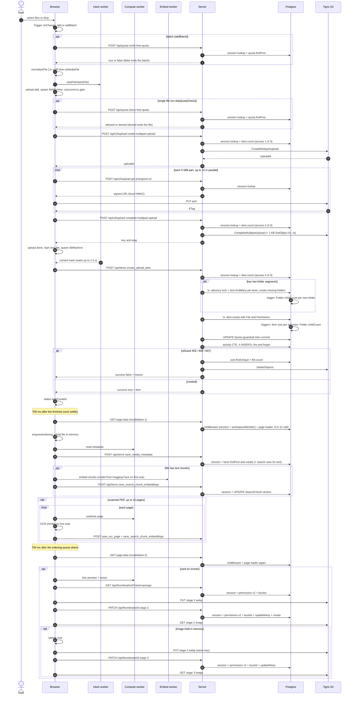

Stashly · upload pipeline · 10 Oct 2026

# Upload Call Audit

Every database call, network request, S3 call and trigger that runs for one uploaded file, from the moment it is selected until it is fully processed. Counts were traced through the code and checked against one real upload measured in Chrome and in Postgres's activity counters.

DB Prisma / SQL call FETCH browser request S3 server → Tigris SDK call TRIG Postgres trigger work

## A 100,000-file folder upload

Each file is 10 MB, 3 folders deep, and the folder is quota-checked once as a batch. Every file still pays for its own chain of calls:

8

× 100k = 800,000

browser requests per file

2

× 100k = 200,000

server → S3 calls per file

20

× 100k = 2,000,000

Prisma calls per file

5

× 100k = 500,000

trigger UPDATEs per file

6

× 100k = 600,000

session lookups per file

Each file also runs 2 interactive transactions and 3 advisory locks, one per path level. It holds row locks on 4 ancestor `Item` rows, the parent `Folder` and the user's `Quota` row until it commits. With 10 files in flight, all of them queue on the same rows.

## One real upload, measured

An 8.46 MB JPEG (2 parts of 5 MiB) was uploaded into the root folder from `/:me/stash` in Chrome. Requests were recorded by wrapping `fetch` plus a resource observer. Database work was read from `pg_stat_database` and `pg_stat_user_tables` before and after; `pg_stat_statements` is not installed on the dev database. The card was off screen, so no thumbnail work ran.

| Measure | Traced | Measured |
| --- | --- | --- |
| Browser requests caused by the upload | 10 (18 with the thumbnail) | **10**: 8 to our server, 2 part PUTs to Tigris |
| Prisma calls | 44 on `/stash` with the card off screen (16 per file + 2 revalidations × 14) | 62 transactions committed in about 2.5 min, against 6 per minute when idle. Roughly 45–50 attributable: **consistent with the trace, not an exact match** |
| Rows written | 9 INSERT + 3 UPDATE | **9 inserted, 3 updated**, an exact match: Item, File, Permission, \_PermissionToUser, Image, ActivityTime, Activity, UploadAction, ItemAction. The UPDATEs were the root Item size, the root Folder childCount and the Quota row |
| Rows read | — | **61,568 returned / 33,068 fetched.** About 3,700 scans on each of Favorite, LockedItem, Folder, File and Thumbnail, 3,294 on Item, 2,475 on ActivityTime and 1,930 on PinItem. Most likely the two page revalidations; *not isolated* |
| Web Workers started | hash, compute | **2**: hash.worker, thumbnail.compute.worker |
| Time from selecting the file to done | — | **≈ 16.5 s**. The row was created at +4.5 s |

```
  ms from select   took    request
      57          +484    POST /api/quota          check-free-quota
     553          +780    POST /api/s3/upload      create-multipart-upload
    1350          +365    POST /api/s3/upload      get-presigned-url   part 1
    1365         +1378    POST /api/s3/upload      get-presigned-url   part 2
    1720         +1412    PUT  Tigris              part 1 (5 MiB)
    2745          +913    PUT  Tigris              part 2
    3719          +725    POST /api/s3/upload      complete-multipart-upload
    4548         +2093    POST /api/items          create_upload_item
    5484         +1789    GET  /:me/stash.data     revalidation 1 (33.6 KB)
   13631          +598    POST /api/items          save_media_metadata   (9 s after the row)
   15466         +1021    GET  /:me/stash.data     revalidation 2 (33.6 KB)
```

One more request in the window, `GET /api/items?intent=pending_search_embeddings`, came from the once-per-tab embedding backfill and was not caused by the upload.

## Constants that set the counts

| Constant | Value | Where |
| --- | --- | --- |
| Part size | 5 MiB · P = ceil(size / 5 MiB) | [s3.multipart.stream.ts:7](https://github.com/dev-gvili/stashly/blob/main/app/machines/multipart/s3.multipart.stream.ts#L7) |
| Parts in flight per file | 10 | [s3.multipart.stream.ts:8](https://github.com/dev-gvili/stashly/blob/main/app/machines/multipart/s3.multipart.stream.ts#L8) |
| Files in flight | 10 (machine) or 100 (schema default), not verified which one applies | [upload.machine.ts:31](https://github.com/dev-gvili/stashly/blob/main/app/machines/upload/upload.machine.ts#L31) |
| Part retries | 5 attempts. Backoff starts at 2.5 s, ×3 for presign and ×2 for PUT. 4xx is retried too | [s3.multipart.stream.ts:10](https://github.com/dev-gvili/stashly/blob/main/app/machines/multipart/s3.multipart.stream.ts#L10) |
| Indexing / thumbnail retries | 2 more, 800 ms apart | [indexing-item.machine.ts:40](https://github.com/dev-gvili/stashly/blob/main/app/machines/indexing/indexing-item.machine.ts#L40) |
| Revalidation debounce | 700 ms of quiet | [upload-thumbnail-runner.tsx:122](https://github.com/dev-gvili/stashly/blob/main/app/components/upload/upload-thumbnail-runner.tsx#L122) |
| Session cache | none: every request to our server does a session lookup | [auth.ts:44](https://github.com/dev-gvili/stashly/blob/main/app/.server/auth.ts#L44) |

## Every call, in order

Counts are per file unless marked per batch. Line links point at `main`; three files with uncommitted edits (`file.machine.ts`, `quota-actions.ts`, `item-actions.ts`) may be a few lines off.

### Select and queue

| # | Type | Count | What happens | Source | Destination |
| --- | --- | --- | --- | --- | --- |
| 1 | — | 0 | Input change → `add` (1 file) or `addBatch` (several). A drop calls `add` per file unless a folder was dropped | [index.tsx:242](https://github.com/dev-gvili/stashly/blob/main/app/components/upload/index.tsx#L242), [useUpload.ts:439](https://github.com/dev-gvili/stashly/blob/main/app/hooks/useUpload.ts#L439) | — |
| 2 | — | 0 | `normalizeFile`: a local 1 KB sniff for `.ts` files | [sniff.ts:72](https://github.com/dev-gvili/stashly/blob/main/app/utils/sniff.ts#L72) | — |
| 3 | — | 1 worker | `startFileHash`: the File is posted to the hash worker | [useUpload.ts:343](https://github.com/dev-gvili/stashly/blob/main/app/hooks/useUpload.ts#L343) | Web Worker |
| 4 | — | 0 | `upload.add` → spawn `fileMachine` → `upload.start`, behind the concurrency gate | [upload.machine.ts](https://github.com/dev-gvili/stashly/blob/main/app/machines/upload/upload.machine.ts) | — |

### Quota pre-check

| # | Type | Count | What happens | Source | Destination |
| --- | --- | --- | --- | --- | --- |
| 5 | FETCH | 1 / batch | `POST /api/quota verify-free-quota` with the batch's total bytes (`addBatch` only) | [useUpload.ts:86](https://github.com/dev-gvili/stashly/blob/main/app/hooks/useUpload.ts#L86) | our server |
| 6 | DB | 2 / batch | Session lookup + `quota.findFirst` | [quota.ts:35](https://github.com/dev-gvili/stashly/blob/main/app/routes/api/quota.ts#L35) | Session, Quota |
| 7 | FETCH | 1 | `POST /api/quota check-free-quota`. Sent for a single file, and for each file of a drop with no folder. A denial ends the file here | [quota.actors.ts:55](https://github.com/dev-gvili/stashly/blob/main/app/machines/quota/quota.actors.ts#L55) | our server |
| 8 | DB | 2 | Session lookup + `quota.findFirst` | [quota.ts:41](https://github.com/dev-gvili/stashly/blob/main/app/routes/api/quota.ts#L41) | Session, Quota |

### Multipart upload

| # | Type | Count | What happens | Source | Destination |
| --- | --- | --- | --- | --- | --- |
| 9 | FETCH | 1 | `POST /api/s3/upload create-multipart-upload` | [s3.mulipart.utils.ts:75](https://github.com/dev-gvili/stashly/blob/main/app/machines/multipart/s3.mulipart.utils.ts#L75) | our server |
| 10 | DB | 2 | Session lookup + `assertCanUploadTo` (`item.count`), access check 1 of 3 | [upload.ts:77](https://github.com/dev-gvili/stashly/blob/main/app/routes/api/upload.ts#L77) | Session, Item, Permission |
| 11 | S3 | 1 | `CreateMultipartUpload` | [s3.ts:1075](https://github.com/dev-gvili/stashly/blob/main/app/.server/s3.ts#L1075) | Tigris |
| 12 | FETCH | P | `POST /api/s3/upload get-presigned-url`, one per 5 MiB part, up to 10 in parallel | [s3.multipart.stream.ts:173](https://github.com/dev-gvili/stashly/blob/main/app/machines/multipart/s3.multipart.stream.ts#L173) | our server |
| 13 | DB | P | Session lookup only. Signing is local and there is no access check | [upload.ts:91](https://github.com/dev-gvili/stashly/blob/main/app/routes/api/upload.ts#L91) | Session |
| 14 | FETCH | P | `PUT` part bytes to the presigned URL | [s3.multipart.stream.ts:207](https://github.com/dev-gvili/stashly/blob/main/app/machines/multipart/s3.multipart.stream.ts#L207) | Tigris |
| 15 | FETCH | 1 | `POST /api/s3/upload complete-multipart-upload` with the part ETags | [s3.mulipart.utils.ts:116](https://github.com/dev-gvili/stashly/blob/main/app/machines/multipart/s3.mulipart.utils.ts#L116) | our server |
| 16 | DB | 2 | Session lookup + `assertCanUploadTo`, access check 2 of 3 | [upload.ts:103](https://github.com/dev-gvili/stashly/blob/main/app/routes/api/upload.ts#L103) | Session, Item, Permission |
| 17 | S3 | 1 (+1 .ts) | `CompleteMultipartUpload`. For `.ts`/`.tsx` files there is also a 1 KB `GetObject` whose result is never saved | [s3.ts:1146](https://github.com/dev-gvili/stashly/blob/main/app/.server/s3.ts#L1146), [upload.ts:128](https://github.com/dev-gvili/stashly/blob/main/app/routes/api/upload.ts#L128) | Tigris |

### Item row

| # | Type | Count | What happens | Source | Destination |
| --- | --- | --- | --- | --- | --- |
| 18 | — | 0 | The `dbMachine` waits up to 1.5 s for the content hash | [file-hash.ts:95](https://github.com/dev-gvili/stashly/blob/main/app/utils/file-hash.ts#L95) | — |
| 19 | FETCH | 1 | `POST /api/items create_upload_item`. Never retried | [db.actors.ts:68](https://github.com/dev-gvili/stashly/blob/main/app/machines/db/db.actors.ts#L68) | our server |
| 20 | DB | 2 | Session lookup + `assertCanUploadTo`, access check 3 of 3 | [item-actions.ts:1736](https://github.com/dev-gvili/stashly/blob/main/app/.server/item-actions.ts#L1736) | Session, Item, Permission |
| 21 | DB | 1 tx | Folder uploads only: a separate transaction to resolve the folder path | [item-actions.ts:1745](https://github.com/dev-gvili/stashly/blob/main/app/.server/item-actions.ts#L1745) | — |
| 22 | DB | 1 / level | `pg_advisory_xact_lock` on the folder name | [item-actions.ts:1405](https://github.com/dev-gvili/stashly/blob/main/app/.server/item-actions.ts#L1405) | advisory lock |
| 23 | DB | 1 / level | `item.findMany` (take 2): reuse the folder, or answer 409 | [item-actions.ts:1416](https://github.com/dev-gvili/stashly/blob/main/app/.server/item-actions.ts#L1416) | Item |
| 24 | DB | 1 / missing level | `item.create` with Folder and View (at least 3 INSERTs) | [item-actions.ts:1438](https://github.com/dev-gvili/stashly/blob/main/app/.server/item-actions.ts#L1438) | Item, Folder, View |
| 24t | TRIG | 1 / new folder | `update_child_count` → `UPDATE "Folder"` on the parent | item_child_count_insert | Folder |
| 25 | DB | 1 tx | The row and the quota charge commit together | [item-actions.ts:1752](https://github.com/dev-gvili/stashly/blob/main/app/.server/item-actions.ts#L1752) | — |
| 26 | DB | 1 | `item.create` with File, Permission and the user (at least 4 INSERTs, then the row is read back) | [item-actions.ts:1753](https://github.com/dev-gvili/stashly/blob/main/app/.server/item-actions.ts#L1753) | Item, File, Permission |
| 26t | TRIG | 1 / ancestor | `update_size` → `UPDATE "Item"` walks up to the root, locking each row until commit | item_size_update chain | Item |
| 26t2 | TRIG | 1 | `update_child_count` → `UPDATE "Folder"` on the direct parent | item_child_count_insert | Folder |
| 27 | DB | 1 | Quota charge: `UPDATE "Quota" … AND used + size <= total`. A row lock that every upload by the user queues on | [quota-actions.ts:476](https://github.com/dev-gvili/stashly/blob/main/app/.server/quota-actions.ts#L476) | Quota |
| 28 | DB | 1 (4 rows) | Activity CTE: ActivityTime, Activity, UploadAction and ItemAction. Fire-and-forget | [item-actions.ts:143](https://github.com/dev-gvili/stashly/blob/main/app/.server/item-actions.ts#L143) | 4 tables |

### Revalidations (per batch)

No upload call goes through a React Router fetcher, so only these two re-run loaders. The root and layout loaders are skipped, but the server middleware still runs on every `.data` request.

| # | Type | Count | What happens | Source | Destination |
| --- | --- | --- | --- | --- | --- |
| 29 | FETCH | 1 / burst | `navigate(same URL, reset)` → `GET <page>.data`, 700 ms after the finished-file count settles | [upload-thumbnail-runner.tsx:122](https://github.com/dev-gvili/stashly/blob/main/app/components/upload/upload-thumbnail-runner.tsx#L122) | our server |
| 30 | DB | 2 | Middleware: a session lookup + `workspaceMember.findMany`. The workspace query is wasted, because the layout loader that uses it doesn't re-run | [workspace.ts:29](https://github.com/dev-gvili/stashly/blob/main/app/.server/middleware/workspace.ts#L29) | Session, WorkspaceMember |
| 31 | DB | 9 – 12 | The page loader: 9 on `/stash/all`, 11 on a folder page (including a write to `openedAt`), 12 on `/stash` | [home.tsx:88](https://github.com/dev-gvili/stashly/blob/main/app/routes/stash/home.tsx#L88), [folder.tsx:55](https://github.com/dev-gvili/stashly/blob/main/app/routes/stash/folder.tsx#L55) | many |
| 32 | FETCH | 1 / drain | `revalidator.revalidate()` → `GET <page>.data`, 700 ms after the indexing queue drains | [indexing/hooks.ts:53](https://github.com/dev-gvili/stashly/blob/main/app/machines/indexing/hooks.ts#L53) | our server |
| 33 | DB | 11 – 14 | The same as #30 + #31 | — | many |

### Indexing: metadata, search and embeddings

| # | Type | Count | What happens | Source | Destination |
| --- | --- | --- | --- | --- | --- |
| 34 | — | 1 worker | Metadata is read locally: the compute worker, `exifr`, `<video>`, `<audio>` | [compute-worker.ts:26](https://github.com/dev-gvili/stashly/blob/main/app/utils/compute-worker.ts#L26) | Web Worker |
| 35 | FETCH | 1 | `POST /api/items save_media_metadata` for every type, even when there is nothing to save. 2 at a time | [indexing.actors.ts:53](https://github.com/dev-gvili/stashly/blob/main/app/machines/indexing/indexing.actors.ts#L53) | our server |
| 36 | DB | 3 | Session lookup + the facet's `findFirst` + `create`, where one upsert would do | [item-actions.ts:1506](https://github.com/dev-gvili/stashly/blob/main/app/.server/item-actions.ts#L1506) | Image / Video / Audio / Pdf / Markdown |
| 37 | DB | 3 (text) | `search.upsert`, then `searchChunk.deleteMany` + `createMany` in a transaction | [search-actions.ts:82](https://github.com/dev-gvili/stashly/blob/main/app/.server/search-actions.ts#L82) | Search, SearchChunk |
| 38 | FETCH | first use | Embedding model `all-mpnet-base-v2` (q4), downloaded on the first text file in a tab | [embedding.worker.ts:46](https://github.com/dev-gvili/stashly/blob/main/app/workers/embedding.worker.ts#L46) | Hugging Face CDN |
| 39 | FETCH | 1 (text) | `POST /api/items save_search_chunk_embeddings`, with every chunk in one request | [indexing.actors.ts:174](https://github.com/dev-gvili/stashly/blob/main/app/machines/indexing/indexing.actors.ts#L174) | our server |
| 40 | DB | 2 (text) | Session lookup + `UPDATE "SearchChunk" … FROM unnest` | [search-actions.ts:727](https://github.com/dev-gvili/stashly/blob/main/app/.server/search-actions.ts#L727) | SearchChunk |
| 41 | FETCH DB | ≤ 30 / ≤ 105 | Scanned PDF only, up to 15 pages. Each page sends `save_ocr_page` (5 DB) and `save_search_chunk_embeddings` (2 DB). The OCR model (about 623 MB) downloads on first use | [indexing.actors.ts:128](https://github.com/dev-gvili/stashly/blob/main/app/machines/indexing/indexing.actors.ts#L128) | our server, Hugging Face |

### Thumbnails (only while the card is on screen)

| # | Type | Count | What happens | Source | Destination |
| --- | --- | --- | --- | --- | --- |
| 42 | FETCH | 1 | `GET /api/thumbnails/:id?intent=presign` | [thumbnail.actors.ts:132](https://github.com/dev-gvili/stashly/blob/main/app/machines/thumbnail/thumbnail.actors.ts#L132) | our server |
| 43 | DB | 4 | Session lookup + `hasItemPermission` (2) + a bucket lookup | [thumbnail-actions.ts:348](https://github.com/dev-gvili/stashly/blob/main/app/.server/thumbnail-actions.ts#L348) | Permission, Item |
| 44 | FETCH | 1 | `PUT` the stage-2 webp (≤ 512 px) | [thumbnail-stages/upload.ts:19](https://github.com/dev-gvili/stashly/blob/main/app/utils/thumbnail-stages/upload.ts#L19) | Tigris |
| 45 | FETCH | 1 | `PATCH /api/thumbnails/:id` for stage 2 | [thumbnail.actors.ts:179](https://github.com/dev-gvili/stashly/blob/main/app/machines/thumbnail/thumbnail.actors.ts#L179) | our server |
| 46 | DB | 6 | Session lookup + permission (2) + bucket + an `updateMany` that matches 0 rows + `create` | [thumbnail-actions.ts:450](https://github.com/dev-gvili/stashly/blob/main/app/.server/thumbnail-actions.ts#L450) | Thumbnail |
| 47 | FETCH | 1 (image) | `PUT` the salient crop to the same key | [thumbnail-item.machine.ts:405](https://github.com/dev-gvili/stashly/blob/main/app/machines/thumbnail/thumbnail-item.machine.ts#L405) | Tigris |
| 48 | FETCH DB | 1 + 5 (image) | `PATCH` for stage 3 | [thumbnail-item.machine.ts:421](https://github.com/dev-gvili/stashly/blob/main/app/machines/thumbnail/thumbnail-item.machine.ts#L421) | our server |
| 49 | FETCH | 1 (+1 image) | `` GETs the signed thumbnail, stage 2 and then stage 3 | [item-card.tsx:273](https://github.com/dev-gvili/stashly/blob/main/app/components/stash/item-card.tsx#L273) | Tigris |
| 50 | FETCH DB | +2 / +4 | When the file is no longer held in memory: `?intent=source`, a GET of the original (≤ 16 MB), then #42–46. Stage 3 is skipped | [thumbnail.actors.ts:62](https://github.com/dev-gvili/stashly/blob/main/app/machines/thumbnail/thumbnail.actors.ts#L62) | our server, Tigris |

### Failure and edge paths

| # | Type | When | What happens | Source |
| --- | --- | --- | --- | --- |
| 51 | DB S3 | refused row | 403/409/507 → `discardUploadedObject`: `user.findUnique` + `file.count`, then `DeleteObjects` | [item-actions.ts:1882](https://github.com/dev-gvili/stashly/blob/main/app/.server/item-actions.ts#L1882) |
| 52 | DB | over quota | The guarded UPDATE matches 0 rows, then 1 SELECT builds the message, then the transaction rolls back | [quota-actions.ts:491](https://github.com/dev-gvili/stashly/blob/main/app/.server/quota-actions.ts#L491) |
| 53 | S3 | refused complete | `AbortMultipartUpload` | [upload.ts:105](https://github.com/dev-gvili/stashly/blob/main/app/routes/api/upload.ts#L105) |
| 54 | NEVER | user abort | Neither a user abort nor exhausted part retries call `AbortMultipartUpload`, so parts stay billed in S3 | [s3.mulipart.utils.ts:240](https://github.com/dev-gvili/stashly/blob/main/app/machines/multipart/s3.mulipart.utils.ts#L240) |
| 55 | FETCH | expired session | `POST /api/items` follows the redirect to `GET /auth/sign-in` | [db.utils.ts:95](https://github.com/dev-gvili/stashly/blob/main/app/machines/db/db.utils.ts#L95) |
| 56 | FETCH | degraded | `sendBeacon /api/metrics`, at most once per tab for each stage and reason | [report-degraded.ts:113](https://github.com/dev-gvili/stashly/blob/main/app/utils/report-degraded.ts#L113) |
| 57 | FETCH | expired image | `` → `revalidate()`, at most once per 10 minutes | [item-card.tsx:281](https://github.com/dev-gvili/stashly/blob/main/app/components/stash/item-card.tsx#L281) |

### By file type, after the upload core

| Type | Metadata | Vectors | OCR | Thumbnail requests (on screen) |
| --- | --- | --- | --- | --- |
| image | 1 | 0 | 0 | 5, plus 2 image GETs |
| video | 1 | 0 | 0 | 3, plus 1 GET |
| PDF with a text layer | 1 | 1 | 0 | 3, plus 1 GET |
| scanned PDF | 1 | 0 | ≤ 30 | 3, plus 1 GET |
| markdown / text / code | 1 | 0–1 | 0 | 3, plus 1 GET |
| audio | 1 | 0 | 0 | 0 |
| other (zip …) | 1, empty | 0 | 0 | 0 |

## End-to-end flow

Every step from selecting the file to the thumbnail. Optional branches are boxed. Scroll sideways on a narrow screen.



## Biggest savings

These are proposals; nothing here is built yet. The savings are traced for the 100,000-file folder upload.

| # | Redundancy | Saved per file | × 100,000 |
| --- | --- | --- | --- |
| 1 | A session lookup on every request, with no cookie cache. A 1 GiB file spends about 205 lookups just presigning parts | 5–6 DB | 500k–600k DB |
| 2 | One presign request per part. Return every part URL from `create-multipart-upload`; signing is local and costs nothing | P requests + P DB | 200k req + 200k DB |
| 3 | Folder-path resolution repeats for every file, even after the folders exist. Resolve the tree once per batch | 6 DB + 1 tx | 600k DB + 100k tx |
| 4 | Ancestor size rollup per file: one locked `UPDATE` per ancestor, so concurrent uploads queue on the root row | 4 trigger UPDATEs | 400k UPDATEs |
| 5 | The same access check runs 3 times (create, complete, item) on the same root folder | 2 DB | 200k DB |
| 6 | `complete-multipart-upload` and `create_upload_item` are separate requests | 1 req + 2 DB | 100k + 200k |
| 7 | `save_media_metadata` is posted even when there is nothing to save, and it always triggers revalidation | 1 req + 1 DB (zip / other) | up to 100k + 100k |
| 8 | Facet writes use `findFirst` + `create` on a unique column; an upsert would do | 1 DB | 100k DB |
| 9 | The workspace middleware queries on every revalidation, but its only consumer never re-runs | 1 DB / revalidation | — |
| 10 | Two full page revalidations per batch, and the first can land before the row exists. Measured: about 1,860 table scans per `/stash` revalidation (inferred) | — | per batch |
| 11 | Thumbnails: 9 permission and bucket queries per image, and stage 3 re-uploads and re-patches the same key | 1–2 req, 5+ DB | when visible |
| 12 | A drop of loose files checks quota once per file; picking the same files checks once per batch | 1 req + 2 DB | — |

## Correctness issues found

1. **Aborted and failed uploads leave parts in S3.** Nothing calls `AbortMultipartUpload` on a user abort or when retries run out.
2. **4xx responses are retried 5 times.** The presign backoff adds up to about 5 minutes before an upload fails.
3. **The `.ts` sniff makes an S3 GET whose result is thrown away.**
4. **Ownership may not be checked** on `save_media_metadata`, `save_ocr_page` and `save_search_chunk_embeddings`: they write by the id the client sends. Not tested yet.
5. **Dead branches in `shouldRevalidate`.** The `create_upload_item` checks can never match, because the upload POST is a plain `fetch`.
6. **The quota machine is spawned but receives no events.**

## Not verified

- How many SQL statements each Prisma call sends (nested creates, `relationJoins`). There is no query log or `pg_stat_statements`.
- What the 61,568 rows read came from. The request sent to isolate one revalidation never answered: after the upload, new requests from the test tab stayed pending while the server answered `curl`. The cause was not investigated.
- Tigris answered one part `PUT` with 503 in the network panel, while the request log recorded both PUTs as 200. Not reconciled.
- Which concurrency limit applies at runtime (10 or 100).
- How many revalidation waves a large batch produces.
- Thumbnail requests in a real run (the card was off screen).
- Model file counts and cache hits; lock wait times under 10 uploads in flight.

Traced by two code-reading passes over the Stashly repository; measured on the dev stack with one real upload. Source of truth: `docs/upload-call-audit.md`.