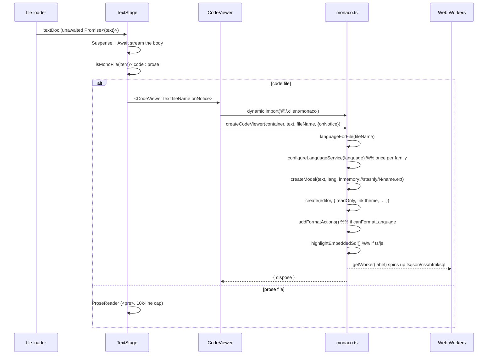
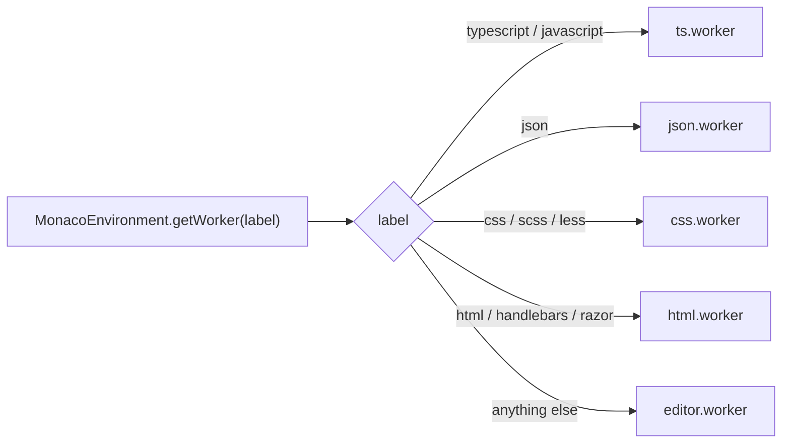
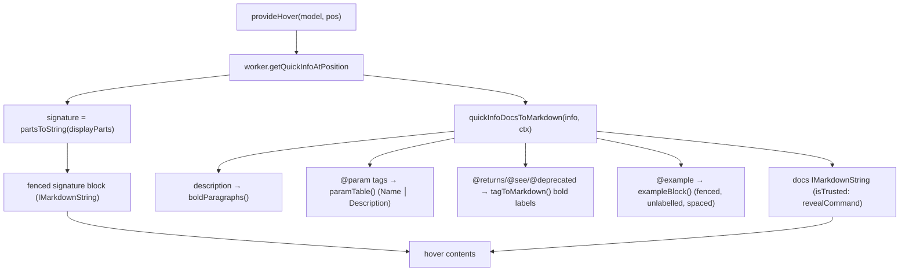
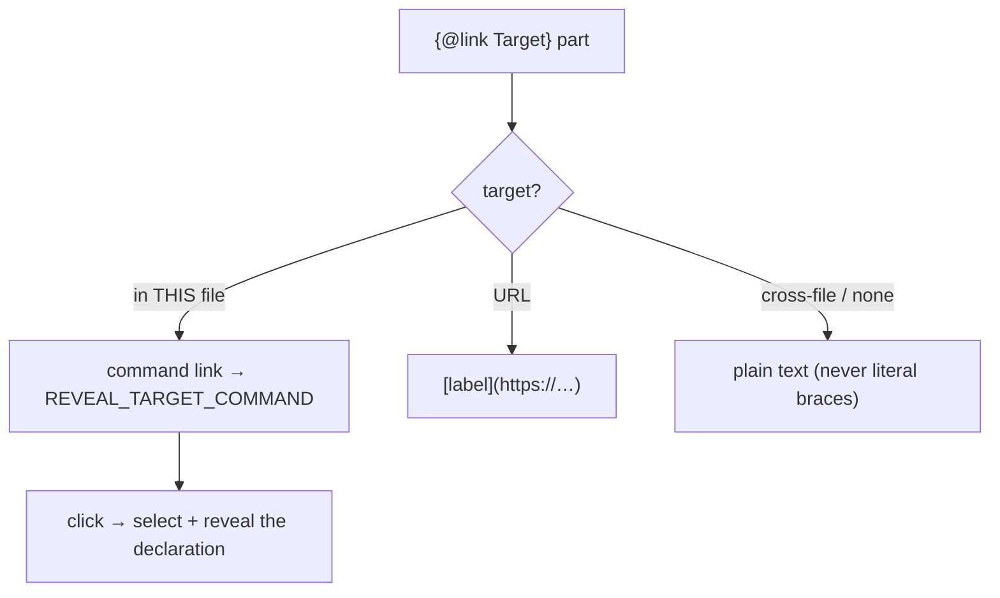
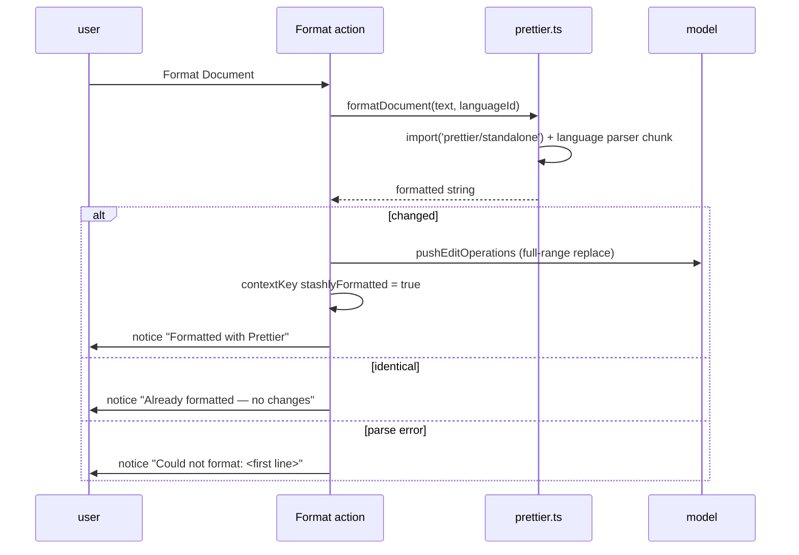
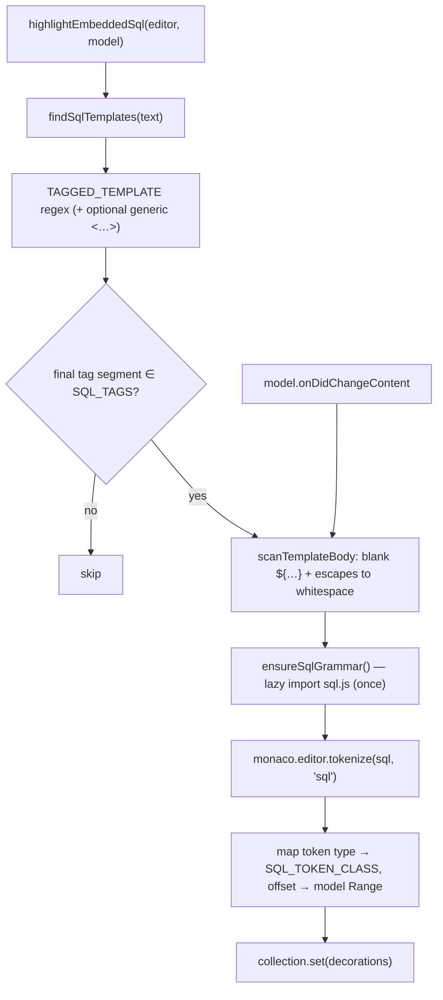
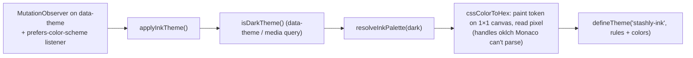

# Code Viewer

A read-only, IDE-grade viewer for text/code files in the item page. It mounts
Monaco (VS Code's editor) lazily in the browser and layers on the pieces VS
Code users expect — syntax highlighting, type-aware hovers, Format Document,
and embedded-SQL highlighting — while staying in lock-step with Stashly's Ink
design tokens and never writing a byte back to storage.

> **Read-only is the load-bearing constraint.** The viewer shows a file fetched
> from S3; it never persists edits. That single fact simplifies almost every
> feature below — formatting is a *view* of the file, decorations are computed
> against a document that only changes on explicit Format/Revert, and there's
> no autosave/undo model to reconcile.

---

## File map

| File | Role |
|------|------|
| `app/components/views/item-page/text-stage.tsx` | Stage host. Streams the file body (Suspense/Await), chooses **code** (Monaco) vs **prose** (`<pre>`) via `isMonoFile`, renders the floating toolbar. |
| `app/components/views/item-page/code-viewer.tsx` | Thin React wrapper. Dynamic-imports the Monaco module from an effect, renders a loading spinner, a notice pill, and a `<pre>` fallback if Monaco fails to load. |
| `app/.client/monaco.ts` | Everything Monaco. Editor creation, theming, worker routing, language services, the JSDoc hover, and embedded-SQL highlighting. Lives in `.client/` so the server bundle never evaluates it. |
| `app/.client/prettier.ts` | Browser Prettier. `prettier/standalone` + per-language parser chunks, behind `canFormatLanguage` / `formatDocument`. |
| `app/utils/text-thumbnail.ts` | `isMonoFile` / `isTextRenderableFile` — decides code vs prose and which files are text at all. |

Both `.client/*` modules are dynamic-imported from a browser-only effect, so
their multi-MB chunks (Monaco, TypeScript, Prettier) download only when a code
file is actually opened.

---

## Mount & render flow

`createCodeViewer(container, text, fileName, { onNotice? }) => { dispose }` is
the single entry point. `dispose` tears down the editor, model, theme
listeners, format actions, and SQL decorations.

---

## Language resolution & worker routing

`languageForFile(name)` resolves a Monaco language id from the filename using
Monaco's own registry (extensions **and** bare filenames, so `Dockerfile` /
`Makefile` resolve too), falling back to `plaintext`.

Monaco runs one Web Worker per language *label*. The base editor worker handles
tokenization for everything; only four languages get a dedicated **language
service** worker (the thing that backs hovers, validation, and IntelliSense):

Each `?worker` chunk is fetched only when its constructor first runs — the ~6MB
of bundled TypeScript downloads the first time a `.ts`/`.js` file opens, and
never for a user who only ever views `.css`.

---

## Language services

Each service is tuned for **one orphan file** — no tsconfig, no `node_modules`,
no sibling sources — opened by an arbitrary uploader.

| Language | Configured by | Diagnostics | Notes |
|----------|---------------|-------------|-------|
| TS / JS | `configureTypeScript` | **Semantic OFF**, syntax ON | Semantic errors are guaranteed wrong with no module graph (every import resolves to nothing). Syntax errors depend only on the bytes present, so they stay. Built-in hover disabled (`modeConfiguration.hovers: false`) in favor of a custom one. |
| JSON | `configureJson` | validate ON, JSONC-tolerant | `enableSchemaRequest: false` (never fetch a file's `$schema` URL); comments `ignore`, trailing commas `warning` — most real `.json` is tsconfig/eslintrc-style JSONC. |
| CSS / SCSS / LESS | `configureCss` | structural ON, style-lint OFF | Silences vendor-prefix/duplicate/unknown-property/empty-rule noise (fires constantly on minified/3rd-party CSS); keeps real errors (bad hex, bad color args). `data.useDefaultDataProvider` kept so property-doc hovers work. |
| HTML / Handlebars / Razor | *(none)* | defaults | Defaults already suit a viewer. |

### The model-URI trick (why `.tsx` parses as `.tsx`)

The TS worker derives `ScriptKind` from the model URI's **suffix alone**.
Monaco's default `inmemory://model/N` has none, and with `allowJs` set the
fallback is JavaScript — so every `.ts`/`.tsx` file was parsed as JS and its
TypeScript syntax flagged wholesale (*"'interface' declarations can only be
used in TypeScript files"*). `modelUriFor` therefore builds
`inmemory://stashly/N/<name>.<ext>`, carrying the real extension. Measured: 2
syntax errors under the default URI → 0 under the suffixed one for identical
source.

---

## JSDoc hover (TS/JS)

Monaco's built-in hover formats JSDoc crudely (`@param name — - text` with a
doubled dash, `@example` never fenced, `{@link X}` printed with literal
braces). It's disabled and replaced with a VS Code-parity formatter over the
same `getQuickInfoAtPosition` payload.

### Link handling — `{@link}` and `@see`

`docPartsToMarkdown` walks the doc parts and routes each link through
`linkToMarkdown`, matching VS Code's three branches:

- The reveal command is registered once via `monaco.editor.registerCommand`;
  its arg is the target span, and the handler selects/reveals it in the editor.
- Trust is scoped to that single command id on the docs `MarkdownString`
  (`isTrusted: { enabledCommands: [REVEAL_TARGET_COMMAND] }`) — no other
  `command:` URI can ride along.
- Cross-file targets (stdlib, other modules) have nowhere to go in a
  single-file viewer, so they degrade to plain text.

### Styling (`injectViewerStyles`)

Monaco ships no CSS for markdown tables in hovers, so a small stylesheet is
injected once:

- **Description** — bold (`boldParagraphs` flattens intra-paragraph newlines
  first, because Markdown emphasis can't straddle a line break).
- **Params** — a real bordered table (greys from `--border` / `--muted-foreground`).
- **`@example`** — each code block gets vertical breathing room; sibling-scoped
  so the lone signature block isn't pushed.
- **Links** — `textLink.foreground` set to the Ink hue in the theme colors.

---

## Format Document (Prettier)

Right-click → **Format Document** (also `Alt+Shift+F`). Formatting is a
view-only transform; nothing is written back to S3.

Key decisions, all forced by **read-only**:

- Edits go through `model.pushEditOperations`, not `editor.executeEdits` (the
  latter is a no-op while `readOnly`).
- Undo is disabled under `readOnly`, so a paired **Revert Formatting** action —
  gated on the `stashlyFormatted` context key so only one of the two is ever
  visible — restores the original bytes.
- Comparison/format happen on **LF**. A model built from CRLF keeps CRLF and
  re-normalizes on push, so a raw compare vs Prettier's LF output falsely
  reports "changed" for a byte-identical document.
- Options mirror `.prettierrc`, so output matches `pnpm format`.

`prettier.ts` maps each Monaco language id to a parser + the plugin chunks it
needs, all dynamic-imported *inside* the call: the module is ~2KB statically,
and formatting a `.css` file pulls postcss without dragging in the ~1MB
TypeScript parser. Supported: ts/tsx, js/jsx, json, css/scss/less, html, yaml,
graphql, markdown.

---

## Embedded SQL highlighting

SQL written inside a tagged template literal — ``sql`…` `` / ``Prisma.sql`…` ``
/ ``prisma.$queryRaw<T>`…` `` — is a single string token to the TypeScript
grammar, so it renders flat. This finds those templates, tokenizes their bodies
with Monaco's own SQL Monarch grammar, and lays down inline decorations.

### Why each piece is the way it is

- **Tag detection** — `TAGGED_TEMPLATE` matches an identifier chain, an
  *optional generic type argument* (balancing up to 3 levels of `<…>`, e.g.
  `$queryRaw<Array<{ id: string }>>`), then the backtick. Only chains whose
  final segment is in `SQL_TAGS` (`sql`, `$queryraw`, `$executeraw`, and the
  `*unsafe` variants) count — so ``css`…` ``, ``styled.div`…` `` and untagged
  templates are left alone. Requiring the trailing backtick keeps a plain
  `sql < x` comparison from matching.
- **Interpolations & escapes** — `scanTemplateBody` blanks `${…}` holes and
  escapes to **equal-length whitespace** (newlines preserved), so token offsets
  map 1:1 back to model positions and interpolation regions simply aren't
  decorated (they keep their TS rendering).
- **Lazy grammar** — the SQL Monarch grammar is imported and registered the
  first time embedded SQL appears; nothing loads for files without any.
- **Recompute on change** — decorations are re-derived on every
  `onDidChangeContent`. The viewer is read-only, so that only fires on Format /
  Revert — but those rewrite the whole model and would smear static decorations
  across the wrong characters. (Decoration edits don't fire content events, so
  no loop; the grammar promise is cached, so re-runs are cheap.)

### Token colors

The whole template is the string-hue by default, so every SQL token is **reset**
from that baseline. CSS classes are scoped under `.view-lines` (specificity
0,3,0) so they win over Monaco's generated `.mtkN` token colors (0,2,0).

| Token | Class | Color |
|-------|-------|-------|
| keyword (`SELECT`, `WHERE`, `JOIN`, …) | `stashly-sql-keyword` | **hue, bold** |
| function (`COALESCE`, `json_agg`, …) | `stashly-sql-function` | hue |
| string | `stashly-sql-string` | hue |
| identifier / quoted / number | `stashly-sql-identifier` … | foreground |
| operator / delimiter | `stashly-sql-operator` | muted |
| comment | `stashly-sql-comment` | muted, italic |

Greys come from Ink tokens; the hue is hard-coded with a `data-theme` +
`prefers-color-scheme` override (it has no design token).

---

## Ink theming

The editor chrome and duotone syntax are derived at runtime from the app's Ink
design tokens (`--card`, `--foreground`, `--muted-foreground`, `--border`, …),
so the viewer tracks `globals.css` exactly, light or dark.

Syntax is **duotone**: greys from the tokens plus one dusty indigo hue
(`#5e6ad2` light / `#96a0e8` dark) reserved for strings and — in embedded SQL —
keywords/functions. A monochrome system has no hues to inherit, and Monaco's
default rainbow would fight the Ink shell. Bracket-pair colorization and
diagnostic squiggles are neutralized into the same palette (errors borrow the
hue rather than screaming red — it's a read-only viewer).

---

## Commit history

| Commit | Change |
|--------|--------|
| `a60a195` | feat: Format Document via Prettier in the context menu |
| `f0dee77` | fix: report the outcome of Format Document (+ CRLF false-positive fix) |
| `73b6e94` | feat: TypeScript language service for hover types/signatures |
| `e65ce7e` | feat: JSON, CSS, HTML language services for hover docs |
| `f2bb4ea` | feat: navigable `{@link}` and `@see` in the hover |
| `ddcc23e` | style: restyle the JSDoc hover (bold description, param table, spaced examples) |
| `24a0bb7` | feat: highlight SQL embedded in tagged template literals |
| `699a976` | feat: also highlight `$queryRaw` / `$executeRaw` templates |
| `907a357` | fix: match SQL tags that carry a generic type argument |
| `00f4018` | style: color embedded-SQL keywords with the syntax hue |
| `da345f6` | fix: keep embedded-SQL highlighting aligned after Format Document |

---

## Extension points & known limitations

- **More language services** — the `LANGUAGE_WORKERS` label switch is the seam;
  each additional language is a one-line worker mapping.
- **More Prettier languages** — add an entry to the `LANGUAGES` map in
  `prettier.ts` (parser + plugin chunks).
- **More SQL tags** — add to the `SQL_TAGS` set (final-segment match).
- **Automatic type acquisition** — imports from npm packages resolve to real
  types via `@typescript/ata` (see `type-acquisition.ts`): it fetches `@types`
  from jsdelivr and feeds them to `addExtraLib`. Requires the model to live in
  the same virtual root as the libs (`file:///stashly/…`, so node resolution
  reaches `file:///node_modules`). App path aliases (`@/…`) are filtered out of
  ATA — resolving those is cross-file's job. Trade-off: outbound jsdelivr
  requests derived from a file's import statements (package names only).
- **Cross-file `{@link}`** — navigation only works for same-file targets; the
  viewer holds one file, so cross-module links render as plain text.
- **SQL generic nesting** — the tag regex balances 3 levels of `<…>`; deeper
  generics degrade to no highlight (never a mismatch).
- **SQL interpolation scanner** — a `}` inside a string literal *within* `${…}`
  could end the hole early (rare in query params).
- **`Toaster` not mounted** — the app never mounts sonner's `Toaster`, which is
  why format outcomes surface as an in-viewer notice pill rather than a toast.
