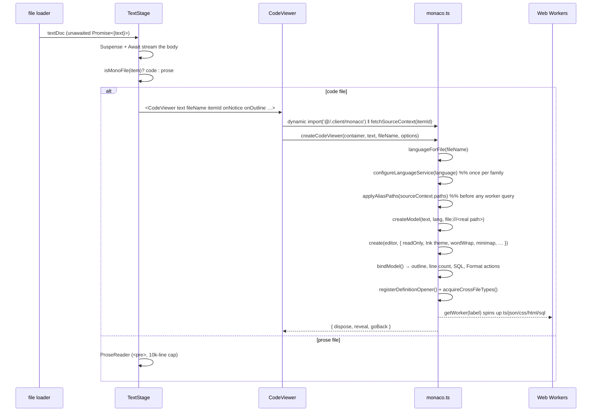
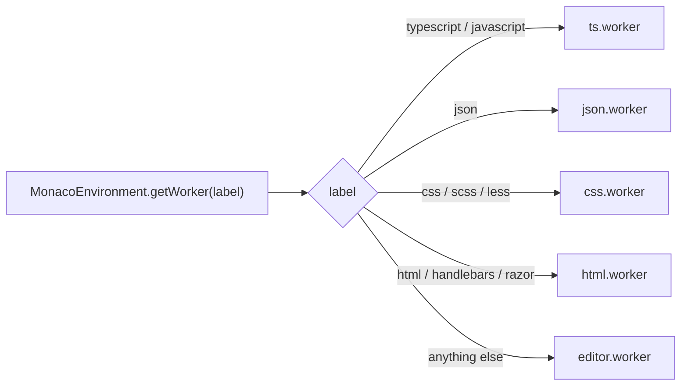
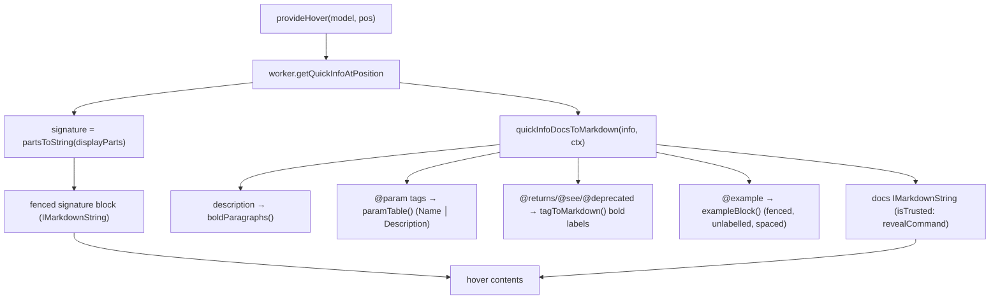
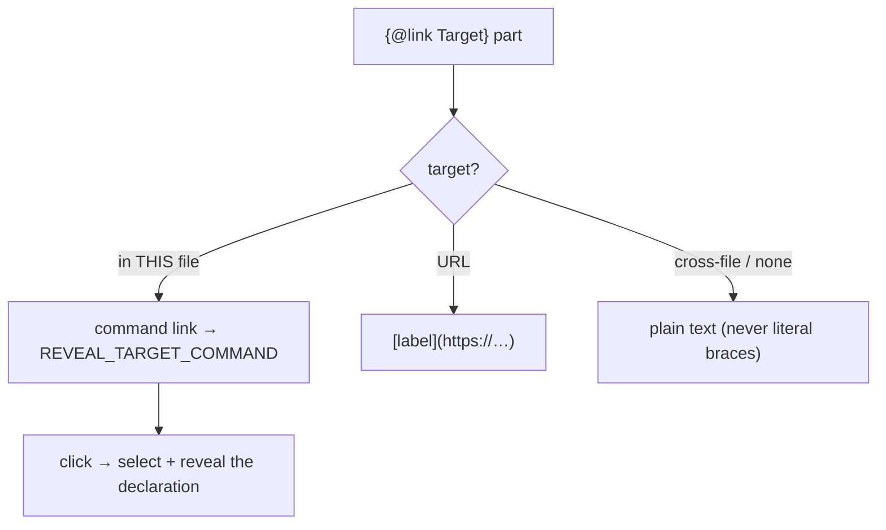
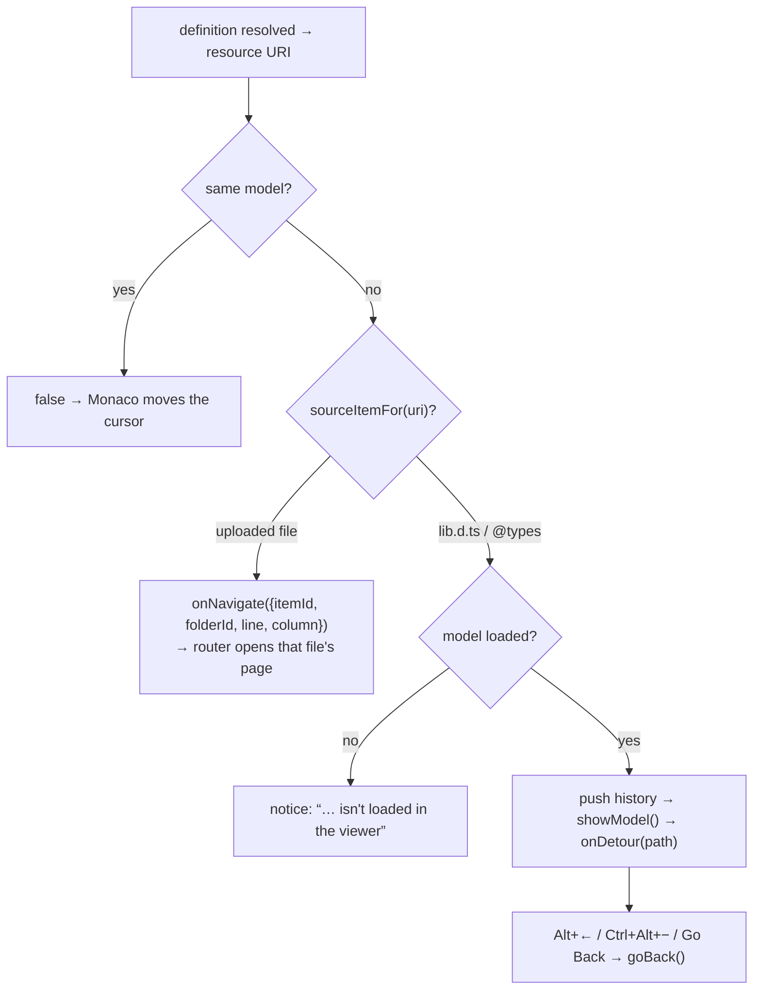
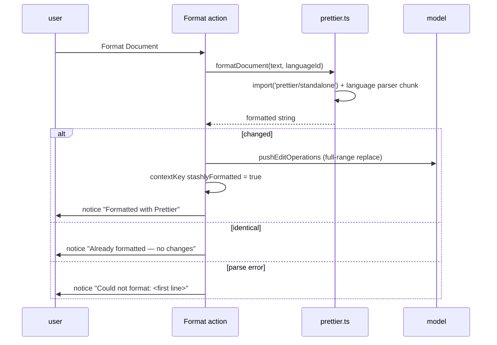
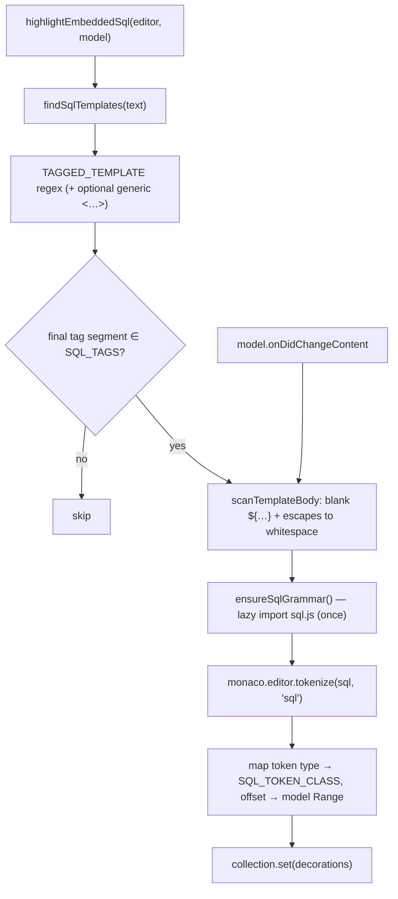
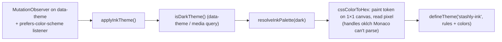
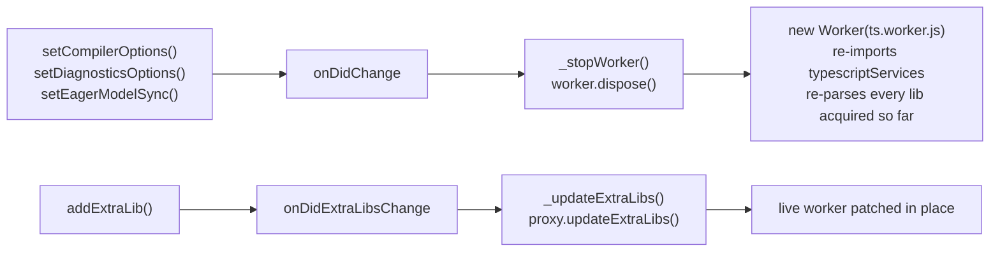

# Code Viewer

A read-only, IDE-grade viewer for text/code files in the item page. It mounts
Monaco (VS Code's editor) lazily in the browser and layers on the pieces VS
Code users expect — syntax highlighting, type-aware hovers, a document outline
rail, Go to Definition across the user's other uploaded files, Format Document,
and embedded-SQL highlighting — while staying in lock-step with Stashly's Ink
design tokens and never writing a byte back to storage.

> **Read-only is the load-bearing constraint.** The viewer shows a file fetched
> from S3; it never persists edits. That single fact simplifies almost every
> feature below — formatting is a *view* of the file, decorations are computed
> against a document that only changes on explicit Format/Revert, and there's
> no autosave/undo model to reconcile.

---

## File map

| File | Role |
|------|------|
| `app/components/views/item-page/text-stage.tsx` | Stage host. Streams the file body (Suspense/Await), chooses **code** (Monaco) vs **prose** (`<pre>`) via `isMonoFile`, lays the outline rail beside the editor card, renders the floating toolbar. |
| `app/components/views/item-page/code-viewer.tsx` | Thin React wrapper. Dynamic-imports the Monaco module from an effect, fetches the file's source context, renders a notice pill, a detour banner, and a `<pre>` fallback if Monaco fails to load. |
| `app/components/views/item-page/code-outline.tsx` | The document outline rail (`CodeOutline`, `CODE_OUTLINE_SIDEBAR_ID`) — clicking a symbol calls the viewer handle's `reveal`. |
| `app/components/views/item-page/stage-skeleton-loader.tsx` | `StageSkeletonLoader` — the one skeleton shared by every stage; `variant="code"` while Monaco's chunks download, `variant="document"` for prose. |
| `app/.client/monaco.ts` | Everything Monaco. Editor creation, theming, worker routing, language services, the JSDoc hover, embedded-SQL highlighting, and Go to Definition. Lives in `.client/` so the server bundle never evaluates it. |
| `app/.client/monaco-outline.ts` | Symbol-tree extraction (`OutlineSymbol` / `OutlineTarget`), rebuilt whenever the language service or the buffer changes. |
| `app/.client/prettier.ts` | Browser Prettier. `prettier/standalone` + per-language parser chunks, behind `canFormatLanguage` / `formatDocument`. |
| `app/.client/type-acquisition.ts` | npm ATA — `@typescript/ata` → jsdelivr → `addExtraLib`. |
| `app/.client/cross-file-types.ts` | Cross-file resolution — `fetchSourceContext` / `acquireCrossFileTypes` / `applyAliasPaths`: walks the import graph, fetches sibling source via the API, registers it as extra libs, and records which extra-lib URI belongs to which uploaded item (`sourceItemFor`) so Go to Definition can route to its page. |
| `app/.server/source-resolution-actions.ts` + `app/routes/api/source-types.ts` | Backend for cross-file: project-root/alias config + reading sibling source by logical path. |
| `app/utils/text-thumbnail.ts` | `isMonoFile` / `isTextRenderableFile` — decides code vs prose and which files are text at all. |

Every `.client/*` module here is dynamic-imported from a browser-only effect, so
their multi-MB chunks (Monaco, TypeScript, Prettier) download only when a code
file is actually opened — and `type-acquisition.ts` / `cross-file-types.ts` load
later still, only for TS/JS files.

---

## Mount & render flow

`createCodeViewer(container, text, fileName, options) => CodeViewerHandle` is
the single entry point. The handle carries `dispose` (tears down the editor,
model, theme listeners, format actions, SQL decorations and the cursor watcher),
`reveal(target)` (the outline rail's click) and `goBack()` (undo a
Go-to-Definition detour — same as Alt+←).

`CodeViewerOptions` is the whole surface the React layer hooks into:
`onNotice` (one-line results), `onLineCount`, `onOutline`, `onCursorLine`,
`sourceContext` (project root / real path / tsconfig `paths`, fetched in React),
`onNavigate` (definition landed in another uploaded file → route to its page)
and `onDetour` (definition landed in a file with no page, e.g. `lib.es5.d.ts`).

Everything that belongs to *the model* rather than the editor — the outline, the
line count, embedded-SQL decorations and the Prettier actions — is wired by
`bindModel` and rebuilt on every Go-to-Definition jump, so the rail never lists
the file you came from.

---

## Language resolution & worker routing

`languageForFile(name)` resolves a Monaco language id from the filename using
Monaco's own registry (extensions **and** bare filenames, so `Dockerfile` /
`Makefile` resolve too), falling back to `plaintext`.

Monaco runs one Web Worker per language *label*. The base editor worker handles
tokenization for everything; only four languages get a dedicated **language
service** worker (the thing that backs hovers, validation, and IntelliSense):

Each `?worker` chunk is fetched only when its constructor first runs — the ~6MB
of bundled TypeScript downloads the first time a `.ts`/`.js` file opens, and
never for a user who only ever views `.css`.

---

## Language services

Each service is tuned for **one orphan file** — no tsconfig, no `node_modules`,
no sibling sources — opened by an arbitrary uploader.

| Language | Configured by | Diagnostics | Notes |
|----------|---------------|-------------|-------|
| TS / JS | `configureTypeScript` | **Semantic OFF**, syntax ON | Semantic errors are guaranteed wrong with no module graph (every import resolves to nothing). Syntax errors depend only on the bytes present, so they stay. Built-in hover disabled (`modeConfiguration.hovers: false`) in favor of a custom one. |
| JSON | `configureJson` | validate ON, JSONC-tolerant | `enableSchemaRequest: false` (never fetch a file's `$schema` URL); comments `ignore`, trailing commas `warning` — most real `.json` is tsconfig/eslintrc-style JSONC. |
| CSS / SCSS / LESS | `configureCss` | structural ON, style-lint OFF | Silences vendor-prefix/duplicate/unknown-property/empty-rule noise (fires constantly on minified/3rd-party CSS); keeps real errors (bad hex, bad color args). `data.useDefaultDataProvider` kept so property-doc hovers work. |
| HTML / Handlebars / Razor | *(none)* | defaults | Defaults already suit a viewer. |

### The model URI (why `.tsx` parses as `.tsx`, and where the file "lives")

The TS worker derives `ScriptKind` from the model URI's **suffix alone**.
Monaco's default `inmemory://model/N` has none, and with `allowJs` set the
fallback is JavaScript — so every `.ts`/`.tsx` file was parsed as JS and its
TypeScript syntax flagged wholesale (*"'interface' declarations can only be
used in TypeScript files"*). `modelUriFor` therefore builds
`file:///stashly/N/<name>.<ext>`, carrying the real extension. Measured: 2
syntax errors under the default URI → 0 under the suffixed one for identical
source. (The `file:///stashly/…` root — rather than `inmemory:` — is also what
lets ATA's `file:///node_modules` libs resolve; see *Extension points* below.)

`modelUriForContext` prefers the file's **real project path**
(`file:///app/.server/x.ts`) whenever a `sourceContext` is known, which is what
makes the file's own `./relative` imports resolve against its uploaded siblings
with no tsconfig involved. One wrinkle it has to handle: Monaco's
`LibFiles.getOrCreateModel` materializes a model at a file's real URI every time
a definition resolves *into* it, and never disposes it — so a page opened after
such a jump would find its own path occupied and silently fall back to the
counter URI, breaking relative resolution. If the squatter has no editor
attached it is disposed and the path reclaimed; otherwise `modelUriFor` takes
over.

---

## JSDoc hover (TS/JS)

Monaco's built-in hover formats JSDoc crudely (`@param name — - text` with a
doubled dash, `@example` never fenced, `{@link X}` printed with literal
braces). It's disabled and replaced with a VS Code-parity formatter over the
same `getQuickInfoAtPosition` payload.

### Link handling — `{@link}` and `@see`

`docPartsToMarkdown` walks the doc parts and routes each link through
`linkToMarkdown`, matching VS Code's three branches:

- The reveal command is registered once via `monaco.editor.registerCommand`;
  its arg is the target span, and the handler selects/reveals it in the editor.
- Trust is scoped to that single command id on the docs `MarkdownString`
  (`isTrusted: { enabledCommands: [REVEAL_TARGET_COMMAND] }`) — no other
  `command:` URI can ride along.
- Cross-file targets (stdlib, other modules) have nowhere to go in a
  single-file viewer, so they degrade to plain text.

### Styling (`injectViewerStyles`)

Monaco ships no CSS for markdown tables in hovers, so a small stylesheet is
injected once:

- **Description** — bold (`boldParagraphs` flattens intra-paragraph newlines
  first, because Markdown emphasis can't straddle a line break).
- **Params** — a real bordered table (greys from `--border` / `--muted-foreground`).
- **`@example`** — each code block gets vertical breathing room; sibling-scoped
  so the lone signature block isn't pushed.
- **Links** — `textLink.foreground` set to the Ink hue in the theme colors.

---

## Go to Definition (F12 / Ctrl+Click / Alt+F12 to peek)

Shipped in `f78e533` (PR #20), on top of the cross-file extra libs. Monaco
resolves the definition as usual; the interesting part is *where it opens*.

- `registerEditorOpener` is **global** but editors are not, so openers are
  registered once per page and dispatch through a `navigators` map keyed by the
  source editor. Returning `false` hands the jump back to Monaco's built-in
  handler — which is what same-file jumps and Peek's embedded editors want.
- A jump into another *uploaded* file routes rather than swapping the buffer:
  quietly repainting the model would leave the URL, breadcrumbs and item panel
  describing the file you left. `text-stage.tsx` turns the callback into a
  navigation carrying `?line=`/`?col=`, which the destination reads back to
  reveal the right caret.
- A jump into a file with **no page** (`lib.es5.d.ts`, an ATA-fetched `@types`
  package) opens in place as a *detour*: the previous URI, selection and
  scrollTop go on a history stack, `onDetour(path)` tells the stage to say which
  file is on screen, and `goBack()` restores the exact offset (re-centering on
  the selection would land the line somewhere it never was). The `Go Back`
  action is gated on the `stashlyCanGoBack` context key.

---

## Format Document (Prettier)

Right-click → **Format Document** (also `Alt+Shift+F`). Formatting is a
view-only transform; nothing is written back to S3.

Key decisions, all forced by **read-only**:

- Edits go through `model.pushEditOperations`, not `editor.executeEdits` (the
  latter is a no-op while `readOnly`).
- Undo is disabled under `readOnly`, so a paired **Revert Formatting** action —
  gated on the `stashlyFormatted` context key so only one of the two is ever
  visible — restores the original bytes.
- Comparison/format happen on **LF**. A model built from CRLF keeps CRLF and
  re-normalizes on push, so a raw compare vs Prettier's LF output falsely
  reports "changed" for a byte-identical document.
- Options mirror `.prettierrc`, so output matches `pnpm format`.

`prettier.ts` maps each Monaco language id to a parser + the plugin chunks it
needs, all dynamic-imported *inside* the call: the module is ~2KB statically,
and formatting a `.css` file pulls postcss without dragging in the ~1MB
TypeScript parser. Supported: ts/tsx, js/jsx, json, css/scss/less, html, yaml,
graphql, markdown.

---

## Embedded SQL highlighting

SQL written inside a tagged template literal — ``sql`…` `` / ``Prisma.sql`…` ``
/ ``prisma.$queryRaw<T>`…` `` — is a single string token to the TypeScript
grammar, so it renders flat. This finds those templates, tokenizes their bodies
with Monaco's own SQL Monarch grammar, and lays down inline decorations.

### Why each piece is the way it is

- **Tag detection** — `TAGGED_TEMPLATE` matches an identifier chain, an
  *optional generic type argument* (balancing up to 3 levels of `<…>`, e.g.
  `$queryRaw<Array<{ id: string }>>`), then the backtick. Only chains whose
  final segment is in `SQL_TAGS` (`sql`, `$queryraw`, `$executeraw`, and the
  `*unsafe` variants) count — so ``css`…` ``, ``styled.div`…` `` and untagged
  templates are left alone. Requiring the trailing backtick keeps a plain
  `sql < x` comparison from matching.
- **Interpolations & escapes** — `scanTemplateBody` blanks `${…}` holes and
  escapes to **equal-length whitespace** (newlines preserved), so token offsets
  map 1:1 back to model positions and interpolation regions simply aren't
  decorated (they keep their TS rendering).
- **Lazy grammar** — the SQL Monarch grammar is imported and registered the
  first time embedded SQL appears; nothing loads for files without any.
- **Recompute on change** — decorations are re-derived on every
  `onDidChangeContent`. The viewer is read-only, so that only fires on Format /
  Revert — but those rewrite the whole model and would smear static decorations
  across the wrong characters. (Decoration edits don't fire content events, so
  no loop; the grammar promise is cached, so re-runs are cheap.)

### Token colors

The whole template is the string-hue by default, so every SQL token is **reset**
from that baseline. CSS classes are scoped under `.view-lines` (specificity
0,3,0) so they win over Monaco's generated `.mtkN` token colors (0,2,0).

| Token | Class | Color |
|-------|-------|-------|
| keyword (`SELECT`, `WHERE`, `JOIN`, …) | `stashly-sql-keyword` | **hue, bold** |
| function (`COALESCE`, `json_agg`, …) | `stashly-sql-function` | hue |
| string | `stashly-sql-string` | hue |
| identifier / quoted / number | `stashly-sql-identifier` … | foreground |
| operator / delimiter | `stashly-sql-operator` | muted |
| comment | `stashly-sql-comment` | muted, italic |

Greys come from Ink tokens; the hue is hard-coded with a `data-theme` +
`prefers-color-scheme` override (it has no design token).

---

## Ink theming

The editor chrome and duotone syntax are derived at runtime from the app's Ink
design tokens (`--card`, `--foreground`, `--muted-foreground`, `--border`, …),
so the viewer tracks `globals.css` exactly, light or dark.

Syntax is **duotone**: greys from the tokens plus one dusty indigo hue
(`#5e6ad2` light / `#96a0e8` dark) reserved for strings and — in embedded SQL —
keywords/functions. A monochrome system has no hues to inherit, and Monaco's
default rainbow would fight the Ink shell. Bracket-pair colorization and
diagnostic squiggles are neutralized into the same palette (errors borrow the
hue rather than screaming red — it's a read-only viewer).

---

## Worker lifecycle — why corrections are extra libs

Monaco's TypeScript defaults expose **two** update channels, and only one of
them keeps the worker alive:

`workerManager.js` wires `onDidChange → _stopWorker()` with no diffing, and
`setCompilerOptions` fires it unconditionally. The replacement worker re-imports
`typescriptServices.js` — **43.5MB unbundled in dev**, and over Chrome's
per-entry disk-cache ceiling, so `Cache-Control: immutable` buys nothing and it
re-downloads in full every time. (`lib.js` at 16.4MB with identical headers
caches fine; size is the only difference.)

Opening one 27-line file used to boot the worker **nine times**: 1,024 requests,
470MB, 391MB of it that one bundle. Every rule below comes out of that.

- **Never call `setCompilerOptions` after the editor mounts.** `createCodeViewer`
  applies alias paths before `createModel`, and `applyAliasPaths` is idempotent,
  so the later call from `acquireCrossFileTypes` is a no-op.
- **Express "make this resolve" as an extra lib**, never as compiler options. A
  `.d.ts` shim at the guessed path re-exporting the real one resolves
  identically and rides the non-destructive channel. Safe because the viewer
  sets both `skipLibCheck: true` and `noSemanticValidation: true`, so the shim's
  `export { default }` raises nothing when the target has no default export.
- **Batch server work rather than serialising it.** `getSourceFiles` places
  every directory a batch needs breadth-first (one query per tree level),
  fetches every candidate file in one more query, then reads texts in parallel
  behind a per-request cache. The shape it replaced walked the tree per segment
  *per candidate extension* — over a thousand sequential queries for a batch of
  25, ~6.5s each.
- **Dedupe the walk queue at push time.** `requested` only fills in once a path
  is spliced into a batch, so a path imported by thirty files was queued thirty
  times and the copies ate slots in the batch they shipped with.

Measured before → after: **1,024 → 582 requests, 470MB → 49.5MB, 9 → 1 worker
boot, 82.4s → 12.0s of server time.** In production the whole worker payload is
a single 6.9MB file rather than 270 dev requests.

To measure it again: patch `window.Worker` in an `initScript` to count boots —
network counting is inference, constructions are fact — and call
`performance.setResourceTimingBufferSize()` first, because the resource timeline
caps at 250 entries and drops the rest silently.

---

## Commit history

| Commit | Change |
|--------|--------|
| `a60a195` | feat: Format Document via Prettier in the context menu |
| `f0dee77` | fix: report the outcome of Format Document (+ CRLF false-positive fix) |
| `73b6e94` | feat: TypeScript language service for hover types/signatures |
| `e65ce7e` | feat: JSON, CSS, HTML language services for hover docs |
| `f2bb4ea` | feat: navigable `{@link}` and `@see` in the hover |
| `ddcc23e` | style: restyle the JSDoc hover (bold description, param table, spaced examples) |
| `24a0bb7` | feat: highlight SQL embedded in tagged template literals |
| `699a976` | feat: also highlight `$queryRaw` / `$executeRaw` templates |
| `907a357` | fix: match SQL tags that carry a generic type argument |
| `00f4018` | style: color embedded-SQL keywords with the syntax hue |
| `da345f6` | fix: keep embedded-SQL highlighting aligned after Format Document |
| `80a23e6` | feat: automatic type acquisition for imported npm packages |
| `9e72d51` | feat: resolve types from other uploaded files (cross-file, option 1) |
| `f1829e0` | feat: resolve relative imports + fix alias specificity (cross-file v2) |
| `0f51ed4` | fix: read TS defaults via `monaco.typescript` in ATA |
| `f053987` | feat: document outline rail (#19) |
| `682b890` | fix: show `const` bindings as variables in the outline |
| `f78e533` | feat: go to definition across uploaded files (#20) |
| `166253f` | feat(item-page): share one `StageSkeletonLoader` across the stages |
| `4f41353` | perf: batch source-file resolution server-side (>1,000 sequential queries per batch → a handful) |
| `555de50` | perf: alias corrections as extra-lib shims — TS worker boots 9 → 1, 470MB → 49.5MB |
| `f6a2a64` | fix: dedupe the project-config lookup across the viewer's double mount |

---

## Extension points & known limitations

- **More language services** — the `LANGUAGE_WORKERS` label switch is the seam;
  each additional language is a one-line worker mapping.
- **More Prettier languages** — add an entry to the `LANGUAGES` map in
  `prettier.ts` (parser + plugin chunks).
- **More SQL tags** — add to the `SQL_TAGS` set (final-segment match).
- **Automatic type acquisition** *(shipped, `80a23e6`)* — imports from npm packages resolve to real
  types via `@typescript/ata` (see `type-acquisition.ts`): it fetches `@types`
  from jsdelivr and feeds them to `addExtraLib`. Requires the model to live in
  the same virtual root as the libs (`file:///stashly/…`, so node resolution
  reaches `file:///node_modules`). App path aliases (`@/…`) are filtered out of
  ATA — resolving those is cross-file's job. Trade-off: outbound jsdelivr
  requests derived from a file's import statements (package names only).
  Also requires **`moduleResolution: Bundler`** (`4d15316`): Monaco's `NodeJs`
  is node10, which reads only `main`/`types`/`typings`, so an exports-only
  package (react-router 8 declares its types solely as `exports['.'].types`)
  resolved to nothing however correctly ATA fetched it. Monaco's enum stops at
  `NodeJs = 2`, so the value is written out and handed to the real compiler.
- **Cross-file types** *(shipped, `9e72d51` + `f1829e0`; see
  [`code-viewer-cross-file-options.md`](code-viewer-cross-file-options.md) for
  why Option 1 won)* — imports of *other uploaded files* resolve via
  `cross-file-types.ts` + the `source-types` API. The loader-adjacent
  `getProjectConfig` returns the file's project root, its real path, and the
  tsconfig `paths`; the viewer **mounts the model at that real path**
  (`file:///app/.server/x.ts`), so the file's own `./relative` imports resolve
  natively — no tsconfig needed for those. Aliases (`@/services/…`) use the
  tsconfig `paths`, matched longest-prefix-first so `@/services/*` beats the
  catch-all `@/*`. The import graph is walked (relative + alias), fetching each
  referenced file's source and registering it as an extra lib at its real path.
  The project root falls back to the topmost uploaded folder when there's no
  tsconfig, so relative resolution works project-wide regardless.
- **Aliases without a tsconfig** *(shipped, `86a73aa`)* — an upload that didn't
  carry its tsconfig gets a *synthesized* alias map, which can only assume an
  alias names the folder it points at. True for `@/utils/*`; false for
  `@/ui/*` (`components/ui`) and `@/services/*` (`.server`). On a miss, and
  **only** when the map was synthesized, `getSourceFiles` searches by the
  *tail* of the logical path — `<dirs>/<base>.<ext>`, then
  `<dirs>/<base>/index.<ext>`, then the filename alone anywhere under the root
  — verifying each hit by walking its parent chain. Matches in more than one
  folder resolve to **nothing**: a plausible wrong file is worse than `any`,
  because it looks right. A second pass then re-tries the leftovers through
  prefixes the first pass *proved* (`services/db` → `.server/db.ts` establishes
  `services` → `.server`), which is what resolves an otherwise undecidable name
  like `services/auth` — four `auth.ts` live under the root. Fetching is only
  half of it: the compiler still resolves the specifier through `paths` and
  lands where the alias pointed, which is empty. So an answer that came back
  from somewhere else gets a **declaration-file shim** written at the guessed
  path, re-exporting the real one (`555de50`). Corrections used to be pinned
  into `compilerOptions.paths` instead — see
  [Worker lifecycle](#worker-lifecycle--why-corrections-are-extra-libs) for what
  that cost.
- **`.js` specifiers for `.ts` sources** *(shipped, `86a73aa`)* — TypeScript
  rewrites an ESM-style `./x.js` import to the `./x.ts` source; `candidatesFor`
  took the extension literally. Generated code leans on this hard — the Prisma
  client reaches `PrismaClient` through `./internal/class.js` — so one
  unfetched file collapsed `prisma` to `any` three hops from the viewed file,
  with nothing pointing at where it broke. `.js→.ts`, `.jsx→.tsx`,
  `.mjs→.mts`, `.cjs→.cts`, literal file tried first.
- **Cross-file acquisition is bounded, and silently so** — the walk stops at 250
  files per document, 25 per round-trip, and the server answers at most 60 paths
  and 25 suffix lookups per call (full table in
  [`code-viewer-cross-file-options.md`](code-viewer-cross-file-options.md#as-shipped--the-actual-bounds)).
  There's no depth cap because the walk is breadth-first, so the count cap
  already resolves the viewed file's own imports first. What's missing is the
  *signal*: with `noSemanticValidation` on and acquisition failures logged to
  the console, hitting the cap looks exactly like a file that doesn't exist —
  both render as `any`. A "types truncated" pill through `onNotice` would close
  it.
- **Acquired libs are session-scoped, cleared per project** — `dispose()` leaves
  the extra libs standing (they're shared with every viewer on the page, and are
  what make revisiting a file free). `resetForRoot` drops them when the viewer
  opens a file under a *different* project root, which is required for
  correctness rather than memory: libs are registered at project-relative paths
  (`file:///app/utils/x.ts`), so two uploads holding the same path would
  otherwise answer each other's imports with no error to show for it. It runs
  before `createCodeViewer`, because the new project's alias map restarts the
  worker on the way in and the restart re-parses whatever is still registered.
- **Cross-file `{@link}`** — still same-file only. `linkToMarkdown` compares
  `target.fileName` against the hovered model's URI and falls through to plain
  text otherwise. Go to Definition now *does* cross files, so this is a gap in
  the hover rather than a limit of the viewer: routing a `{@link}` through the
  same `navigators` path would close it.
- **SQL generic nesting** — the tag regex balances 3 levels of `<…>`; deeper
  generics degrade to no highlight (never a mismatch).
- **SQL interpolation scanner** — a `}` inside a string literal *within* `${…}`
  could end the hole early (rare in query params).
- **`Toaster` not mounted** — the app never mounts sonner's `Toaster`, which is
  why format outcomes surface as an in-viewer notice pill rather than a toast.
