# Stashly main toolbar — control spec (for a redesign)

This describes every control in the two toolbars of the Stashly web app as they exist today, so they can be redesigned. Nothing here is a proposal; everything was read from the code. Each control has a `file:line` pointer (paths relative to the repo root) in case a detail needs checking.

**Stashly** is a file-management app (a personal drive plus shared workspaces): folders, files, collections, a trash bin, search. Pages show items as cards in a grid, or as a list.

## 1. The two toolbars

| Name | What it is | Where |
|---|---|---|
| **Main header** | A sticky 56px (`h-14`) bar across the top of every signed-in page, above the page content. It carries navigation, upload, search, filters, sort, layout and account-level controls. | `app/components/app-header.tsx:44` |
| **Folder toolbar** (the "path rail") | A second sticky 56px row, shown at the top of three pages only: **All files**, **a folder**, and **Trash** (including a trashed folder). It carries the breadcrumb path, item counts, and the bulk-action buttons that appear when items are selected. | `app/components/core-components/page-toolbar/page-toolbar-path-rail.tsx:188`, mounted via `app/components/views/stash-page-toolbar.tsx:80` from `app/routes/stash/all.tsx:171`, `app/routes/stash/folder.tsx:158`, `app/routes/stash/trash.tsx:245` |

Other pages (collections, favorites, search, storage, workspaces…) have only the main header. Screenshots of each component and state are in section 6.

There is also an old bottom bar, `app/components/app-toolbar.tsx`, that is not rendered (`app/routes/layout.tsx:97` has it commented out). Ignore it.

### Visual conventions used by every control today
Controls are pill/box shapes on a card background (`bg-card`) with a 2px accent ring (`ring-2 ring-accent`), 36px tall, icon size 20px, font "stashly" (the app's display font, small sizes only: nothing below 12px). Header surface is the page background. Both light and dark themes exist.

### Width rules (important for the redesign)
The header measures **its own width**, not the window's (the sidebar can be open or collapsed). Breakpoints on the header's width (`app/styles/globals.css:560-569`):

| Name | Header width below… | Effect |
|---|---|---|
| compact | 60rem (960px) | Active-filter chips hide; the Sort label hides (icon only); Images-page view controls hide |
| narrow | 48rem (768px) | Search field hides (replaced by a search icon button); flag toggles (Locked/Favorited) hide from the Filter pill and move into the filter panel |
| phone | 36rem (576px) | Filter, Sort and Layout fold into one "View options" button |

Separately, **below the window width of 768px (`md`)** the sidebar becomes a slide-over sheet, and the same fold into "View options" applies (`app/components/filters/filters.tsx:614-615`).

## 2. Main header — controls, left to right

Row layout: `[sidebar button] [back button] [left group] ........ [right group]`. The left group shrinks first; overflow is clipped on the right edge of the left group.

### 2.1 Sidebar button
- **Open navigation** — icon button. Only visible below 768px window width, where it is the only way to open the navigation sheet. `app-header.tsx:66`.

### 2.2 Back button
- **Back** — icon button (left arrow), goes back one history step. Visible **only on a file page** (a single file opened, URL contains `/files/<id>`); hidden everywhere else. `app-header.tsx:71`.

### 2.3 Left group — depends on the page

| Page | Left group content | Code |
|---|---|---|
| File page (`/…/folders/:folderId/files/:fileId`) | Breadcrumb trail only. No upload, no filters, no layout switch. | `app-header.tsx:87` |
| Images page (URL ends `/images`) | Breadcrumb (hidden when the header is under 28rem, Tailwind’s default `md` container size) + search field (width 160–320px, may shrink to 0 on phone). No upload menu, no filter/sort. | `app-header.tsx:89-100` |
| Videos page (`/videos`) | Upload group only. `hasHeaderFilters` is false so no search, filter or sort. | `filters.tsx:607` |
| Every other page (stash home, All files, folders, collections, favorites, pinned, shares, search, trash, storage, workspace pages…) | **Upload group** + **Filters group** (search, Filter, Sort). | `app-header.tsx:106-109` |

> Note: `hasHeaderFilters` excludes any path containing `/videos`, `/images` or `/files`. A workspace gallery at `…/workspaces/:id/gallery` therefore gets the full filter group, while the personal Images page does not.

#### 2.3.1 Upload group
A joined button group with an accent ring. Not rendered on a file page. `app-header.tsx:133-228`.

1. **Uploads** (icon button, upload arrow; `aria-label="Uploads"`, `data-testid="upload-toggle"`) — shows/hides the upload progress panel. It is the panel's only opener. `:150-161`
2. **New and upload** (icon button, chevron; `aria-label="New and upload"`) — opens a small menu (a popover, not a dropdown-menu). Highlighted while open. `:162-172`. Menu items (`:173-219`):
   - **New** (folder-plus icon) — closes the menu and opens the **New folder dialog**. `:177-187`
   - **Files** (file-upload icon) — opens the system file picker (multiple files) and uploads into the current folder. `:188-202`
   - **Folders** (folder-upload icon) — opens the system folder picker (whole directory trees) and uploads into the current folder. `:203-218`
3. **New folder dialog** (`app/components/core-components/new-folder-dialog.tsx:15`): title "New folder", text "Create a new folder in the current location." Fields: **Name** (text, placeholder "Untitled folder", autofocus, disabled while submitting); buttons **Cancel**, **Create** (disabled while the name is blank or submitting; label becomes "Creating…"). An error message shows in red under the field if the server refuses. The folder is created in the current folder; at the stash root the user's root folder is used (`app-header.tsx:55`, `:221-225`).

Where uploads go: the folder in the URL (`:folderId`), or the user's root folder when there is none.

#### 2.3.2 Filters group (`HeaderFilters`, `filters.tsx:686`)
Contains, in order: Search field → (narrow only) Search icon button → [Filter pill + Sort] (hidden at phone width) → **View options** button (phone width only).

**A. Search field** (`filters.tsx:127`, `app/components/core-components/search-input.tsx:50`)
- Text input, placeholder "Search…", search icon at left, width min 160px, max 320px, shrinks first when space is tight.
- Typing writes URL param **`query`** after a **200 ms** pause (`app/hooks/useDebouncedCommit.ts:5`). Empty text removes the param. Browser back/forward, removing a filter or "Reset" replaces the field text.
- **Clear** button (× icon, `aria-label="Clear search"`) — appears only while the field has text; empties it. `search-input.tsx:79-90`
- **Mode toggle** (two-state toggle group at the right inside the field; exactly one is on): `search-input.tsx:91-119`
  - **Fuzzy search** (default) — keyword/typo-tolerant match. Writes nothing to the URL (param removed).
  - **Semantic search** — meaning-based match. Writes `searchMode=semantic`.
  - Parsed in `app/hooks/useFilters.ts:72-73`; anything other than `semantic` means fuzzy.
- Hidden when the header is under 48rem (narrow). Not shown on file pages, the Videos page. On the Images page it is shown by itself (no filter/sort), same field and params.

**B. Search icon button** (narrow header only; `aria-label="Search"`, tooltip "Search") — a link to the full search page `/:me/stash/search`. Replaces the field. `filters.tsx:697-711`

**C. Filter pill + panel** (hidden at phone width; folded into View options there) `filters.tsx:261-311`, `:617-632`
The pill (outline button with accent ring, label "Filter") is one click target that opens the panel; its parts:
- Filter icon + text **Filter**.
- **Active-filter chips** — one chip per selected Category/Status/Type value (icon + label), at most 2 shown, then a "+N" chip. Hidden under 60rem. Not clickable. `filters.tsx:158-181`, chips built in `useFilters.ts:174-189`
- Dashed divider, then two **flag toggles** (icon-only toggle buttons; clicking one does **not** open the panel):
  - **Locked** (lock icon, `aria-label="Locked"`) → URL param `locked=true`
  - **Favorited** (heart icon, `aria-label="Favorited"`) → URL param `favorited=true`
  - Pressed state = on (muted background, accent text). They apply **immediately** (no Apply needed). Presence-based: on = param present with value `true`; off = param removed. Hidden under 48rem, and then appear inside the panel (see below). `filters.tsx:185-226`, `useFilters.ts:113-121`
- Dropdown chevron icon.
- Open state: pill gets a muted tint.

**The panel** (popover, 448px wide, `w-md`) `filters.tsx:321-338`. Three parts stacked:

1. **Tabs** — three tabs, each showing a count badge when it has selections; the tab whose id is `category` is open by default. `filters.tsx:357-403`, `:622-626`
2. **Flags section** — only if the trigger's flag toggles are hidden (header under 48rem): a row "Flags" with the same two toggles. `filters.tsx:484-496`
3. **Footer** — **Reset (N)** at left, **Cancel** and **Apply** at right. `filters.tsx:498-558`

**Tab: Categories** (`category`; 2-column grid of checkbox rows; icon + label + checkbox) `app/utils/filter-data.ts:10-24`
Archive (`archive`), Audio (`audio`), Binaries (`binaries`), Code (`code`), Document (`document`), Graphic (`graphic`), Image (`image`), Pdf (`pdf`), Presentation (`presentation`), Script (`script`), Spreadsheet (`spreadsheet`), Video (`video`), Unknown (`unknown`).

**Tab: Status** (`status`; single column) `filter-data.ts:26-31`
Archived (`archived`), Locked (`locked`), Shared (`shared`), Trashed (`trashed`).
(Note: `Locked` exists twice with different meaning of param: tab value `status=locked` vs. flag toggle `locked=true`. Both exist today as separate params.)

**Tab: Type** (`type`; single column) `filter-data.ts:33-37`
Collection (`collection`), File (`file`), Folder (`folder`).

Behaviour of the three tabs (`filters.tsx:415-471`, `useFilters.ts:140-146`):
- Every row is a button with a checkbox; multiple values can be ticked per tab (OR within a tab).
- Ticks go into a **draft**; nothing is written until **Apply**. The draft resets to the current URL state each time the panel opens.
- **Apply** writes each tab as one comma-separated param: `category=image,pdf`, `status=archived`, `type=folder`. An empty tab removes its param. Closes the panel.
- **Cancel** closes without applying.
- **Reset (N)** — N is the total active count (all Category + Status + Type values + active flags; the search query is not counted). Disabled when N is 0. It clears Category, Status, Type, both flags **and the search query**, then closes (`useFilters.ts:157-160`).
- Combination: different groups combine with AND (e.g. category in {image,pdf} AND type = file AND favorited); values inside a group are alternatives. The server decides the final semantics; the client only writes the params.
- Every filter, search, sort and layout change deletes the `cursor` param (paging resets to the first page) (`useFilters.ts:107`, `sort-pill.tsx:136`). All writes use history *replace*, so Back does not step through filter changes.
- URL param summary: `query`, `searchMode` (only `semantic`), `category`, `status`, `type` (comma lists), `locked`, `favorited` (`true` when on).

**D. Sort pill** (hidden at phone width; folded into View options there) `app/components/filters/sort-pill.tsx:109-227`
Two buttons side by side, plus a popover:
- **Sort field button** (sort-list icon + current field label; tooltip `Sort by <field> · <direction hint>`) — opens the sort popover. Label hides (icon stays) under 60rem. `:150-167`
- **Direction button** (icon-only; arrow up/down icon reflects current direction; `aria-label="Toggle sort direction (currently …)"`) — flips ascending/descending without opening the popover. `:168-177`
- **Sort popover** (208px wide): heading "SORT BY", one row per field (icon + label + checkbox; one checked), then a "DIRECTION" row with a text button showing the current hint, which flips direction on click. `:180-224`
- Fields, their URL column, and direction hints (`:33-83`):

| Label | Column written | Ascending hint | Descending hint |
|---|---|---|---|
| Name (default) | `name` | A → Z | Z → A |
| Updated | `updatedAt` | Old → New | New → Old |
| Created | `createdAt` | Old → New | New → Old |
| Size | `size` | Smallest first | Largest first |
| Type | `type` | A → Z | Z → A |
| Count | folders: `folder.childCount`, collections: `members._count` (two keys) | Fewest first | Most first |

  (A "Similarity" field exists only as commented-out code.)
- URL form: `orderBy[name]=asc`; Count writes two indexed keys, `orderBy[0][folder][childCount]=asc` and `orderBy[1][members][_count]=asc`. `:126-135`
- Default when no `orderBy[...]` param: shows **Name, ascending** (nothing is written to the URL).
- On a **collection page** (`:collectionId` in the URL) the **Count** field is removed, because a collection holds files only (`:107`).

**E. View options button** (phone only: window < 768px or header < 36rem; icon = filter icon, `aria-label="View options"`) `filters.tsx:648-684`
Opens a right-aligned popover with three labelled rows:
- **Filter** → the same Filter pill + panel as C (panel width capped to the available space).
- **Sort** → the same Sort pill as D.
- **Layout** → layout toggle with only **Grid** and **List**.
On pages without the filter group (Images, Videos) the layout switch stays in the header instead (`app-header.tsx:115-120`).

### 2.4 Right group (always on the right, never shrinks) `app-header.tsx:111-128`

1. **Images page only — view controls** (`GalleryHeaderTools`, `app/components/gallery/gallery-view-controls.tsx:31`). Hidden under 60rem header width. Three controls:
   - **By date** (toggle button with a clock icon; pressed = images grouped by day). `:91-99`
   - **Gap between images** — slider 0–20 px, step 2, with a "tight" glyph at left, a "wide" glyph at right and a live `Npx` readout. `:101-118`
   - **Thumbnail size** — slider 1–5, step 1, zoom-out icon left, zoom-in icon right. `:120-134`
   - These three are remembered in a cookie (`stashly-gallery`), not in the URL (`app/hooks/useGalleryPrefs.ts:21`).
   - **While one or more images are selected** these controls are replaced by the selection actions (section 3.3, Images variant: Add to collection, Share, Download, Trash, Clear) and those show at every width.
2. **Layout toggle** (segmented icon buttons, exactly one active; each has a tooltip) `app/components/layout-toggle.tsx:11-87`, `app/components/ui/layout-menu.tsx:27`
   - Items by page:

| Page | Items shown |
|---|---|
| Images, Videos | **River view** (river icon, `layout=river`), **Waterfall view** (`layout=waterfall`), **Grid view** (`layout=grid`) |
| All other pages | **Grid view** (`layout=grid`), **List view** (`layout=list`) |
| File page (`/files/…`) | The whole toggle is not rendered |

   - URL param **`layout`**. Default: `waterfall` on Images, `grid` everywhere else. If the URL has no `layout`, the default is written into it on load (history replace), because views render nothing without it.
   - Hidden on pages that have the filter group at phone width (it moves into View options); stays visible on Images/Videos.
3. **Notifications** (bell icon button; `aria-label` "Notifications" or "Notifications, N unread") `app/components/core-components/notifications/notifications-panel.tsx:126-248`
   - Icon is the empty bell when 0 unread, the filled bell when ≥ 1 (animated swap). Open state tints the button.
   - Panel (448px, popover):
     - Header: title "Notifications", an "N unread" label when N > 0, and a **Mark all read** button (check icon; disabled when 0 unread or while saving; marks everything read at once, optimistically). `:191-216`
     - **Filter tabs**: **All**, **Unread**, **Alerts** (the active one is filled). `:87-120`; names in `app/utils/notifications.ts:50-56`
     - List grouped by day (sticky day headings), scrollable (280px high), live-updated (server stream).
     - Empty states, per tab: All — "Nothing here yet. Activity on your files and shares shows up here."; Unread — "You've read everything."; Alerts — "No warnings or failures." `:66-70`
     - The look and actions of an individual notification row are in `notification-item.tsx` and are not covered by this spec.
   - Note: the unused `NotificationBell` helper in the same file (`:31`) duplicates the trigger; only the trigger at `:157` is used.
4. **Color mode** (icon button, `aria-label="Color mode"`; icon shows the current setting) `app/components/color-mode.tsx:12-84`
   - Opens a small menu with three buttons: **Dark** (moon icon), **Light** (sun icon), **System** (half-circle icon). Choosing saves the preference through `/api/theme`; the button icon updates to match: moon = dark, sun = light, half-circle = system. There is no "selected" mark in the list itself.

## 3. Folder toolbar (path rail) — controls

Row layout: `[Back] [Select-all] [path + counts ............] [right group]`. `page-toolbar-path-rail.tsx:205-308`. Sticky at the top of the content, 56px, page background.

### 3.1 Left side (always visible)

1. **Back** (icon button, left arrow, `aria-label="Back"`) — one step back in history. Hidden when there are no breadcrumbs (e.g. the stash root/All files page). `:211-222`
2. **Select all** (tri-state checkbox in a 36px square with accent ring) `app/components/core-components/page-toolbar/toolbar-stats.tsx:13-92`
   - States: **off** (nothing selected; `aria-label="Select all"`), **mixed/indeterminate** (some selected; minus icon; clicking selects all), **on** (every item on the page selected; double-check icon; `aria-label="Clear selection"`; clicking clears).
   - Scope is the loaded items of the page. The selection is stored in the URL param **`selectedItems`** (comma-separated item ids), so it survives refresh and is shareable. Breadcrumb links drop `selectedItems` and `cursor` when navigating.
   - The component also supports a subset (one date group) via `ids`/`label` props ("Select {label}" / "Deselect {label}"), used where a page groups items; the toolbar itself uses the whole-page form.
3. **Path** (`Breadcrumbs`, `app/components/core-components/breadcrumb-navigation.tsx:141-217`)
   - Shows `root / … / parent / current`. The current folder is plain text (not a link); ancestors are links (each max 160px wide, truncated with a tooltip title showing the full name). A link keeps the current URL's other params, except `cursor` and `selectedItems`; `layout=grid` is added if absent.
   - With **more than 3 crumbs** the middle ones collapse into an **ellipsis button** ("…", screen-reader text "Toggle menu") that opens a dropdown listing each hidden ancestor as a link; the root, the second-to-last, and the last crumb stay visible.
   - In **Trash**, the trail is "Trash / folder / …" and every link stays inside Trash.
   - When there are no crumbs (stash root), a plain text title is shown instead: the route's name, or the last URL segment with dashes turned into spaces; on Trash itself, the heading "Trash".
4. **Counts** (three outlined badges, normal mode only; not in Trash) `:257-274`
   - Total **size** (e.g. "1.2 GB"; hidden below the `sm` window width, 640px), **"N files"**, **"N folders"**. These are the counters of the current folder / drive, not of the selection.

### 3.2 Right side — nothing selected (not Trash)
A search icon button (`aria-label="Search"`, tooltip "Search") that links to `/:me/stash/search`, and a thin vertical divider. Only shown when the user id is available. `:293-306`

### 3.3 Right side — one or more items selected ("bulk mode")
The neutral search button is replaced in place by one joined group with an accent ring (the path never moves) (`PathRailSelectionActions`, `:103-162`):

**Normal context (All files, folders), in this order** — a button shows only if the page wires it; the default set is Move, Share, Download, Trash:
1. Text **"N selected"** (count of selected items).
2. **Add to collection** (collection icon; tooltip "Add to collection") — a dropdown listing the user's collections (heading "Add to collection"; each item = icon + collection name). The list loads when first opened: while loading, a disabled "Loading…" item; if none, a disabled "No collections yet" item. Choosing one adds the selected items to it and clears the selection. `add-to-collection-menu.tsx:24-77`. *Not in the default set — only used on the Images page.*
3. **Move to…** (icon button; tooltip "Move to…") — opens the **Move to folder** picker dialog for the whole selection (`MoveToFolderDialog`; it disables the current folder as a target).
4. **Share** (tooltip "Share") — opens the **Share** dialog for one item. **Disabled with tooltip "Share one item at a time"** when more than one item is selected. (The dialog's own content is a separate component.) `stash-page-toolbar.tsx:151-152, 188-196`
5. **Download** (tooltip "Download") — downloads the selected files. **Disabled** with tooltip "Preparing download…" while a download is being prepared, or "Folders can’t be downloaded yet" when any selected item is a folder. `stash-page-toolbar.tsx:153-157`
6. **Trash** (red/destructive tint; tooltip "Trash") — moves the selection to Trash. Asks "Move N item(s) to Trash? You can restore them from Trash." (buttons: Move to Trash / cancel) **only** where the page sets the confirm option (Images page); on All files and folders it trashes immediately. `stash-page-toolbar.tsx:114-125`
7. **Clear selection (Esc)** (× icon) — empties the selection. *Not in the default set — only on the Images page.* The tooltip says "(Esc)", but no Escape-key handler for the selection exists in the code; do not treat Esc as a working shortcut.
- A **Favorite** button is wired up in the page code (`onFavorite`) but commented out of the toolbar (`page-toolbar-path-rail.tsx:143`); it does not exist in the UI.

**Trash context (the Trash page and trashed folders):** `:120-135`
1. Text **"N selected"**.
2. **Restore** (restore icon) — moves the selection back out of Trash.
3. **Delete forever** (red trash icon) — asks "Permanently delete N item(s)? This action cannot be undone, deleted items cannot be restored." (button "Delete"), then deletes permanently.
- In Trash with nothing selected, the right side shows the same search button + divider as 3.2; the left shows the "Trash" heading (or trail) and no count badges.

Pluralization: "1 item" / "N items" (`stash-page-toolbar.tsx:104`).

**Images page variant:** the same group (Add to collection, Share, Download, Trash with confirmation, Clear) is rendered inside the main header's right group instead of a second row, because that page has no folder toolbar (`gallery-view-controls.tsx:18-24, 47-57`). The Images page has no select-all checkbox in the header.

## 4. Quick matrix — what shows where

| Control | Stash home, collections, favorites, search, etc. | All files / Folder | Trash | Images | Videos | File page |
|---|---|---|---|---|---|---|
| Sidebar button (<768px) | ✔ | ✔ | ✔ | ✔ | ✔ | ✔ |
| Back (header) | – | – | – | – | – | ✔ |
| Breadcrumb in header | – | – | – | ✔ (≥28rem) | – | ✔ |
| Upload group | ✔ | ✔ | ✔ | – | ✔ | – |
| Search field | ✔ (≥48rem) | ✔ | ✔ | ✔ | – | – |
| Filter pill + panel | ✔ | ✔ | ✔ | – | – | – |
| Sort pill | ✔ | ✔ | ✔ | – | – | – |
| View options (phone) | ✔ | ✔ | ✔ | – | – | – |
| Layout toggle | Grid, List | Grid, List | Grid, List | River, Waterfall, Grid | River, Waterfall, Grid | – |
| Gallery view controls | – | – | – | ✔ (≥60rem) | – | – |
| Notifications, Color mode | ✔ | ✔ | ✔ | ✔ | ✔ | ✔ |
| Folder toolbar row | – | ✔ | ✔ | – | – | – |

(Trash and the other pages use the main header's filters because they only exclude `/videos`, `/images`, `/files`. Whether a given page *honours* a given filter is decided by that page's loader and is not part of the toolbar.)

## 5. Not in either toolbar (do not add or expect)
Paging has no control: page size is the `take` URL param (default 100 items) and the next page loads through a "load more" element at the bottom of the page content, not the toolbar. There is no Favorites or Pin button in either toolbar, no keyboard-shortcut handling for select/clear, and no per-state (empty/loading) design for the counts badges.

## 6. Screenshots of components and states

Captured from the running app (light theme unless noted, 2x resolution) with a seeded test user, so the content (file names, empty notifications, broken image placeholders) is test data. Only the toolbar chrome matters. Files are in `docs/design/screenshots/`.

**Not captured** (would need data changes or a state not present in the test drive): the Trash page's folder toolbar with items selected (Restore / Delete forever), the collapsed breadcrumb with its "…" menu (needs 4+ nested folders), a notification list with real entries, and the confirm dialogs for Trash / Delete forever.

### Header and folder toolbar, wide (1440px)

**Light theme, All files page: header (upload group, search, Filter pill with flag toggles, Sort, layout toggle, notifications, color mode) over the folder toolbar (back, select-all, path, counts, search button). The left rail is the app sidebar, not part of either toolbar.**

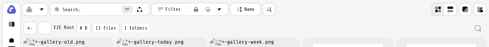

**Same view, dark theme.**

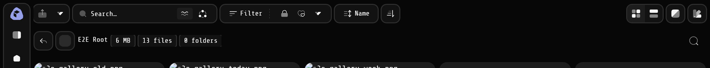

**Folder page, nothing selected: select-all empty, counts, neutral search button.**

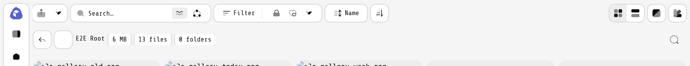

### Filters and search

**Active state: URL `category=image,pdf&favorited=true`. (The chips and Favorited highlight are subtle at this width; compare with 01.)**

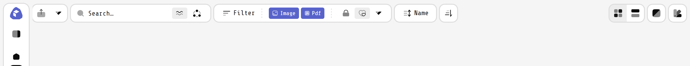

**Filter panel open, Categories tab, nothing ticked. Reset (0) is disabled.**

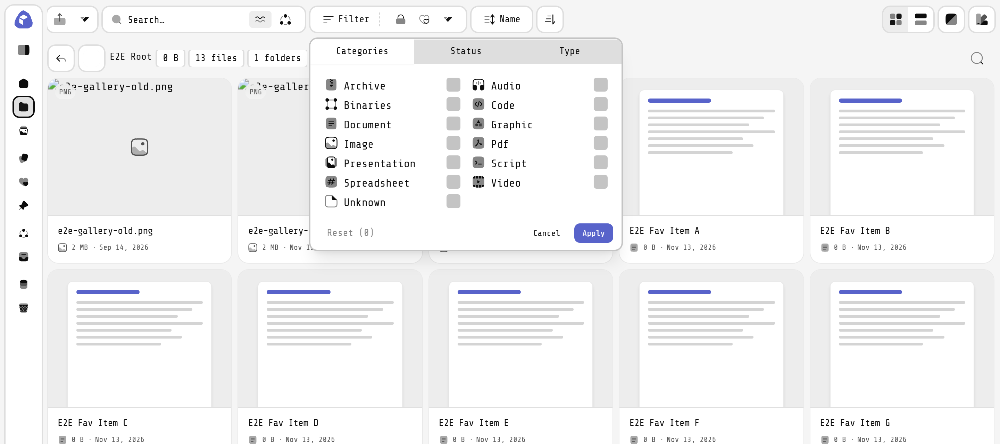

**Draft state: Document, Image, Pdf ticked but not yet applied.**

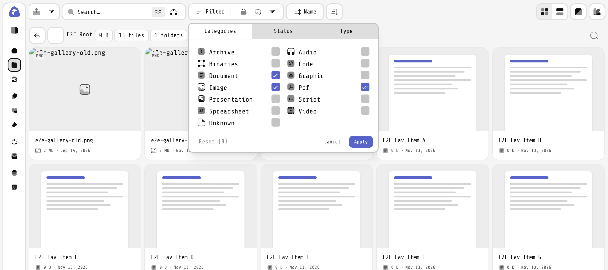

**Status tab (Archived ticked in the draft).**

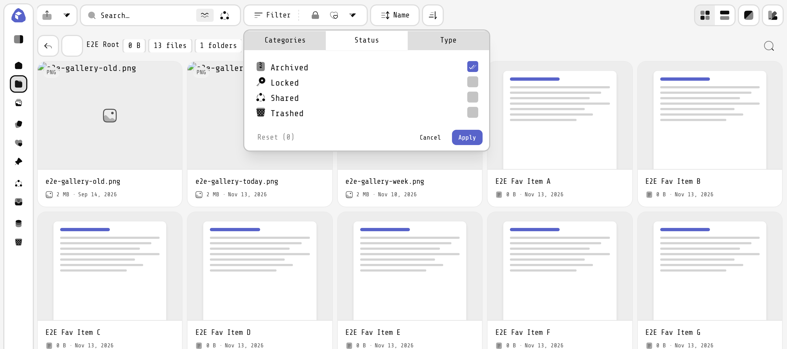

**Type tab.**

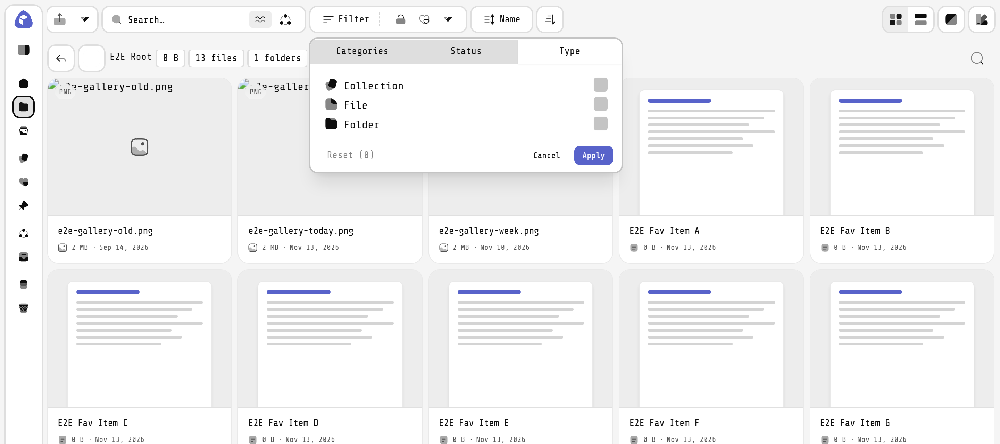

**URL `query=report&searchMode=semantic&orderBy[size]=desc`.**

![URL `query=report&searchMode=semantic&orderBy[size]=desc`.](screenshots/03-search-semantic-and-sort-size-desc.png)

**Search field with text typed: the clear (×) button appears.**

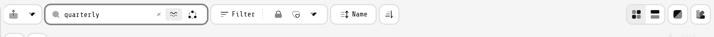

### Sort and layout

**Sort popover open: the six fields, one ticked, and the Direction row.**

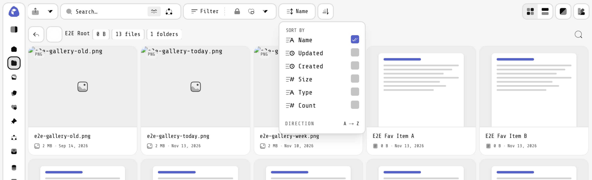

**`layout=list`: the second segment of the layout toggle is active.**

### Upload, notifications, color mode

**"New and upload" menu: New, Files, Folders.**

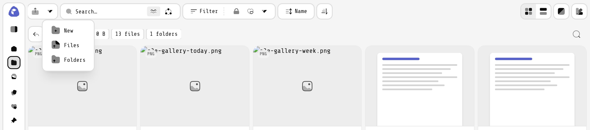

**New folder dialog.**

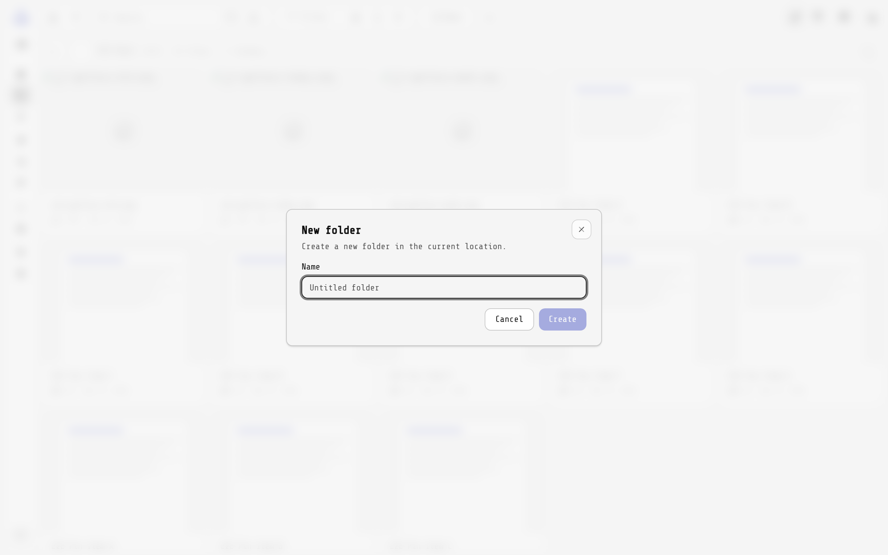

**Notifications panel, empty state, All tab.**

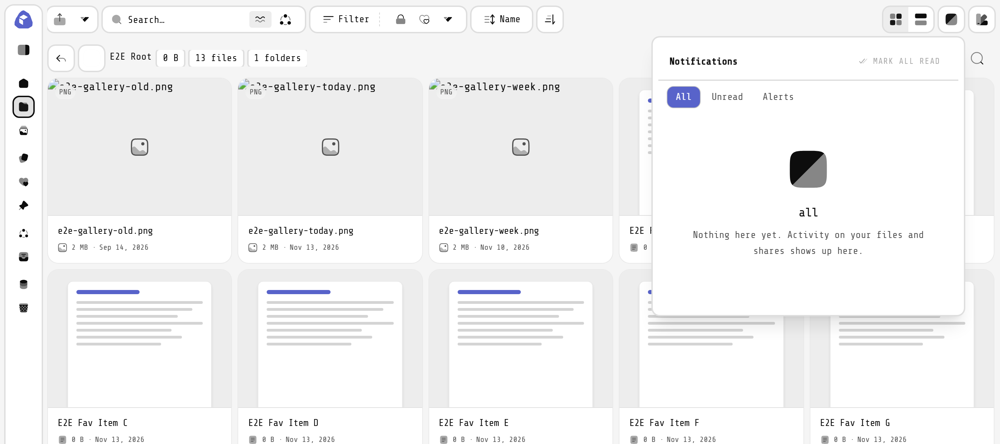

**Color mode menu: Dark, Light, System.**

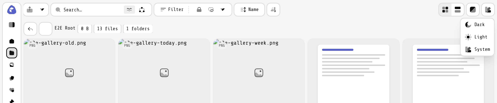

### Folder toolbar — selection states

**One item selected: "1 selected", Move to…, Share, Download, Trash.**

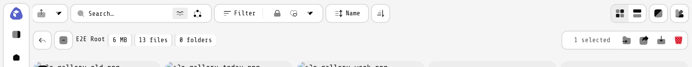

**Two selected: select-all shows the mixed (minus) state; Share is disabled.**

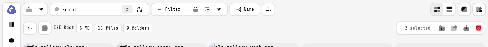

**Hovering the disabled Share button: "Share one item at a time".**

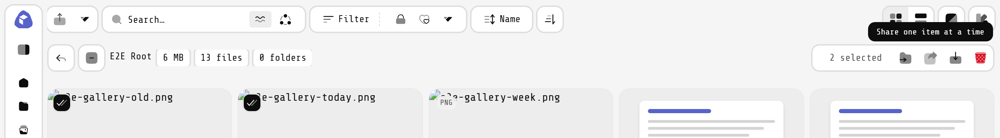

**Everything selected: select-all in its checked state.**

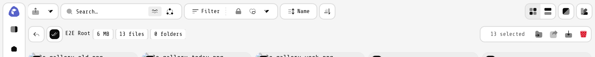

**One selected, dark theme.**

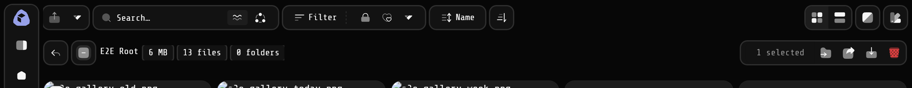

### Other pages

**Images page header at full width: page name, search, then By date, gap slider (16px shown), thumbnail-size slider, layout toggle (River/Waterfall/Grid; Waterfall active), notifications, color mode.**

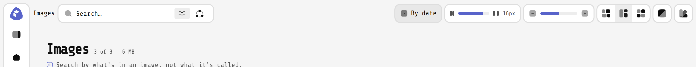

**Images page with two images selected: selection actions in the header (Add to collection, Share, Download, Trash, Clear).**

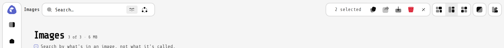

**The Add to collection dropdown.**

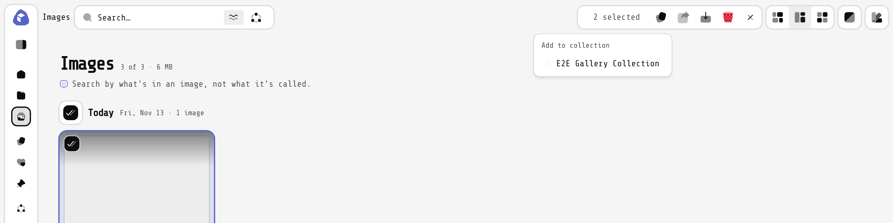

**Videos page header: upload group only; River/Waterfall/Grid layout toggle.**

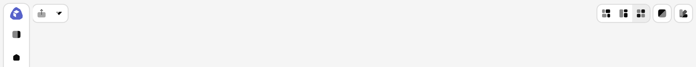

**File page header: Back button and breadcrumb; no upload, filters or layout toggle.**

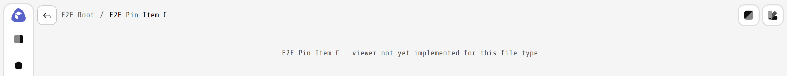

### Responsive states

**Window 1000px (header under 60rem): chips hidden, Sort label hidden. Active filters: category=image,pdf and favorited.**

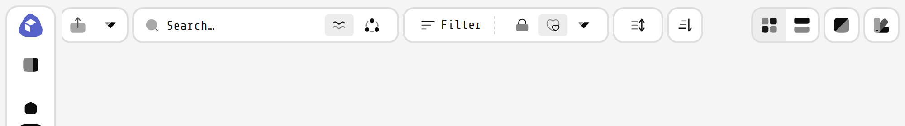

**Window 820px (header under 48rem): search field replaced by a search button; flags move into the panel.**

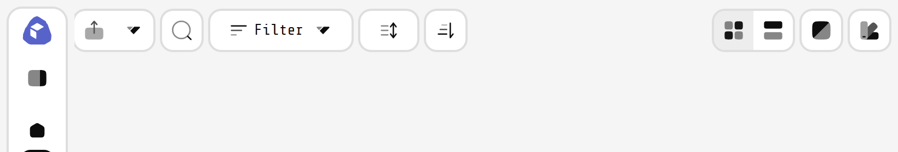

**Window 700px (under 768): sidebar becomes a sheet; Filter, Sort, Layout fold into the single View options button.**

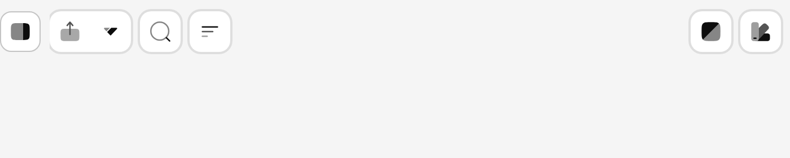

**375px phone: header and folder toolbar.**

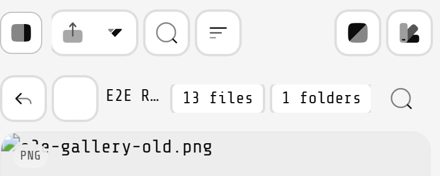

**View options popover: Filter, Sort, Layout rows.**

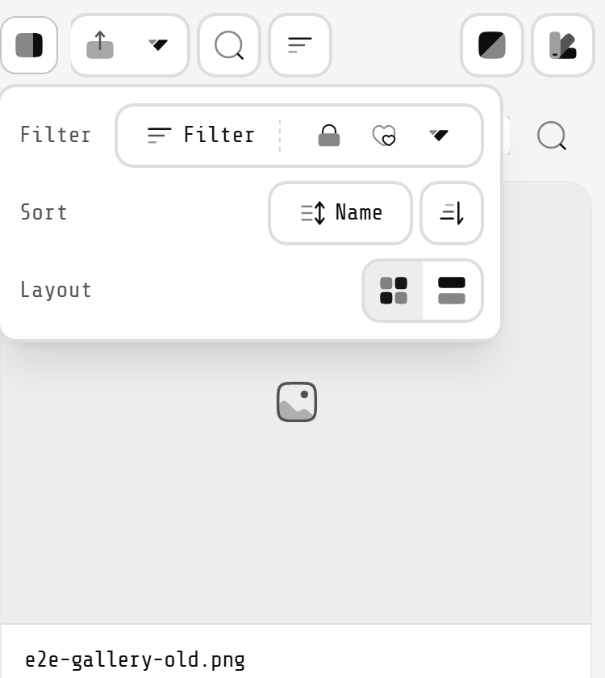

**Filter panel opened from inside View options.**

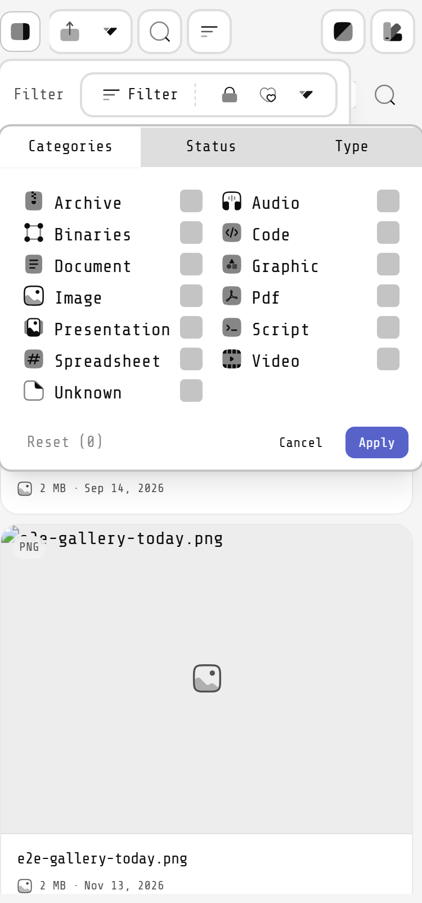
