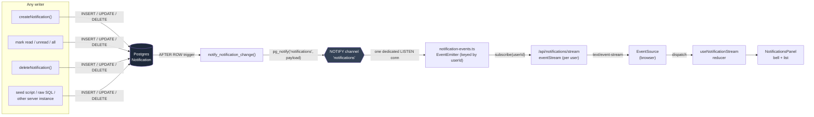
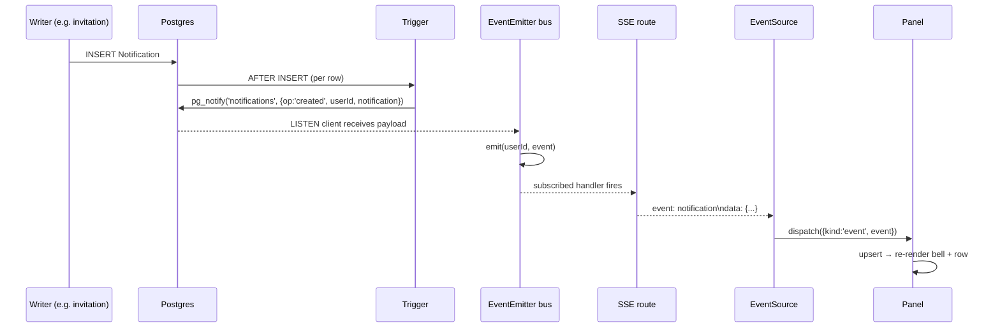
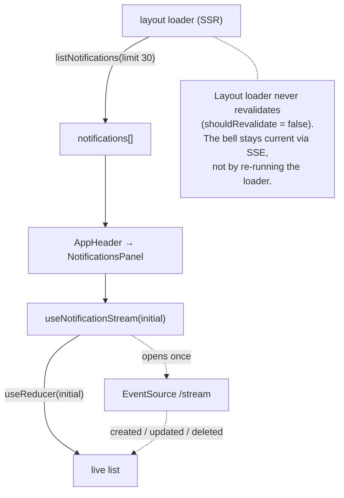
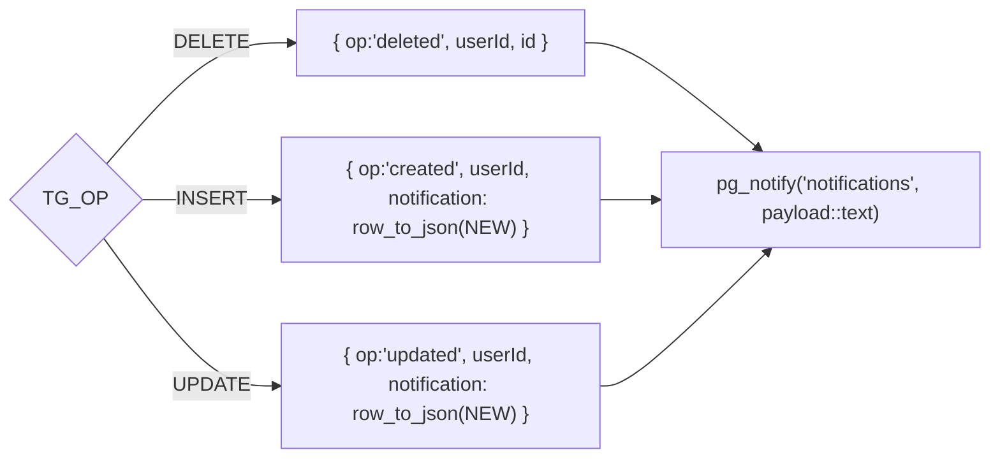
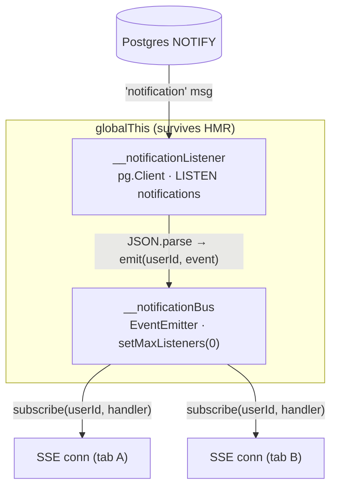
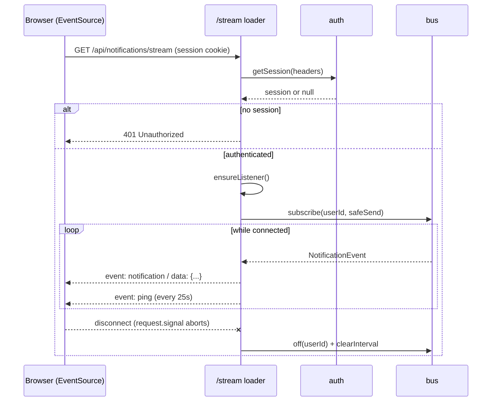
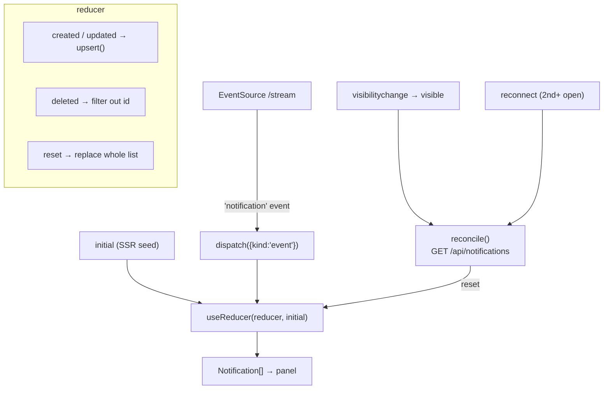
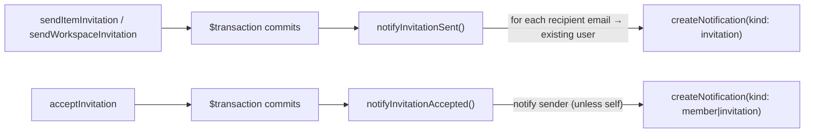
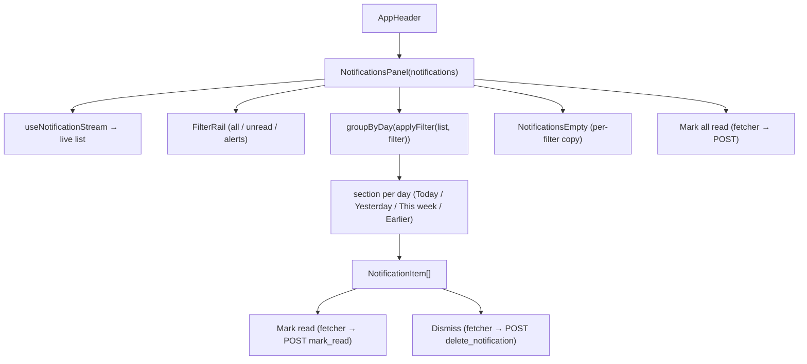
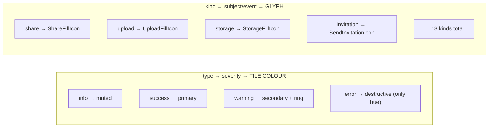

# Live Notifications (SSE)

Real-time notification feed for Stashly. A bell in the app header shows the
user's notifications and updates **live** — new notifications, read/unread
changes, mark-all, and dismissals all appear without a page refresh or a
route revalidation.

The transport is **Server-Sent Events (SSE)**, fed by a **Postgres
`LISTEN`/`NOTIFY`** trigger. Firing at the database level means _every_ writer
(app code, the seed script, raw SQL, other server instances) pushes live with
no extra plumbing.

- **Feature commit:** `feat(notifications): live SSE notification feed + panel`
- **Migration:** `prisma/migrations/20260724000000_notification_notify`

---

## Table of contents

1. [End-to-end flow](#end-to-end-flow)
2. [Prisma schema](#prisma-schema)
3. [Database trigger](#database-trigger)
4. [Server bridge (LISTEN → EventEmitter)](#server-bridge-listen--eventemitter)
5. [SSE route](#sse-route)
6. [Client hook](#client-hook)
7. [Actions](#actions)
8. [REST API](#rest-api)
9. [UI layer](#ui-layer)
10. [Two axes: type vs kind](#two-axes-type-vs-kind)
11. [Reliability & edge cases](#reliability--edge-cases)
12. [File map](#file-map)

---

## End-to-end flow

Any write to the `Notification` table is broadcast to every open browser tab of
the owning user.



### Sequence — creating a notification



### Seeding & first paint

The bell is **not** empty on first load. The `layout` loader fetches the first
page server-side, and the panel is seeded from it; the stream only carries
_changes_ afterward.



---

## Prisma schema

`prisma/models/notification.prisma`. Two orthogonal enums drive the UI (see
[type vs kind](#two-axes-type-vs-kind)).

```prisma
model Notification {
  id        String             @id
  message   String
  // `type` carries severity (tile colour); `kind` carries the subject/event
  // that drives the glyph (a share vs. an upload vs. a quota warning).
  type      NotificationType
  kind      NotificationKind   @default(system)
  status    NotificationStatus @default(unread)
  createdAt DateTime           @default(now())
  updatedAt DateTime           @default(now()) @updatedAt

  userId    String
  user      User               @relation(fields: [userId], references: [id], onDelete: Cascade)

  @@index([createdAt])
  @@index([type])
  @@index([kind])
  @@index([status])
  @@index([message(raw: "gin_trgm_ops")], type: SpGist)
}

enum NotificationType {   // severity → tile colour
  info
  warning
  error
  success
}

enum NotificationKind {   // subject/event → glyph
  system
  share
  upload
  file
  storage
  invitation
  member
  workspace
  collection
  favorite
  pin
  comment
  lock
}

enum NotificationStatus {
  read
  unread
}
```

> **Note:** `app/prisma/*` (`enums.ts`, `models/Notification.ts`,
> `commonInputTypes.ts`, `internal/*`) are the **generated** client — they are
> regenerated from the schema by `prisma generate`, not edited by hand. After a
> schema change, restart the dev server (cached-client issues have been
> observed).

---

## Database trigger

`prisma/migrations/20260724000000_notification_notify/migration.sql`. A single
`AFTER INSERT OR UPDATE OR DELETE` row trigger serializes the change and calls
`pg_notify`.



Key points:

- **Payload shape** distinguishes `created`/`updated` (full row via
  `row_to_json`) from `deleted` (just `userId` + `id`, since the row is gone).
- **8 KB cap** — `pg_notify` payloads are limited to 8000 bytes. Notification
  messages are short, so a serialized row stays well under.
- The trigger is idempotently (re)created: `DROP TRIGGER IF EXISTS ... CREATE`.

---

## Server bridge (LISTEN → EventEmitter)

`app/.server/notification-events.ts`. One dedicated Postgres connection does
`LISTEN notifications`; incoming payloads are re-emitted on an in-process
`EventEmitter` keyed by `userId`.



Design decisions:

- **Singleton, pinned to `globalThis`.** Dev HMR re-imports server modules;
  pinning the emitter and LISTEN client prevents stacking duplicate
  connections/listeners.
- **`setMaxListeners(0)`** — there is one listener per open SSE connection, so
  the default Node warning at 10 is disabled deliberately.
- **Self-healing.** `ensureListener()` is safe to call on every SSE request
  (only the first connects). On `end` (or a failed connect) the slot is cleared
  and a reconnect is scheduled after 1s; `error` events are logged (a fatal
  error is followed by `end`).

Public API:

| Export | Purpose |
| --- | --- |
| `notificationBus` | The per-user `EventEmitter` (event name === `userId`). |
| `subscribe(userId, handler)` | Attach a handler; returns an unsubscribe fn. |
| `ensureListener()` | Idempotently open the singleton `LISTEN` connection. |
| `NotificationEvent` | `{op:'created'\|'updated', userId, notification}` \| `{op:'deleted', userId, id}` |

---

## SSE route

`app/routes/api/notifications-stream.ts` — `GET /api/notifications/stream`.
A resource route that returns a `text/event-stream` via
`remix-utils/sse/server`'s `eventStream`.



Guarantees:

- **Auth per stream.** Cookie-based; every subscription is scoped to
  `session.user.id`, so no one can read another user's stream.
- **`safeSend` guard.** The underlying `ReadableStream` controller can close on
  client disconnect before cleanup runs; calling `send()` then throws
  `ERR_INVALID_STATE`. Every send is wrapped — the first throw triggers
  `cleanup()` instead of crashing the server with an uncaught exception.
- **Heartbeat.** A `ping` event every 25s keeps idle connections alive through
  proxies.
- **`X-Accel-Buffering: no`** header + the `server.js` compression carve-out
  (below) prevent buffering so frames flush immediately.

### Compression carve-out (`server.js`)

Express `compression` buffers responses, which would stall an SSE stream.
Compression runs in **production only** (dev skips it entirely — brotli on
Vite's hundreds of uncached module responses is CPU-heavy), and its filter
excludes `text/event-stream`:

```js
app.use(
  compression({
    filter: (req, res) => {
      const type = String(res.getHeader('Content-Type') || '')
      if (type.includes('text/event-stream')) return false
      return compression.filter(req, res)
    },
  })
)
```

---

## Client hook

`app/hooks/useNotificationStream.ts`. Seeded from the loader, then kept current
by a single native `EventSource` + a reducer.



Why native `EventSource` and not remix-utils' `useEventSource`:

> `useEventSource` retains only the **latest** event and would silently drop
> bursts — e.g. mark-all-read emits one `UPDATE` per row. Every event is
> dispatched into the reducer instead, so nothing is lost.

Reducer operations:

| Action | Effect |
| --- | --- |
| `reset` | Replace the whole list (used by reconcile). |
| `event: created/updated` | `upsert` — replace in place if the `id` exists (keeps order), else prepend (newest first). |
| `event: deleted` | Remove by `id`. |

**Gap recovery.** `EventSource` does not replay events missed while
disconnected. The hook calls `reconcile()` (a plain fetch of the canonical
list) on **reconnect** (2nd+ `open`) and whenever the **tab becomes visible**
again, then `reset`s the list.

---

## Actions

`app/.server/notification-actions.ts` — plain exported functions, direct Prisma
access, permission enforced inline (ownership checks throw `StashlyError`).

| Function | Description |
| --- | --- |
| `listNotifications({ userId, status?, type?, cursor?, limit=20 })` | Cursor-paginated list, `createdAt desc`. Returns `{ notifications, nextCursor, hasMore }`. |
| `searchNotifications(...)` | `searchFactory`-based filterable/paginated search. |
| `createNotification({ userId, message, type, kind=system })` | Insert one unread notification. The trigger pushes it live. |
| `markNotificationRead(id, userId)` | Set `status = read` (ownership-checked). |
| `markNotificationUnread(id, userId)` | Set `status = unread` (ownership-checked). |
| `markAllNotificationsRead(userId)` | `updateMany` all unread → read in one query. |
| `deleteNotification(id, userId)` | Delete one (ownership-checked). |

Every mutation flows through the same DB trigger, so the live feed reflects it
automatically — the actions contain **no** push logic themselves.

### Invitation fan-out

`app/.server/invitation-actions.ts` wires invitations to notifications
**best-effort, after the transaction commits** (using the shared `prisma`, not
the tx client) so a notification hiccup can never roll back the invitation.



- Recipients are matched by email to existing user accounts; invitees without
  an account get nothing (they'll see the pending invite on sign-up).
- Both helpers are wrapped in `try/catch` and only log on failure.

---

## REST API

`app/routes/api/notifications.ts` — request parsing via `parseSearchParams` /
`parseFormData`, schemas in `app/schemas/api.schemas.ts`.

### `GET /api/notifications` — list (also used for reconcile)

Query params (`notificationsLoaderInput`):

| Param | Type | Default |
| --- | --- | --- |
| `status` | `read \| unread` | — |
| `type` | `info \| warning \| error \| success` | — |
| `cursor` | string | — |
| `limit` | number (1–100) | 20 |

Returns `{ notifications, nextCursor, hasMore }`.

### `POST /api/notifications` — mutations

Discriminated union on `intent` (`notificationsApiRouteInput`):

| `intent` | Payload | Action | Response |
| --- | --- | --- | --- |
| `mark_read` | `notificationId` | `markNotificationRead` | `{ notification }` |
| `mark_unread` | `notificationId` | `markNotificationUnread` | `{ notification }` |
| `mark_all_read` | — | `markAllNotificationsRead` | `{ count }` |
| `delete_notification` | `notificationId` | `deleteNotification` | `{ success: true }` |
| `create_notification` | `message`, `type`, `kind?` | `createNotification` | `{ notification }` (201) |

### `GET /api/notifications/stream` — SSE

See [SSE route](#sse-route). Emits `notification` and `ping` events; `401` if
unauthenticated.

---

## UI layer

`app/components/core-components/notifications/`

| File | Role |
| --- | --- |
| `notifications-panel.tsx` | Header bell (`Popover`), header actions, filter rail, grouped list, empty states. |
| `notification-item.tsx` | A single notification row (glyph, message, meta, per-row actions). |
| `notification-model.ts` | Client-side `Notification` type + presentation helpers (icon/label/tile maps, filtering, day-grouping, relative time). |



Behaviour:

- **Optimistic updates.** Mark-all clears every unread the instant the form is
  submitted; a dismissed row returns `null` immediately; mark-read flips the
  row before the loader/stream confirms.
- **Day grouping** is derived (`groupByDay`) — empty buckets never render.
  Order: Today → Yesterday → This week → Earlier.
- **Filters:** `all`, `unread`, `alerts` (warning/error). Each empty state has
  filter-specific copy.
- **Polish** (`make-interfaces-feel-better`): staggered spring enter on popover
  open, `layout` reflow when a row is dismissed, bell icon cross-fade
  (scale/opacity/blur, `initial={false}`), `active:scale-[0.96]` on controls,
  `tabular-nums` on relative time, `text-pretty` on messages.

---

## Two axes: type vs kind

Two orthogonal fields drive the row's appearance. Stashly's palette is
greyscale ("the signal is contrast, not hue"), so **`error` is the single
chromatic exception**.



| Axis | Field | Owns | Source |
| --- | --- | --- | --- |
| Severity | `type` | Tile background colour + `typeLabel` | `TYPE_TILE`, `TYPE_LABEL` in `notification-model.ts` |
| Subject | `kind` | The glyph icon | `KIND_ICON` in `notification-model.ts` |

`isAlert(type)` (`warning`/`error`) backs the **Alerts** filter.

---

## Reliability & edge cases

| Concern | Handling |
| --- | --- |
| Server crash on client disconnect | `safeSend` guards every write; first throw runs `cleanup()`. |
| Duplicate connections under HMR | Emitter + LISTEN client pinned to `globalThis`. |
| Dropped `LISTEN` connection | `ensureListener()` self-heals on `end`/failed connect (reconnect after 1s). |
| Events missed while disconnected | `reconcile()` on reconnect + tab-visible → full `reset`. |
| Bursts (mark-all) collapsed | Native `EventSource` + reducer processes every event (not `useEventSource`). |
| Idle proxy timeouts | 25s `ping` heartbeat + `X-Accel-Buffering: no`. |
| SSE stalled by gzip | `compression` filter excludes `text/event-stream`. |
| Cross-user leakage | Stream subscription + all mutations scoped to `session.user.id`. |
| Layout loader cost on every nav | `shouldRevalidate = false`; bell stays live via SSE, not revalidation. |

### Known gap

The rendered header bell shows only the full/empty glyph — **no numeric unread
badge**. The badge markup exists in the unused `NotificationBell` helper in
`notifications-panel.tsx` but the live trigger is inlined without it. Wiring the
count into the live trigger is a follow-up.

---

## Operations: metrics & connection pooling

Under a synchronized burst (see the earlier load analysis), the walls the system
hits are — in order — the **DB connection pool**, the **single `LISTEN` funnel
saturating the event loop**, and **`pg_notify` queue contention**. The row
writes themselves are a non-event. Two operational pieces address the first two.

### Metrics (`GET /api/metrics`)

Dependency-free Prometheus text exposition (`app/.server/metrics.ts`),
scrapeable by Fly.io's managed Prometheus. Guarded by `METRICS_TOKEN` when set;
otherwise served only outside production.

| Metric | Type | Why it matters |
| --- | --- | --- |
| `stashly_db_pool_waiting` | gauge | **Leading saturation signal** — requests queued for a DB connection. Climbs before you see errors. |
| `stashly_db_pool_total` / `_idle` | gauge | Pool occupancy. |
| `stashly_eventloop_lag_seconds_{mean,p99,max}` | gauge | The single-funnel ceiling — LISTEN processing and request handling share one loop. |
| `stashly_notify_events_total` | counter | NOTIFY throughput through the LISTEN bridge. |
| `stashly_sse_connections` | gauge | Open EventSource streams (each holds a heartbeat timer). |
| `stashly_sse_connections_opened_total` | counter | Cumulative stream opens — churn vs. the steady-state gauge above. |
| `stashly_mark_all_read_total` | counter | The burst trigger itself. |
| `stashly_db_pool_errors_total` | counter | pg pool errors. |

To scrape via Fly's managed Prometheus, add to the app's `fly.toml`:

```toml
[metrics]
  port = 80
  path = "/api/metrics"
```

### Connection pooling (PgBouncer)

`deploy/pgbouncer/` is a standalone Fly app that fronts Postgres with
**transaction pooling**, removing the pool-exhaustion cliff. The app uses two
URLs — `DATABASE_URL` (→ PgBouncer, all normal queries) and
`DIRECT_DATABASE_URL` (→ Postgres, for the session-pinned `LISTEN` client and
migrations, which cannot run through transaction pooling). The code prefers the
direct URL and falls back to `DATABASE_URL` when unset, so local dev is
unaffected. Setup: [`deploy/pgbouncer/README.md`](../deploy/pgbouncer/README.md).

### Scaling limits & when to escalate

| Limit | Mitigation in place | Escalate when |
| --- | --- | --- |
| DB pool exhaustion | PgBouncer transaction pooling | — (solved) |
| Single `LISTEN` funnel saturates the event loop | metrics visibility | `eventloop_lag_seconds_p99` stays high during bursts → move fan-out to a sharded broker (Redis/NATS) and/or isolate the SSE process |
| `pg_notify` fan-out (N events per bulk op) | cheap per-row events + idempotent client reducer | funnel lag persists → emit one `{op:'bulk_read', userId}` for bulk ops instead of per-row |
| Every instance processes every NOTIFY | acceptable at current scale | many instances → shard by `userId` off `pg_notify` |

Deliberately **not** built yet (YAGNI): the broker migration and SSE-process
isolation. The metrics above are the trigger to revisit — instrument first,
escalate on signal.

---

## File map

| Path | Layer |
| --- | --- |
| `prisma/models/notification.prisma` | Schema (model + enums) |
| `prisma/migrations/20260724000000_notification_notify/migration.sql` | `NOTIFY` trigger |
| `app/.server/notification-events.ts` | LISTEN bridge + `EventEmitter` bus |
| `app/routes/api/notifications-stream.ts` | SSE route (`GET /stream`) |
| `app/routes/api/notifications.ts` | REST list + mutations |
| `app/.server/notification-actions.ts` | Business logic (Prisma) |
| `app/.server/invitation-actions.ts` | Invitation → notification fan-out |
| `app/schemas/api.schemas.ts` | Zod: loader input + `intent` union |
| `app/hooks/useNotificationStream.ts` | Client `EventSource` + reducer |
| `app/routes/layout.tsx` | Seeds initial list; `shouldRevalidate = false` |
| `app/components/app-header.tsx` | Mounts `NotificationsPanel` |
| `app/components/core-components/notifications/*` | Panel, row, model/helpers |
| `app/components/states/generic-empty-state.tsx` | Empty state (gained `className`) |
| `server.js` | Compression carve-out for SSE |
| `app/.server/metrics.ts` | Dependency-free Prometheus registry |
| `app/routes/api/metrics.ts` | `GET /api/metrics` scrape endpoint |
| `app/.server/db.ts` | Owns the `pg.Pool` (exposes saturation gauges) |
| `deploy/pgbouncer/*` | PgBouncer Fly app (transaction pooling) |
