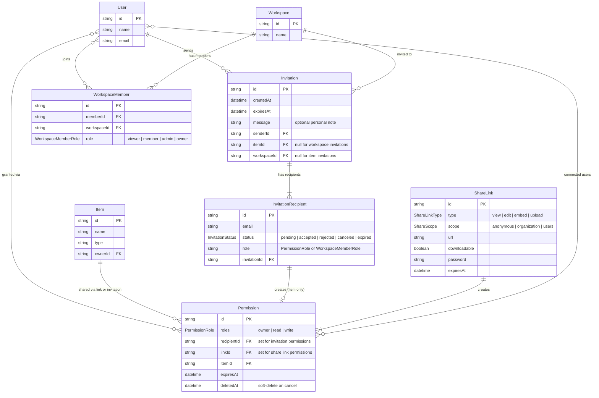

# Sharing & Invitations

This document covers the two mechanisms by which users can grant others access to their items: **Share Links** (URL-based, anonymous or scoped) and **Invitations** (email-based, direct access grants).

---

## Table of Contents

1. [Concepts](#1-concepts)
2. [Share Links](#2-share-links)
   - [Link Types](#link-types)
   - [Scopes](#scopes)
   - [Creating Links](#creating-links)
   - [Managing Links](#managing-links)
   - [Revoking Links](#revoking-links)
   - [Share Link Flows](#share-link-flows)
3. [Invitations](#3-invitations)
   - [Multi-Recipient Model](#multi-recipient-model)
   - [Invitation Types](#invitation-types)
   - [Sending Invitations](#sending-invitations)
   - [Recipient Lifecycle](#recipient-lifecycle)
   - [Invitation Flows](#invitation-flows)
4. [Data Model](#4-data-model)
5. [API Reference](#5-api-reference)

---

## 1. Concepts

Both mechanisms use the `Permission` model as the common access record:

```
ShareLink ──────┐
                ├── Permission ──── Item
Invitation ─────┘         │
                          └──── User[]  (connected on accept/use)
```

- A **ShareLink** creates a Permission at link-creation time. Users are connected to it when they use the link (or when the owner adds them via `scope: 'users'`).
- An **Invitation** creates a Permission at send time, but the user is only connected when they **accept**. Until then the Permission exists but grants no access.
- **Workspace invitations** are the exception — they do not create a Permission at all. On accept they create a `WorkspaceMember` record instead.

---

## 2. Share Links

### Link Types

| Type     | What it allows                                                                                        | Default permission role |
| -------- | ----------------------------------------------------------------------------------------------------- | ----------------------- |
| `view`   | Read-only access. Optionally downloadable.                                                            | `read`                  |
| `edit`   | Read + write content (upload files, update file content). Cannot modify item settings or permissions. | `write`                 |
| `embed`  | Embed the item in an external page. Always anonymous, never downloadable.                             | `read`                  |
| `upload` | Folder drop zone — anyone can add files but cannot view contents.                                     | `write`                 |

### Scopes

| Scope          | Who can use the link                                   |
| -------------- | ------------------------------------------------------ |
| `anonymous`    | Anyone with the URL, no login required                 |
| `organization` | Any workspace member (login required)                  |
| `users`        | Only specific users explicitly added to the Permission |

### Creating Links

All creation is handled in `app/.server/share-actions.ts` and exposed via `POST /api/shares`.

| Intent               | Function                                    | Notes                     |
| -------------------- | ------------------------------------------- | ------------------------- |
| `create_view_link`   | `createViewLink(itemId, scope, options?)`   | `downloadable` optional   |
| `create_edit_link`   | `createEditLink(itemId, scope, options?)`   |                           |
| `create_embed_link`  | `createEmbedLink(itemId, options?)`         | scope always `anonymous`  |
| `create_upload_link` | `createUploadLink(itemId, scope, options?)` | folder-only by convention |

All creators call `createShareLinkForItem` which runs in a `$transaction` — the `ShareLink` and its `Permission` are always created atomically.

Optional properties available on all link types:

```ts
type ShareLinkOptions = {
  url?: string // public URL (e.g. /s/abc123)
  downloadable?: boolean
  password?: string // password-protect the link
  expiresAt?: Date // auto-expire after this date
}
```

### Managing Links

| Intent                     | Function                                                | What it changes                                                                                         |
| -------------------------- | ------------------------------------------------------- | ------------------------------------------------------------------------------------------------------- |
| `update_link_scope`        | `updateShareLinkScope(linkId, scope)`                   | Restricts/expands who can use the URL                                                                   |
| `update_link_type`         | `updateShareLinkType(linkId, type)`                     | Downgrades edit→view or upgrades. Atomically syncs Permission role: view/embed→read, edit/upload→write. |
| `expire_link`              | `expireShareLink(linkId, expiresAt)`                    | Sets a future expiry                                                                                    |
| `remove_link_expiry`       | `updateShareLink({ where, data: { expiresAt: null } })` | Removes the expiry                                                                                      |
| `update_link_downloadable` | `updateShareLink(...)`                                  | Toggles download permission                                                                             |
| `update_link_password`     | `updateShareLink(...)`                                  | Sets, changes, or clears the link password (omit `password` to clear)                                   |

### Revoking Links

| Intent             | Function                             | What it does                                                              |
| ------------------ | ------------------------------------ | ------------------------------------------------------------------------- |
| `revoke_link`      | `revokeShareLink(linkId)`            | Deletes the link and all its Permission records in a `$transaction`       |
| `revoke_all_links` | `revokeAllShareLinksForItem(itemId)` | Finds all links for the item, bulk-deletes permissions + links atomically |

---

### Share Link Flows

#### Flow A — Create a public view link

```
Owner
  │
  ├─ POST /api/shares { intent: 'create_view_link', itemId, scope: 'anonymous' }
  │    → createShareLinkForItem (transaction)
  │         ├─ ShareLink { type: 'view', scope: 'anonymous' }
  │         └─ Permission { roles: 'read', itemId, linkId }
  │
  └─ Any user with the URL can view the item (no login required)
       └─ URL: /s/<link-id>  — built client-side by `buildShareUrl` in
          share-dialog.tsx and copied to the clipboard (falls back to
          `ShareLink.url` when the record carries one).
          ⚠ No route currently serves `/s/:linkId` — the link is issued
            and stored, but consuming it is not wired up yet.
```

#### Flow B — Create a users-scoped edit link (invite specific people)

```
Owner
  │
  ├─ POST /api/shares { intent: 'create_edit_link', itemId, scope: 'users' }
  │    → ShareLink { type: 'edit', scope: 'users' }
  │    → Permission { roles: 'write', itemId, linkId, users: [] }
  │
  ├─ Owner adds specific users to the permission:
  │    addUserToShareLink(linkId, userId)
  │         → Permission.users.connect(userId)
  │    ⚠ Server-side helper only — no `/api/shares` intent exposes it yet.
  │      The share dialog grants per-user access through
  │      POST /api/permissions { intent: 'grant_permission', userId, itemId, role }
  │      instead.
  │
  └─ Only those connected users can use the link
```

#### Flow C — Change scope from public to organization

```
Owner
  │
  ├─ POST /api/shares { intent: 'update_link_scope', linkId, scope: 'organization' }
  │    → ShareLink.scope = 'organization'
  │
  └─ Link now requires the user to be a workspace member
       └─ Previously anonymous uses are no longer valid
```

#### Flow D — Downgrade edit link to view

```
Owner
  │
  ├─ POST /api/shares { intent: 'update_link_type', linkId, type: 'view' }
  │    → $transaction:
  │         ├─ ShareLink.type   = 'view'
  │         └─ Permission.roles = 'read'   ← synced atomically
  │
  └─ type and permission role are always kept in step:
       view | embed  →  roles: read
       edit | upload →  roles: write
```

#### Flow E — Set expiry on a link

```
Owner
  │
  ├─ POST /api/shares { intent: 'expire_link', linkId, expiresAt: '2026-05-01' }
  │    → ShareLink.expiresAt = 2026-05-01
  │
  └─ After expiry:
       findActiveShareLink(id) returns null
       isShareLinkActive(id) returns false
       (both live in share-actions.ts — no public share route consumes
        them yet, so expiry is currently enforced only where a caller
        checks it)
```

#### Flow F — Revoke a single link

```
Owner
  │
  ├─ POST /api/shares { intent: 'revoke_link', linkId }
  │    → $transaction:
  │         ├─ permission.deleteMany({ where: { linkId } })
  │         └─ shareLink.delete({ where: { id: linkId } })
  │
  └─ Link URL is now dead. Anyone who bookmarked it gets 404/403.
```

#### Flow G — Revoke all links (on item delete or full lockdown)

```
Owner
  │
  ├─ POST /api/shares { intent: 'revoke_all_links', itemId }
  │    → $transaction:
  │         ├─ findShareLinksForItem(itemId)  → linkIds
  │         ├─ permission.deleteMany({ where: { linkId: { in: linkIds } } })
  │         └─ shareLink.deleteMany({ where: { id: { in: linkIds } } })
  │
  └─ All share URLs for the item are dead
```

#### Flow H — Embed link (public, no download)

```
Owner
  │
  ├─ POST /api/shares { intent: 'create_embed_link', itemId }
  │    → ShareLink { type: 'embed', scope: 'anonymous', downloadable: false }
  │    → Permission { roles: 'read' }
  │
  └─ Embed snippet:  <iframe src="/s/<linkId>" />
       Scope is always anonymous — embed links cannot be scoped to org/users.
       downloadable is forced false at creation (createEmbedLink omits it
       from its options type); `update_link_downloadable` can still flip it
       on any link afterwards.
```

---

## 3. Invitations

### Multi-Recipient Model

Invitations support **batch sending** — one invitation can include multiple recipients, each with their own role and independent lifecycle status. This is implemented via a dedicated `InvitationRecipient` model.

### Invitation Types

| Type                 | What it grants                        | Permission created?                                     | Member record created?             |
| -------------------- | ------------------------------------- | ------------------------------------------------------- | ---------------------------------- |
| Item invitation      | Access to a specific item             | Yes, one per recipient (on send, inactive until accept) | No                                 |
| Workspace invitation | Membership in a workspace with a role | No                                                      | Yes, one per recipient (on accept) |

### Sending Invitations

Both types are handled in `app/.server/invitation-actions.ts` and exposed via `POST /api/invitations`.

**Item invitation guards:**

- Sender must be the item owner or have `write` permission on the item
- No existing `pending` recipient for the same `email + itemId` across any invitation

**Workspace invitation guards:**

- Sender must be a workspace `admin` or `owner`
- No email is already a workspace member
- No existing `pending` recipient for the same `email + workspaceId` across any invitation

Both senders may attach an optional `message` — a personal note stored on the `Invitation` and surfaced in the invitation detail panel.

**Notification fan-out** runs *after* the invitation transaction commits, using the shared `prisma` client so a notification failure can never roll back the invitation. `notifyInvitationSent` creates a `kind: 'invitation'` Notification for every recipient email that maps to an existing user (invitees without an account see the invitation once they sign up); `notifyInvitationAccepted` notifies the sender (`kind: 'member'` for workspaces, `'invitation'` for items). Inserting the row pushes it live via the DB `NOTIFY` → SSE stream — see `docs/notifications-sse.md`.

### Recipient Lifecycle

```
pending ──accept──→ accepted   (connects user to Permission / creates WorkspaceMember)
        ──reject──→ rejected
        ──cancel──→ canceled   (sender cancels; soft-deletes the Permission)
        ──expire──→ expired    (checked on accept when invitation.expiresAt < now)

accepted ─┐
rejected ─┴─undo──→ pending    (recipient reverses their own response)
```

`accepted` and `rejected` are **not** terminal: the recipient can call `undo_invitation_response` to return the entry to `pending`. Undoing an acceptance also revokes what it granted — the user is disconnected from the item Permission, or their `WorkspaceMember` row is deleted. Undo is refused once the invitation has expired. `canceled` and `expired` are terminal.

The sender can cancel one pending recipient with `cancel_recipient`, or all pending recipients in a batch with `cancel_invitation` (which throws `GONE` if none are pending).

### Invitation Flows

#### Flow I — Item invitation: multi-recipient, accepted

```
Sender (owner or write-access user)
  │
  ├─ POST /api/invitations
  │    { intent: 'send_item_invitation', itemId,
  │      recipients: [
  │        { email: 'alice@example.com', role: 'read' },
  │        { email: 'bob@example.com', role: 'write' }
  │      ] }
  │         → Invitation { senderId, itemId }
  │         → InvitationRecipient × 2 { email, role, status: 'pending' }
  │         → Permission × 2 { roles, recipientId, itemId, users: [] }
  │              ⚠ Permissions exist but users[] is empty → no access yet
  │
Alice (logs in, email matches)
  │
  ├─ sees invitation at /:me/stash/invitations → Received tab
  │
  ├─ POST /api/invitations { intent: 'accept_invitation', recipientId }
  │         → verifies session.user.email === recipient.email
  │         → $transaction:
  │              ├─ permission.update({ users: { connect: { id: userId } } })
  │              └─ recipient.update({ status: 'accepted' })
  │
  └─ item now appears in Alice's shared-with-me view
       Bob's recipient is still pending (independent lifecycle)
```

#### Flow J — Item invitation: declined

```
Recipient
  │
  ├─ POST /api/invitations { intent: 'reject_invitation', recipientId }
  │         → verifies email match
  │         → InvitationRecipient.status = 'rejected'
  │
  └─ Permission record remains in DB with users: []
       → never grants access (no user connected)
       → sender sees status: 'rejected' in InviteDialog sent tab
```

#### Flow K — Item invitation: sender cancels all

```
Sender
  │
  ├─ POST /api/invitations { intent: 'cancel_invitation', invitationId }
  │         → verifies senderId matches
  │         → for each pending recipient:
  │              $transaction:
  ���                ├─ permission.update({ deletedAt: now() })  ← soft-delete
  │                └─ recipient.update({ status: 'canceled' })
  │
  └─ All pending recipients are canceled. Already accepted/rejected
       recipients are not affected. If no recipient is pending, the whole
       call throws GONE (410).

To cancel one person instead of the whole batch:
  POST { intent: 'cancel_recipient', recipientId }
       → same sender check, same soft-delete + status: 'canceled',
         scoped to a single InvitationRecipient.
```

#### Flow L — Item invitation: expired

```
Sender sets expiresAt when creating:
  POST { intent: 'send_item_invitation', ..., expiresAt: '2026-04-15' }

Recipient tries to accept after expiry:
  │
  ├─ POST { intent: 'accept_invitation', recipientId }
  │         → acceptInvitation checks: invitation.expiresAt < new Date()
  │         → marks InvitationRecipient.status = 'expired'
  │         → throws GONE (410)
  │
  └─ Access denied. Sender must create a new invitation.
```

#### Flow M — Workspace invitation: multi-recipient, accepted

```
Workspace admin/owner
  │
  ├─ POST /api/invitations
  │    { intent: 'send_workspace_invitation', workspaceId,
  │      recipients: [
  │        { email: 'alice@example.com', role: 'member' },
  │        { email: 'bob@example.com', role: 'admin' }
  │      ] }
  │         → Invitation { senderId, workspaceId }
  │         → InvitationRecipient × 2 { email, role, status: 'pending' }
  │              ⚠ No Permission records — workspace uses WorkspaceMember not Permission
  │
Recipient
  │
  ├─ POST { intent: 'accept_invitation', recipientId }
  │         → $transaction:
  │              ├─ workspaceMember.create({ memberId: userId, workspaceId, role })
  │              └─ recipient.update({ status: 'accepted' })
  │
  └─ user is now a workspace member; can access workspace items per their role
```

#### Flow N — Duplicate invite prevention

```
Sender tries to invite the same email to the same item twice:
  │
  ├─ First invite: created with alice@example.com, status: pending
  │
  ├─ Second invite includes alice@example.com (pending recipient exists):
  │    → CONFLICT (409): 'A pending invitation for alice@example.com already exists'
  │
  └─ Must cancel or wait for first to resolve before sending a new one.
       Other emails in the batch are also rejected (atomic operation).
```

#### Flow O — Recipient undoes their own response

```
Recipient (already accepted or rejected)
  │
  ├─ POST /api/invitations { intent: 'undo_invitation_response', recipientId }
  │         → verifies email match
  │         → refuses if status is pending/canceled/expired  → GONE (410)
  │         → refuses if invitation.expiresAt < now          → GONE (410)
  │         → $transaction (only if status was 'accepted'):
  │              ├─ item:      permission.update({ users: { disconnect } })
  │              ├─ workspace: workspaceMember.deleteMany({ workspaceId, memberId })
  │              └─ recipient.update({ status: 'pending' })
  │
  └─ Access granted by the acceptance is revoked; the invitation is
       actionable again from the Received tab.
```

---

## 4. Data Model

```
Invitation (batch envelope)
  ├─ id, createdAt, expiresAt
  ├─ message?      (optional personal note shown in the detail panel)
  ├─ senderId → User
  ├─ itemId? → Item            (for item invitations)
  ├─ workspaceId? → Workspace  (for workspace invitations)
  └─ recipients[] → InvitationRecipient[]

InvitationRecipient (per-person)
  ├─ id, createdAt
  ├─ email         (recipient's email address)
  ├─ status        (pending | accepted | rejected | canceled | expired)
  ├─ role          (string: PermissionRole for items, WorkspaceMemberRole for workspaces)
  ├─ invitationId → Invitation
  └─ permission?   (present for item invitations; absent for workspace invitations)
       └─ Permission
            ├─ id, roles, recipientId, itemId
            ├─ users[]    (empty until accepted)
            ├─ expiresAt  (mirrors the invitation's expiresAt)
            └─ deletedAt  (set when invitation is canceled)

ShareLink
  ├─ id, type, scope, url, downloadable, password, expiresAt
  └─ permission[]
       └─ Permission
            ├─ id, roles, linkId, itemId
            └─ users[]   (for scope: 'users' — specific people granted access)
```

### Entity Relationship Diagram

The following Mermaid diagram illustrates the relationships between users, items, workspaces, invitations, share links, and permissions in the Stashly sharing and invitation system:




## 5. API Reference

### `GET /api/shares?itemId=<id>`

Returns all share links for an item with their permission details.

**Auth:** Must be item owner or have `write` permission.

**Response:**

```json
{ "links": [ ShareLink & { permission: Permission & { users: User[] } } ] }
```

---

### `POST /api/shares`

| Intent                     | Required fields          | Optional fields                         |
| -------------------------- | ------------------------ | --------------------------------------- |
| `create_view_link`         | `itemId`, `scope`        | `downloadable`, `password`, `expiresAt` |
| `create_edit_link`         | `itemId`, `scope`        | `password`, `expiresAt`                 |
| `create_embed_link`        | `itemId`                 | `password`, `expiresAt`                 |
| `create_upload_link`       | `itemId`, `scope`        | `password`, `expiresAt`                 |
| `update_link_scope`        | `linkId`, `scope`        |                                         |
| `update_link_type`         | `linkId`, `type`         |                                         |
| `expire_link`              | `linkId`, `expiresAt`    |                                         |
| `remove_link_expiry`       | `linkId`                 |                                         |
| `update_link_downloadable` | `linkId`, `downloadable` |                                         |
| `update_link_password`     | `linkId`                 | `password` (omit to clear)              |
| `revoke_link`              | `linkId`                 |                                         |
| `revoke_all_links`         | `itemId`                 |                                         |

---

### `GET /api/invitations?type=sent|received[&itemId=<id>]`

Returns invitations with nested `recipients[]`. `type` defaults to `received` — every invitation with a recipient matching the user's email whose status is not `canceled`, so the view can show resolved (accepted/rejected) history and offer undo, not just pending ones. `itemId` overrides `type` and returns all invitations for that item regardless of status.

Every finder returns the **enriched** `InvitationWithDetails` shape, not the raw row: the sender's `title`, the invitation `message`, single-item meta (`mimeType` / `fileCount` / `thumbnailUrl`), workspace roll-ups (`size` / `fileCount` / `memberCount`), and a `previews[]` array of thumbnail-backed children that render through the standard `ItemCard`.

**Response:**

```json
{ "invitations": [ Invitation & { sender, recipients: InvitationRecipient[], previews: [], item?, workspace? } ] }
```

---

### `POST /api/invitations`

| Intent                      | Required fields                              | Optional fields          | Who can call                                 |
| --------------------------- | -------------------------------------------- | ------------------------ | -------------------------------------------- |
| `send_item_invitation`      | `itemId`, `recipients: [{email, role}]`      | `expiresAt`, `message`   | Item owner or write-access user              |
| `send_workspace_invitation` | `workspaceId`, `recipients: [{email, role}]` | `expiresAt`, `message`   | Workspace admin/owner                        |
| `accept_invitation`         | `recipientId`                                |                          | Recipient (email must match)                 |
| `reject_invitation`         | `recipientId`                                |                          | Recipient (email must match)                 |
| `undo_invitation_response`  | `recipientId`                                |                          | Recipient (email must match), accepted/rejected only |
| `cancel_recipient`          | `recipientId`                                |                          | Sender only (cancels one pending recipient)  |
| `cancel_invitation`         | `invitationId`                               |                          | Sender only (cancels all pending recipients) |
