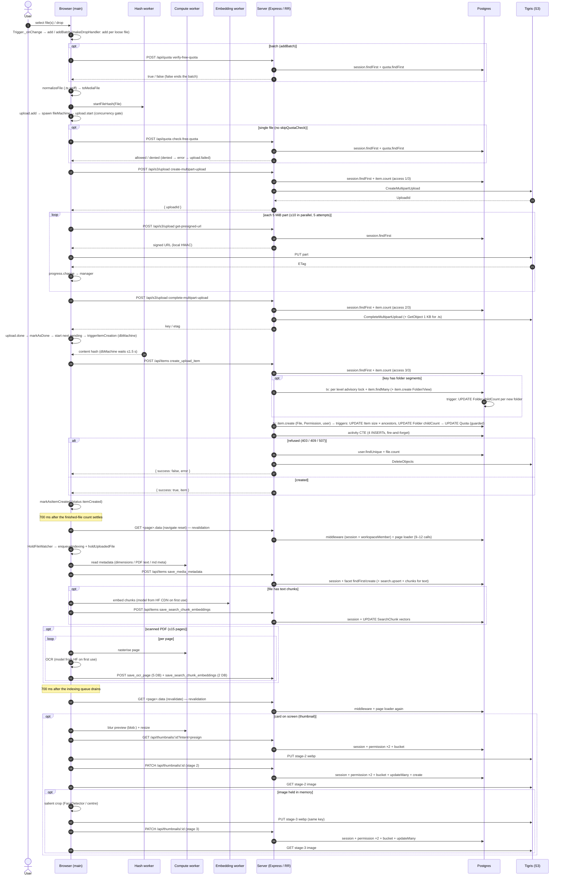

# Upload call audit: every DB and network call for one uploaded file

*2026-10-10. This audit traces the code from the moment a file is selected until it is fully processed. It also includes one measured upload in the browser. The line links point at the working tree, which has uncommitted changes to `file.machine.ts`, `quota-actions.ts` and `item-actions.ts` from the quota fix.*

**How to read the numbers**
- **Traced** means the count was read from the code by following every call. A traced count is exact for the code path, but it was not observed running.
- **Measured** means it was observed in one real upload in Chrome (an 8.46 MB JPEG uploaded into the root folder from `/:me/stash`), together with the Postgres activity counters for the same window.
- **"Prisma call"** means one call on the Prisma client. A nested create can send several SQL statements; how many was not counted (see [Not verified](#not-verified)).
- **"Session lookup"** means `auth.api.getSession`, which costs 1 Prisma call (`session.findFirst` joined to the user). `cookieCache` is not configured ([auth.ts:44-165](../app/.server/auth.ts#L44)), so **every request to our server does one**, including revalidations.

**Constants that drive the counts**

| Constant | Value | Where |
|---|---|---|
| Part size | 5 MiB (`CHUNK_SIZE`) | [s3.multipart.stream.ts:7](../app/machines/multipart/s3.multipart.stream.ts#L7) |
| Parts per file, **P** | ceil(size / 5 MiB). 10 MB gives 2 | |
| Parts in flight per file | 10 | [s3.multipart.stream.ts:8](../app/machines/multipart/s3.multipart.stream.ts#L8) |
| Files in flight | 10 in the machine's initial context, 100 by the schema default; which one applies was not verified | [upload.machine.ts:31](../app/machines/upload/upload.machine.ts#L31), [machine.schemas.ts:298](../app/schemas/machine.schemas.ts#L298) |
| Part retries | 5 attempts. Presign backoff starts at 2.5 s and grows ×3; part PUT starts at 2.5 s and grows ×2. **Every** non-OK status is retried, 4xx included | [s3.multipart.stream.ts:10-49](../app/machines/multipart/s3.multipart.stream.ts#L10) |
| Server S3 SDK retries | 3 attempts (SDK default, not overridden) | [s3.ts](../app/.server/s3.ts) |
| Indexing / thumbnail retries | 2 more attempts, 800 ms apart | [indexing-item.machine.ts:40](../app/machines/indexing/indexing-item.machine.ts#L40), [thumbnail-item.machine.ts:41](../app/machines/thumbnail/thumbnail-item.machine.ts#L41) |
| Revalidation debounce | 700 ms of quiet | [upload-thumbnail-runner.tsx:122-132](../app/components/upload/upload-thumbnail-runner.tsx#L122), [hooks.ts:53-60](../app/machines/indexing/hooks.ts#L53) |

---

## 1. Headline numbers

### One 10 MB JPEG uploaded alone into the root folder

| | Traced | Measured (8.46 MB JPEG, card off screen) |
|---|---|---|
| Browser requests to our server | 12 with the thumbnail, 8 without | **8**: quota, create, 2 presign, complete, item, metadata (7), plus 2 revalidations, less the thumbnail requests, since the card was off screen |
| Browser requests to Tigris (S3) | 6 with the thumbnail (2 part PUTs, 2 thumbnail PUTs, 2 thumbnail image GETs), 2 without | **2** part PUTs |
| **Browser requests in total** | **18**, or **10** off screen | **10** caused by the upload. A further `GET /api/items?intent=pending_search_embeddings` was the per-tab embedding backfill, not caused by the upload |
| Server → S3 calls | 2 (CreateMultipartUpload, CompleteMultipartUpload) | not measured server-side |
| Prisma calls | 31 per file + 22 to 28 per batch (2 revalidations × 11 to 14, depending on the page), so **53 to 59**. Off screen: 16 + 28 = **44** on `/stash` | **62 transactions committed** in a window of about 2.5 minutes, against an idle rate of 6 per minute. That is roughly 45 to 50 attributable, **consistent with the traced 44, not a precise match** |
| Rows written | 9 INSERTs + 3 UPDATEs (2 from triggers + the Quota charge) | **9 inserted, 3 updated**: an exact match (Item, File, Permission, `_PermissionToUser`, Image, ActivityTime, Activity, UploadAction, ItemAction; UPDATEs on the root Item size, root Folder childCount and Quota) |
| Rows read | — | **61,568 tuples returned and 33,068 fetched**, with about **3,700 index or sequential scans on each** of Favorite, LockedItem, Folder, File and Thumbnail, 3,294 on Item, 2,475 on ActivityTime and 1,930 on PinItem. These are almost certainly the two `/stash` page revalidations, but that was **not isolated**: the request I sent to isolate them hung (see [Not verified](#not-verified)) |
| Web Workers started | hash, compute (and embedding, for text files only) | **2**: `hash.worker`, `thumbnail.compute.worker` |
| Time from select to done | — | **about 16.5 s**: the item row was created at +4.5 s and the second revalidation finished at +16.5 s |

**Measured request timeline**, in ms from file select; the number after `+` is the request's duration:

```
    57 +484   POST /api/quota            check-free-quota
   553 +780   POST /api/s3/upload        create-multipart-upload
  1350 +365   POST /api/s3/upload        get-presigned-url   (part 1)
  1365 +1378  POST /api/s3/upload        get-presigned-url   (part 2)
  1720 +1412  PUT  tigris                part 1 (5 MiB)
  2745 +913   PUT  tigris                part 2
  3719 +725   POST /api/s3/upload        complete-multipart-upload
  4548 +2093  POST /api/items            create_upload_item
  5484 +1789  GET  /:me/stash.data       revalidation #1 (33.6 KB)
 13631 +598   POST /api/items            save_media_metadata   (9 s after the row: indexing queue + compute worker)
 15466 +1021  GET  /:me/stash.data       revalidation #2 (33.6 KB)
```

### One 10 MB file inside a 100,000-file folder upload, 3 levels deep

The batch is checked once up front, so every file skips the per-file quota check.

| Per file | Browser requests | Server → S3 | Prisma calls | Trigger UPDATEs | Session lookups |
|---|---|---|---|---|---|
| Upload core (create, 2 presign, 2 PUT, complete, item) | 7 | 2 | 17 (create 2, parts 2, complete 2, item 11) | 5 (4 ancestor sizes + parent childCount) | 5 |
| Metadata | 1 | 0 | 3 | 0 | 1 |
| Thumbnail (only if its card is on screen) | 0 normally | 0 | 0 normally (15 if on screen) | 0 | 0 |
| **Per file** | **8** | **2** | **20** | **5** | **6** |
| **× 100,000** | **800,000** | **200,000** | **2,000,000** | **500,000** | **600,000** |
| Per batch | 1 quota POST + R₁ + R₂ revalidations, each 11 to 14 Prisma calls. R₁ and R₂ are counts of 700 ms quiet gaps, not determinable statically | | | | |

Each file in the folder upload also runs **2 interactive transactions** and **3 advisory locks** (one per path level), and holds row locks on 4 ancestor `Item` rows, the parent `Folder` row and the user's `Quota` row until it commits. With 10 files in flight, all 10 queue on the same `Quota` row and the same ancestor rows.

---

## 2. Full call table

Columns:
- **Type:** DB is a Prisma or SQL call; FETCH is a browser request; S3 is a server-side AWS SDK call; TRIG is work done by a Postgres trigger.
- **Count:** per file unless it says per batch.
- **Source:** the invoking function and its line.

### 2.1 Select and queue (browser only)

| # | Type | Count | Description | Source | Destination |
|---|---|---|---|---|---|
| 1 | — | 0 | Input `change` → `add` for one file, `addBatch` for several. A drop goes through `makeDropHandler`, which calls `add` **per file** unless a folder was dropped | [index.tsx:242](../app/components/upload/index.tsx#L242), [useUpload.ts:411](../app/hooks/useUpload.ts#L411), [useUpload.ts:439-443](../app/hooks/useUpload.ts#L439) | — |
| 2 | — | 0 | `normalizeFile`: local 1 KB sniff for `.ts` files | [sniff.ts:72](../app/utils/sniff.ts#L72) | — |
| 3 | — | 0 network, 1 worker | `startFileHash`: the `File` is posted to `hash.worker` | [useUpload.ts:343](../app/hooks/useUpload.ts#L343), [file-hash.ts:26](../app/utils/file-hash.ts#L26) | Web Worker |
| 4 | — | 0 | `upload.add` → spawn `fileMachine` → `upload.start`, gated by the concurrency limit | [upload.machine.ts](../app/machines/upload/upload.machine.ts) | — |

### 2.2 Quota pre-check

| # | Type | Count | Description | Source | Destination |
|---|---|---|---|---|---|
| 5 | FETCH | **1 per batch** (`addBatch` only) | `POST /api/quota` `verify-free-quota` with the batch's total bytes | `verifyBatchQuota` [useUpload.ts:86-93](../app/hooks/useUpload.ts#L86) | our server |
| 6 | DB | 2 per batch | Session lookup + `quota.findFirst` | [quota.ts:35](../app/routes/api/quota.ts#L35) | Session, User, Quota, Drive |
| 7 | FETCH | **1 per file** for a single file, and for **every file of a drop that has no folder** | `POST /api/quota` `check-free-quota`. A denial ends the file here with no further calls | `checkQuota` [quota.actors.ts:55](../app/machines/quota/quota.actors.ts#L55), state [file.machine.ts:279](../app/machines/reviset/file.machine.ts#L279) | our server |
| 8 | DB | 2 | Session lookup + `quota.findFirst` | [quota.ts:41](../app/routes/api/quota.ts#L41) → [quota-actions.ts:173](../app/.server/quota-actions.ts#L173) | Session, User, Quota, Drive |

### 2.3 Multipart upload

| # | Type | Count | Description | Source | Destination |
|---|---|---|---|---|---|
| 9 | FETCH | 1 | `POST /api/s3/upload` `create-multipart-upload` | `createMultipartUpload` [s3.mulipart.utils.ts:75](../app/machines/multipart/s3.mulipart.utils.ts#L75), state [file.machine.ts:326](../app/machines/reviset/file.machine.ts#L326) | our server |
| 10 | DB | 2 | Session lookup + `assertCanUploadTo` (`item.count`, write access to key segment 0), **1st of 3** | [upload.ts:53](../app/routes/api/upload.ts#L53), [upload.ts:77](../app/routes/api/upload.ts#L77) | Session, Item, Permission |
| 11 | S3 | 1 | `CreateMultipartUpload` | [s3.ts:1075](../app/.server/s3.ts#L1075) | Tigris |
| 12 | FETCH | **P** | `POST /api/s3/upload` `get-presigned-url`, one per 5 MiB part. Up to 10 in parallel | `streamParts` [s3.multipart.stream.ts:173](../app/machines/multipart/s3.multipart.stream.ts#L173) | our server |
| 13 | DB | **P** | Session lookup only. Signing is local HMAC (no S3 call) and **there is no access check** | [upload.ts:91](../app/routes/api/upload.ts#L91) → [s3.ts:1110](../app/.server/s3.ts#L1110) | Session |
| 14 | FETCH | **P** | `PUT` part bytes (5 MiB; the last part is the remainder) directly to the presigned URL | [s3.multipart.stream.ts:207](../app/machines/multipart/s3.multipart.stream.ts#L207) | **Tigris** |
| 15 | FETCH | 1 | `POST /api/s3/upload` `complete-multipart-upload` with the part ETags | `completeMultipartUpload` [s3.mulipart.utils.ts:116](../app/machines/multipart/s3.mulipart.utils.ts#L116), state [file.machine.ts:487](../app/machines/reviset/file.machine.ts#L487) | our server |
| 16 | DB | 2 | Session lookup + `assertCanUploadTo`, **2nd of 3** | [upload.ts:103](../app/routes/api/upload.ts#L103) | Session, Item, Permission |
| 17 | S3 | 1 | `CompleteMultipartUpload` | [s3.ts:1146](../app/.server/s3.ts#L1146) | Tigris |
| 17a | S3 | 1, `.ts`/`.tsx` only | Ranged `GetObject` (1 KB) to sniff the file type. **The result is never saved** (a TODO) | [upload.ts:128-134](../app/routes/api/upload.ts#L128) | Tigris |

### 2.4 Item row (the `dbMachine`)

| # | Type | Count | Description | Source | Destination |
|---|---|---|---|---|---|
| 18 | — | 0 network | Waits up to 1.5 s for the hash from the worker | [file-hash.ts:95](../app/utils/file-hash.ts#L95) | — |
| 19 | FETCH | 1 | `POST /api/items` `create_upload_item` (FormData). Never retried | `postItem` [db.actors.ts:68](../app/machines/db/db.actors.ts#L68), spawned by `triggerItemCreation` [upload.machine.ts:328](../app/machines/upload/upload.machine.ts#L328) | our server |
| 20 | DB | 2 | Session lookup + `assertCanUploadTo`, **3rd of 3** | [items.ts:108](../app/routes/api/items.ts#L108), [item-actions.ts:1736](../app/.server/item-actions.ts#L1736) | Session, Item, Permission |
| 21 | DB | 1 transaction, folder uploads only | A separate transaction that resolves the folder path, so its locks release early | [item-actions.ts:1745](../app/.server/item-actions.ts#L1745) | — |
| 22 | DB | **1 per path level** | `pg_advisory_xact_lock(hashtextextended(...))` | [item-actions.ts:1405](../app/.server/item-actions.ts#L1405) | advisory lock |
| 23 | DB | **1 per path level** | `item.findMany` (take 2): reuse the folder, or report a 409 | [item-actions.ts:1416](../app/.server/item-actions.ts#L1416) | Item |
| 24 | DB | 1 per **missing** level | `item.create` with nested Folder + View (≥3 INSERTs) | [item-actions.ts:1438](../app/.server/item-actions.ts#L1438) | Item, Folder, View |
| 24t | TRIG | 1 per created folder | `update_child_count` → `UPDATE "Folder"` on the parent. `update_size` does nothing, because a new folder has size 0 | `item_child_count_insert` | Folder |
| 25 | DB | 1 transaction | The row and the quota charge commit together | [item-actions.ts:1752](../app/.server/item-actions.ts#L1752) | — |
| 26 | DB | 1 (≥4 INSERTs + read-back) | `item.create` with nested File + Permission + `users.connect` | [item-actions.ts:1753](../app/.server/item-actions.ts#L1753) | Item, File, Permission, `_PermissionToUser` |
| 26t | TRIG | **1 per ancestor** (root upload: 1; 3 levels deep: 4) | `update_size` → `UPDATE "Item"` on the parent. Each of those re-fires the trigger, so the update walks up to the root. **Holds a row lock on every ancestor until commit** | `item_size_update` / `item_size_update_on_update` | Item |
| 26t2 | TRIG | 1 | `update_child_count` → `UPDATE "Folder"` on the direct parent | `item_child_count_insert` | Folder |
| 26t3 | TRIG | 3 function invocations per ancestor UPDATE | Only `update_size` issues SQL; the collection sync returns early when `pg_trigger_depth() > 1` | triggers | — |
| 27 | DB | 1 | Quota charge: `UPDATE "Quota" … AND used + size <= total RETURNING *`. Takes a row lock until commit, so **all of one user's uploads queue here** | [quota-actions.ts:476](../app/.server/quota-actions.ts#L476) via [item-actions.ts:1794](../app/.server/item-actions.ts#L1794) | Quota, Drive |
| 28 | DB | 1 statement, 4 rows | Activity CTE: ActivityTime + Activity + UploadAction + ItemAction. Fire-and-forget after commit | [item-actions.ts:143](../app/.server/item-actions.ts#L143) via [item-actions.ts:1807](../app/.server/item-actions.ts#L1807) | 4 tables |

### 2.5 Revalidations (per batch; the only calls that re-run loaders)

No upload call goes through a React Router fetcher; every one is a plain `fetch`. Exactly two things re-run loaders. The root and layout loaders never re-run (`shouldRevalidate = false`), but **the server middleware does run on every `.data` request**.

| # | Type | Count | Description | Source | Destination |
|---|---|---|---|---|---|
| 29 | FETCH | **per batch**: one per burst, 700 ms after the count of finished files stops changing | `navigate(same URL, { replace, state: { reset: true } })` → `GET <page>.data?_routes=<page>` | `UploadThumbnailRunner` [upload-thumbnail-runner.tsx:122-132](../app/components/upload/upload-thumbnail-runner.tsx#L122) | our server |
| 30 | DB | 2 per revalidation | Middleware: session lookup + `workspaceMember.findMany`. The workspace result is used only by the layout loader, which doesn't re-run, so **this query is wasted** | [auth.ts:13](../app/.server/middleware/auth.ts#L13), [workspace.ts:29](../app/.server/middleware/workspace.ts#L29) | Session, WorkspaceMember |
| 31 | DB | 9 (`/stash/all`), 11 (folder page, **including a write of `openedAt`**), 12 (`/stash` home) | The page loader runs again | [all.tsx:116-125](../app/routes/stash/all.tsx#L116), [folder.tsx:55-71](../app/routes/stash/folder.tsx#L55), [home.tsx:88-99](../app/routes/stash/home.tsx#L88) | many tables |
| 32 | FETCH | **per batch**: once each time the indexing queue drains and stays quiet for 700 ms | `revalidator.revalidate()` → `GET <page>.data` | `useIndexingRevalidation` [hooks.ts:53-60](../app/machines/indexing/hooks.ts#L53) | our server |
| 33 | DB | as #30 + #31 | | | |

### 2.6 Indexing: metadata, search and embeddings

| # | Type | Count | Description | Source | Destination |
|---|---|---|---|---|---|
| 34 | — | 0 network, 1 worker | Read metadata locally: compute worker for image dimensions and PDF text/meta, `exifr`, `<video>`, `<audio>` | [indexing-item.machine.ts](../app/machines/indexing/indexing-item.machine.ts), [compute-worker.ts:26](../app/utils/compute-worker.ts#L26) | Web Worker |
| 35 | FETCH | **1 per file, every type**, including zip and other files with nothing to save | `POST /api/items` `save_media_metadata`. 2 at a time | `saveMetadataToServer` [indexing.actors.ts:53](../app/machines/indexing/indexing.actors.ts#L53), queued by `enqueueIndexing` [upload-thumbnail-runner.tsx:59](../app/components/upload/upload-thumbnail-runner.tsx#L59) | our server |
| 36 | DB | 1 + 2 | Session lookup, then the facet's `findFirst` + `create`. A single upsert would do, since `itemId` is unique | [item-actions.ts:1506-1512](../app/.server/item-actions.ts#L1506) (Image); Video [1535](../app/.server/item-actions.ts#L1535), Audio [1579](../app/.server/item-actions.ts#L1579), Pdf [1627](../app/.server/item-actions.ts#L1627), Markdown [1672](../app/.server/item-actions.ts#L1672) | facet table |
| 37 | DB | 1 + 2 in a transaction, text files only | `search.upsert`, then `searchChunk.deleteMany` + `createMany` | [search-actions.ts:82](../app/.server/search-actions.ts#L82), [search-actions.ts:688](../app/.server/search-actions.ts#L688) | Search, SearchChunk |
| 38 | FETCH | 1, text files only | Model download (`Xenova/all-mpnet-base-v2`, q4), on the first text file in the tab and again after 60 s idle. Should come from Cache Storage after the first time | [embedding.worker.ts:46](../app/workers/embedding.worker.ts#L46) | Hugging Face CDN |
| 39 | FETCH | 1, text files only | `POST /api/items` `save_search_chunk_embeddings`. All chunks go in one request (768-dim vectors). Does not revalidate | `postVectors` [indexing.actors.ts:174](../app/machines/indexing/indexing.actors.ts#L174) | our server |
| 40 | DB | 2 | Session lookup + `UPDATE "SearchChunk" … FROM unnest` | [search-actions.ts:727](../app/.server/search-actions.ts#L727) | SearchChunk |
| 41 | FETCH + DB | scanned PDF only: ≤15 pages × (1 + 1) | `save_ocr_page` (5 Prisma calls) plus `save_search_chunk_embeddings` (2) per page, so **up to 105 Prisma calls**. The OCR model (~623 MB) downloads on first use | [indexing.actors.ts:128](../app/machines/indexing/indexing.actors.ts#L128), [ocr.ai.ts:87](../app/workers/ocr.ai.ts#L87), [search-actions.ts:131-174](../app/.server/search-actions.ts#L131) | our server, Hugging Face |

### 2.7 Thumbnails (only when the card is on screen)

The thumbnail is made only for a card that is on screen and only for a type that has a thumbnail producer (image, video, PDF, text). In the measured run the card was off screen, so none of these ran.

| # | Type | Count | Description | Source | Destination |
|---|---|---|---|---|---|
| 42 | FETCH | 1 | `GET /api/thumbnails/:id?intent=presign` | `presignActor` [thumbnail.actors.ts:132](../app/machines/thumbnail/thumbnail.actors.ts#L132), `IntersectionObserver` [hooks.ts:72](../app/machines/thumbnail/hooks.ts#L72) | our server |
| 43 | DB | 4 | Session lookup + `hasItemPermission` (2) + bucket `findUnique` | [thumbnail-actions.ts:348](../app/.server/thumbnail-actions.ts#L348), [356](../app/.server/thumbnail-actions.ts#L356) | Permission, Item |
| 44 | FETCH | 1 | `PUT` stage-2 webp (≤512 px) | `putThumbnailToS3` [upload.ts:19](../app/utils/thumbnail-stages/upload.ts#L19) | **Tigris** |
| 45 | FETCH | 1 | `PATCH /api/thumbnails/:id` for stage 2 | `patchThumbnailActor` [thumbnail.actors.ts:179](../app/machines/thumbnail/thumbnail.actors.ts#L179) | our server |
| 46 | DB | 6 | Session lookup + permission (2) + bucket + `updateMany` (matches 0 rows on a new upload) + `create` | [thumbnail-actions.ts:450-492](../app/.server/thumbnail-actions.ts#L450) | Thumbnail |
| 47 | FETCH | 1, images held in memory only | `PUT` the salient crop to the **same** key | [thumbnail-item.machine.ts:405](../app/machines/thumbnail/thumbnail-item.machine.ts#L405) | **Tigris** |
| 48 | FETCH + DB | 1 + 5, images only | `PATCH` for stage 3 | [thumbnail-item.machine.ts:421](../app/machines/thumbnail/thumbnail-item.machine.ts#L421) | our server |
| 49 | FETCH | 1, plus 1 more for images | `` GETs the signed thumbnail URL (stage 2, then stage 3) | [item-card.tsx:273](../app/components/stash/item-card.tsx#L273) | **Tigris** |
| 50 | FETCH + DB | +2 requests, +4 DB | Download lane, used when the file is no longer in memory (another tab, or after a reload): `?intent=source`, then GET the original (≤16 MB), then #42 to #46. No stage 3 | [thumbnail.actors.ts:62](../app/machines/thumbnail/thumbnail.actors.ts#L62), [78](../app/machines/thumbnail/thumbnail.actors.ts#L78) | our server, Tigris |

### 2.8 Failure and edge paths

| # | Type | Count | Description | Source |
|---|---|---|---|---|
| 51 | DB + S3 | on refusal | A refused row (403/409/507) → `discardUploadedObject`: `user.findUnique` + `file.count`, then S3 `DeleteObjects` | [items.ts:334](../app/routes/api/items.ts#L334) → [item-actions.ts:1882-1899](../app/.server/item-actions.ts#L1882) |
| 52 | DB | on quota refusal | The guarded UPDATE matches 0 rows, then 1 `SELECT` on Quota builds the message, then rollback | [quota-actions.ts:491](../app/.server/quota-actions.ts#L491) |
| 53 | S3 | on a refused complete | `AbortMultipartUpload` | [upload.ts:105](../app/routes/api/upload.ts#L105) |
| 54 | — | **never** | **User abort and exhausted part retries do not call `AbortMultipartUpload`.** `abortUpload` has no callers, so parts already in S3 stay billed until a lifecycle rule or the orphan sweep removes them | [s3.mulipart.utils.ts:240](../app/machines/multipart/s3.mulipart.utils.ts#L240) |
| 55 | FETCH | expired session | `POST /api/items` follows the redirect to `GET /auth/sign-in` (200 HTML) | [db.utils.ts:95](../app/machines/db/db.utils.ts#L95) |
| 56 | FETCH | degraded pipeline | `sendBeacon /api/metrics`, at most once per tab for each stage and reason | [report-degraded.ts:113](../app/utils/report-degraded.ts#L113) |
| 57 | FETCH | thumbnail expired | `` → `revalidate()`, at most once per 10 minutes per tab | [item-card.tsx:281](../app/components/stash/item-card.tsx#L281) |
| 58 | DB | once a day per session | Session refresh `session.update` (or a delete if it has expired) | better-auth |

**Calls by file type, after the upload core**

| Type | Metadata | Vectors | OCR | Thumbnail requests (card on screen) |
|---|---|---|---|---|
| image | 1 | 0 | 0 | 5, plus 2 image GETs |
| video | 1 | 0 | 0 | 3, plus 1 GET |
| PDF with a text layer | 1 | 1, plus the model on first use | 0 | 3, plus 1 GET |
| scanned PDF | 1 | 0 | ≤15 + ≤15, plus 2 models | 3, plus 1 GET |
| markdown / text / code | 1 | 1 if it has text | 0 | 3, plus 1 GET |
| audio | 1 | 0 | 0 | 0 |
| other (zip, …) | 1, empty | 0 | 0 | 0 |

---

## 3. End-to-end flow



---

## 4. Where the calls go: the biggest redundancies

These are proposals. None of them is implemented. The savings are traced, per file, for the 100,000-file folder upload.

| # | Redundancy | Saving per file | ×100k |
|---|---|---|---|
| 1 | **A session lookup on every request, with no cookie cache.** 6 of the 20 Prisma calls per file, and one more per 5 MiB part. A 1 GiB file spends about 205 session queries just presigning parts | 5 to 6 DB | 500k to 600k DB |
| 2 | **One presign request per part.** Return all P part URLs from `create-multipart-upload`. Signing is local, so this is free on the server | P requests, P DB | 200k requests + 200k DB |
| 3 | **The same access check 3 times** (create, complete, `createUploadedItem`), all on segment 0, which every file of a batch shares | 2 DB | 200k DB |
| 4 | **Folder-path resolution repeats for every file** of a directory upload: an advisory lock + `findMany` per level, in its own transaction, even after the folders exist. Resolve the tree once per batch | 6 DB + 1 transaction (3 levels deep) | 600k DB + 100k transactions |
| 5 | **Ancestor size rollup per file.** One `UPDATE "Item"` per ancestor per file, holding row locks until commit, so concurrent uploads queue on the root row | 4 trigger UPDATEs | 400k UPDATEs |
| 6 | **`save_media_metadata` is posted for every file**, even when there is nothing to save, and it always triggers the indexing revalidation | 1 request + 1 DB for the zip/other types | up to 100k + 100k |
| 7 | **`complete-multipart-upload` and `create_upload_item` are separate requests.** One request could complete the upload and file the row | 1 request + 2 DB | 100k + 200k |
| 8 | **Facet writes use `findFirst` + `create`** when the column is unique. Use an upsert | 1 DB | 100k DB |
| 9 | **`workspaceMiddleware` runs on every revalidation**, but its only consumer, the layout loader, never re-runs | 1 DB per revalidation | — |
| 10 | **Two full page revalidations per batch.** The first can land before the row exists, because the count includes `done` as well as `itemCreated` ([upload-thumbnail-runner.tsx:85](../app/components/upload/upload-thumbnail-runner.tsx#L85)). On a folder page each one also writes `openedAt`. Measured: about 1,860 table scans per `/stash` revalidation (inferred; see Not verified) | — | per batch |
| 11 | **Thumbnails:** 9 permission and bucket queries per image across presign + 2 PATCHes; stage 3 re-uploads and re-patches the same key | 1 to 2 requests, 5+ DB per image | when visible |
| 12 | **A drop of loose files checks quota per file** (`makeDropHandler` only batches folders), while picking the same files batches | 1 request + 2 DB | — |

## 5. Correctness issues found while tracing (not counted above)

1. **Aborted and failed uploads leave parts in S3.** Nothing calls `AbortMultipartUpload` on a user abort or when part retries run out (#54).
2. **`retryFetch` retries 4xx responses**, 5 times. The presign backoff adds up to about 5 minutes (2.5 + 7.5 + 22.5 + 67.5 + 202.5 s) before the upload fails.
3. **The `.ts` sniff makes an S3 GET whose result is thrown away** (#17a).
4. **Possible missing ownership check (not verified by test).** `save_media_metadata`, `save_ocr_page` and `save_search_chunk_embeddings` ([items.ts:338-532](../app/routes/api/items.ts#L338)) write by the `itemId`/`chunkId` the client sends; `setSearchChunkVectors` and `appendSearchPage` take no user id. Worth a rolled-back repro.
5. **Dead revalidation branches.** The `create_upload_item` checks in the `shouldRevalidate` of home, all and folder can never match, because the upload POST is a plain `fetch`.
6. **The quota machine is spawned but does nothing.** Nothing sends it events ([upload.machine.ts:121](../app/machines/upload/upload.machine.ts#L121)).

## Not verified

- **SQL statements per Prisma call**: how many INSERTs a nested create sends, and whether `relationJoins` makes each read one statement. Query logging was not enabled; `pg_stat_statements` is not installed on the dev DB.
- **What the 61,568 rows read came from.** I attribute them to the two `/stash` revalidations, but the single `.data` request I sent to isolate them never answered. After the upload, every new request from that tab stayed pending (the compute-worker script request was also pending), while the server answered `curl` at once. **The cause was not investigated.** It is possibly connection exhaustion in the dev tab. The same symptom hit twice earlier in this session.
- **Tigris answered one part `PUT` with 503**, as seen in the network panel. My fetch log recorded both part PUTs as 200. **Not reconciled**; it may be a retry that the log merged.
- Which `maxConcurrentUploads` applies at runtime (10 or 100).
- How many revalidation waves a large batch produces (R₁, R₂).
- Thumbnail requests in a real run, since the card was off screen in the measured run.
- Hugging Face model file counts and Cache Storage hits; lazy JS chunks per tab.
- Lock wait time on `Quota` and ancestor `Item` rows under 10 concurrent uploads.
