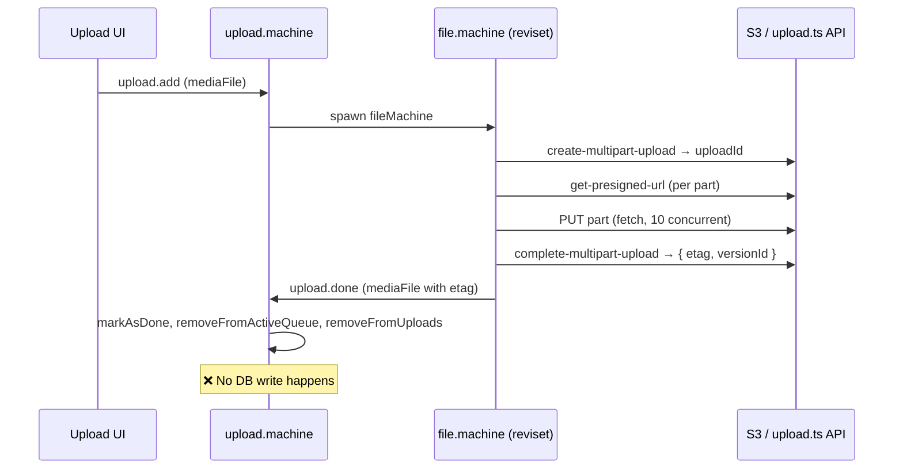
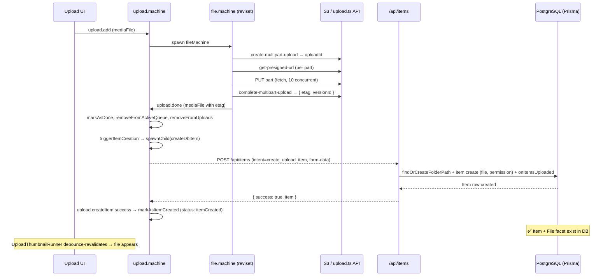
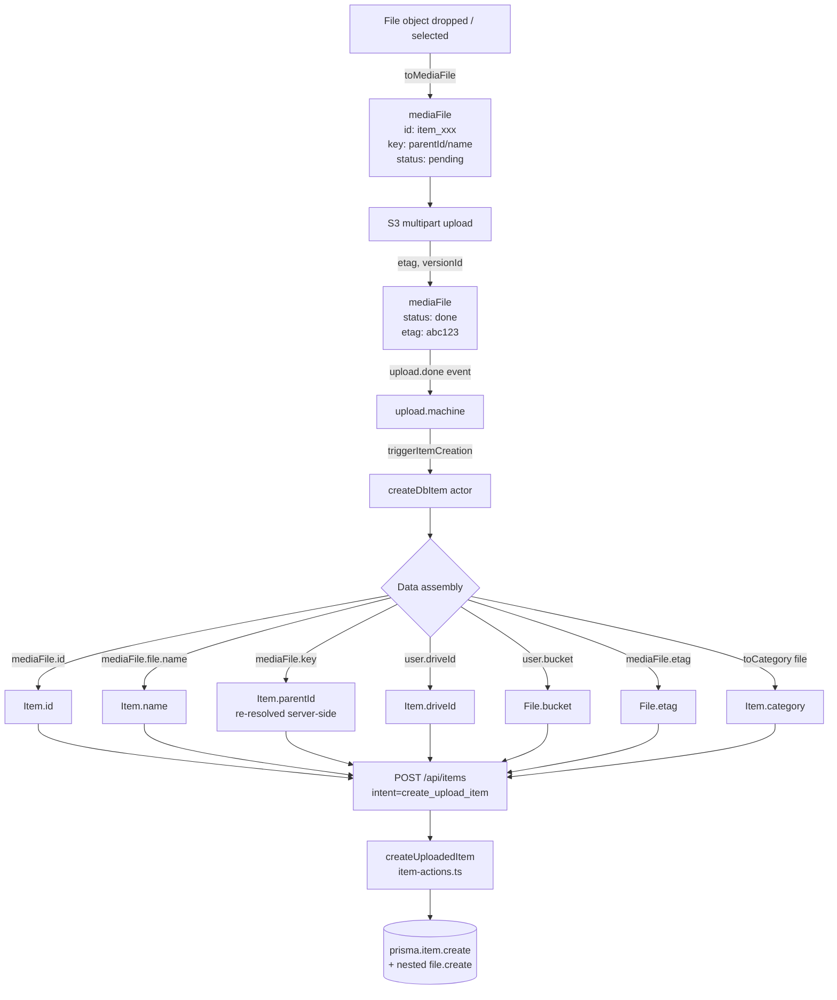

# Upload → DB Item Creation: Summary Report

## Why This Change

When a file finishes uploading to S3, the `upload.done` event fires and the UI shows "done" — but no database record is created. This change closes that gap: as soon as upload completes, an `Item` row and its linked `File` facet row are written to the database, making the file visible in the user's stash.

---

## Files Changed

### 1. `app/schemas/api.schemas.ts`
**Why:** This is where all API route request schemas live. The items API uses a discriminated union on `intent` — adding `create_upload_item` here makes the new operation type-safe end-to-end.

**What's added:**
```ts
z.object({
  intent: z.literal('create_upload_item'),
  id: z.string(),        // pre-generated item ID from upload machine
  name: z.string(),      // file.name
  key: z.string(),       // S3 object key
  size: z.coerce.bigint(), // file.size (coerced from form string)
  mimeType: z.string().optional(),
  etag: z.string().optional(),
  bucket: z.string(),    // from user config
  driveId: z.string(),   // from user config
  parentId: z.string(),  // first key segment; server re-resolves it from the full key
  ownerId: z.string(),
  category: z.string().optional(),
  uploadId: z.string(),  // S3 multipart upload id (recorded on Item + the upload activity)
})
```

---

### 2. `app/.server/item-actions.ts`
**Why:** All business logic and direct Prisma access lives here per project convention. The new `createUploadedItem()` function creates both the `Item` row and the nested `File` facet in a single transaction.

**Function added:** `createUploadedItem(data)`

| Param | Source | Notes |
|-------|--------|-------|
| `id` | `mediaFile.id` | Pre-generated as `item_xxx` by `toMediaFile()` |
| `name` | `mediaFile.file.name` | Original filename |
| `key` | `mediaFile.key` | S3 object path |
| `size` | `mediaFile.file.size` | Bytes |
| `mimeType` | `mediaFile.file.type` | MIME type |
| `etag` | `mediaFile.etag` | S3 ETag from completion response |
| `bucket` | `user.bucket` | From upload machine config |
| `driveId` | `user.driveId` | Tenant scope |
| `parentId` | `key.split('/')[0]` | Posted by the client, but the server re-resolves the real parent from the full key (see `findOrCreateFolderPath` below) |
| `ownerId` | `user.id` | Session user |
| `category` | `toCategory(file)` | Derived from MIME (video/audio/image/document/etc.) |
| `uploadId` | `mediaFile.uploadId` | S3 multipart upload id |

**Reuses:**
- `toObjectId(getPrefixForModel('File'))` — ID generation, already used throughout this file
- `defaultItemSelect` — standard select shape, already defined in this file
- `prisma` — already imported

**Also does, in the same transaction:** resolves the folder path via `findOrCreateFolderPath`, creates the owner `Permission`, and applies the quota delta with `onItemsUploaded({ userId, dataSize, client: tx })`. Activity rows (for the file and each folder created along the way) are written fire-and-forget with `createActivity`.

---

### 3. `app/routes/api/items.ts`
**Why:** The existing items API route handles all item mutations via form-data POST with an `intent` field. Adding `create_upload_item` here follows the established pattern exactly.

**What's added:** A new `case 'create_upload_item'` in the existing `action()` switch that calls `createUploadedItem()` and returns `{ success: true, item }`.

**Import added:** `createUploadedItem` from `item-actions.ts`

---

### 4. `app/machines/upload/upload.machine.ts`
**Why:** The upload machine owns the `upload.done` event. Spawning a fire-and-forget `fromPromise` child actor on that event is the XState v5 pattern for triggering side effects without blocking the state machine.

**What's added:**

| Addition | Purpose |
|----------|---------|
| `import { fromPromise } from 'xstate'` | Enable promise-based actors |
| `import { toCategory } from '@/utils/converters'` | Derive item category from MIME type |
| `createDbItem` actor | `fromPromise` that POSTs a `FormData` body (with `intent=create_upload_item`) to `/api/items` |
| `triggerItemCreation` action | `enqueueActions` that spawns `createDbItem` on `upload.done` |
| `'triggerItemCreation'` in `upload.done` handler | Wires the action into the event |
| `upload.createItem.success` / `.error` handlers | `markAsItemCreated` / `markItemCreationError` |

**Actor input:** `{ mediaFile, user, parent }` — `mediaFile` from the `upload.done` event, `user` from machine context, `parent` as `self` so the actor can report back with `upload.createItem.success` / `upload.createItem.error`. The child is spawned with id `create-item-${mediaFile.id}`.

---

## Flow Diagrams

### Current Upload Flow (no DB write)



---

### New Upload Flow (with DB write)



---

### Data Transformation Flow



---

### Key Derivations

| Field | Derived From | Example |
|-------|-------------|---------|
| `Item.id` | `mediaFile.id` (pre-generated by `toMediaFile`) | `item_ABC123` |
| `Item.parentId` | Sent as `mediaFile.key.split('/')[0]`; `createUploadedItem` re-resolves it by walking the middle key segments through `findOrCreateFolderPath` | `fld_XYZ` (or the leaf folder for a nested key) |
| `Item.driveId` | `upload.machine context.config.user.driveId` | `drv_123` |
| `File.id` | `toObjectId(getPrefixForModel('File'))` — generated server-side | `file_DEF456` |
| `File.key` | `mediaFile.key` | `fld_XYZ/photo.jpg` |
| `File.bucket` | `upload.machine context.config.user.bucket` | `stashly-prod` |
| `Item.category` | `toCategory(mediaFile.file)` from `app/utils/converters.ts` | `image` |

---

## Scope & Known Limitations

- **Flat uploads**: Works correctly — the key has no middle segments, so `parentId = key.split('/')[0]` is the destination folder.
- **Directory drops**: ✅ resolved since this report was written. The key carries `webkitRelativePath`, and `createUploadedItem` recreates the nested folders via `findOrCreateFolderPath` (advisory-locked per `owner:parent:name` so concurrent files in the same directory don't create duplicate folders), parenting the file at the leaf.
- **Error handling**: The actor reports back — `upload.createItem.error` sets the error on the media file — but there is no retry. If the DB write fails, the file never reaches `itemCreated`, so no thumbnail pipeline runs and the item is absent from the stash.
- **Quota**: Applied inside `createUploadedItem`'s transaction via `onItemsUploaded`. The per-file machine separately calls `updateQuota` (`POST /api/quota`, `action: 'items-uploaded'`) in its `updatingQuota` state — **suspected double-counting; see the note in `docs/quota-and-machines.md`.**

---

## Verification Steps

1. `pnpm dev` — start dev server
2. Sign in, open a folder
3. Drag-and-drop a file onto the folder view
4. Watch upload panel → status reaches `done`
5. Refresh the page — file should appear in the folder
6. `pnpm prisma studio` — confirm `Item` row exists with `type=file`, correct `parentId`, `ownerId`, `driveId`; confirm linked `File` row with `key`, `etag`, `bucket`
