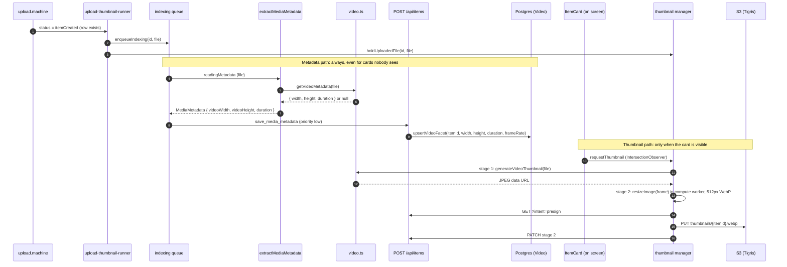
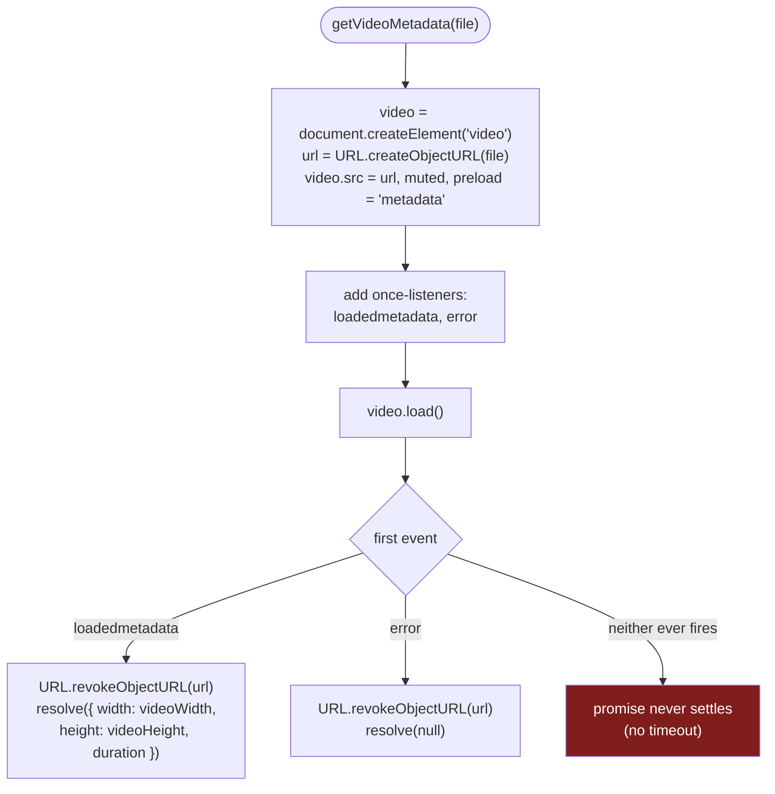
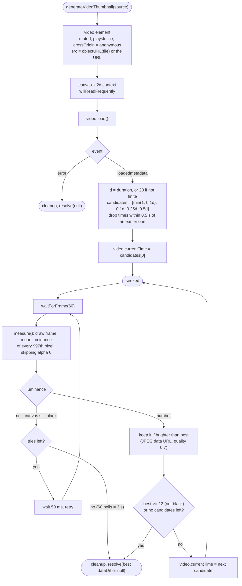

# Video metadata and thumbnails: `getVideoMetadata` and `generateVideoThumbnail`

Both functions live in `app/utils/video.ts`. Each loads the video into a hidden `<video>` element on the **main thread** (a `<video>` can't exist in a worker) and reads one thing from it: the first returns width, height and duration, the second returns a JPEG frame.

Written 16 Nov 2026 while investigating "MKV uploads have no metadata and some have no thumbnail". Measurements are from the dev database and the owner's 31 MKV files.

## Table of contents

1. [Summary](#summary)
2. [Where they are used](#where-they-are-used)
3. [End-to-end flow](#end-to-end-flow)
4. [`getVideoMetadata` step by step](#getvideometadata-step-by-step)
5. [`generateVideoThumbnail` step by step](#generatevideothumbnail-step-by-step)
6. [From file to stored facet](#from-file-to-stored-facet)
7. [Where the original comes from, and the 16 MiB cap](#where-the-original-comes-from-and-the-16-mib-cap)
8. [Known issues](#known-issues)
9. [The MKV investigation, measured](#the-mkv-investigation-measured)
10. [File map](#file-map)

---

## Summary

| | `getVideoMetadata(file)` | `generateVideoThumbnail(file \| url)` |
|---|---|---|
| Input | a `File` | a `File`, or a URL string (legacy gallery) |
| Output | `{ width, height, duration } \| null` | a JPEG data URL (quality 0.7) `\| null` |
| Used by | `extractMediaMetadata` (indexing, after an upload) | the `video` thumbnail producer (stage 1), and `Gallery.tsx`'s `VideoItem` |
| Settles when | `loadedmetadata` or `error` | a non-black frame was drawn, every candidate time was tried, 60 polls found no frame, or `error` |
| Timeout | **none** | **none** |
| Cleans up | revokes its object URL on success or error | revokes its object URL when it finishes |

Neither reads a codec, bit rate, frame rate or container: a `<video>` element does not expose them. The `Video` table has columns for all of them (`codec`, `bitrate`, `container`, `frameRate`, `fourCC`, `audio*`), the item panel shows rows for `Codec` and `Bitrate`, and nothing fills them (see [Known issues](#known-issues)).

---

## Where they are used

```mermaid
flowchart TB
    subgraph meta["Metadata path (indexing, runs for every upload)"]
        U1["upload-thumbnail-runner.tsx<br/>status = itemCreated"] --> EQ["enqueueIndexing(id, file)"]
        EQ --> IQ["indexing-queue.machine<br/>2 slots, oldest first"]
        IQ --> IM["indexing-item.machine<br/>readingMetadata"]
        IM --> EX["extractMediaMetadata(file)<br/>media-metadata.ts:506<br/>file.type startsWith 'video/'"]
        EX --> GVM["getVideoMetadata(file)"]
    end

    subgraph thumb["Thumbnail path (only when the card is on screen)"]
        V1["useThumbnailWhenVisible<br/>IntersectionObserver"] --> TM["thumbnail-manager.machine<br/>memory lane / download lane"]
        TM --> TI["thumbnail-item.machine"]
        TI --> S1["generateStage1Preview(file)"]
        S1 --> VP["videoProducer.preview<br/>thumbnail-stages/video.ts"]
        VP --> GVT["generateVideoThumbnail(file)"]
    end

    subgraph legacy["Legacy gallery (Videos page, workspaces)"]
        G1["Gallery.tsx VideoItem<br/>useEffect on src"] --> GVT2["generateVideoThumbnail(src: string)"]
    end
```

Callers, from a grep of `app/`:

| Caller | Function | Why |
|---|---|---|
| `app/utils/media-metadata.ts:507` (`extractMediaMetadata`) | `getVideoMetadata` | the only way the app learns a video's size and length |
| `app/utils/thumbnail-stages/video.ts:16` (`videoProducer.preview`) | `generateVideoThumbnail` | a video thumbnail is a frame, and stage 2 resizes that frame as an image |
| `app/components/Gallery.tsx:40` (`VideoItem`) | `generateVideoThumbnail` with a URL | poster frame for the old gallery, which still serves the Videos page and workspaces |

---

## End-to-end flow

An uploaded video goes down two independent paths. They share nothing but the `File`.

---

## `getVideoMetadata` step by step

`app/utils/video.ts:1-27`

- **Input:** a `File`. Its `type` matters only for the caller's `startsWith('video/')` check; Chrome sniffs the container from the bytes.
- **Output:** `{ width, height, duration }` in pixels and seconds (`duration` is a float, `Infinity` for a recording with no length), or `null`.
- **Caller** (`media-metadata.ts:506-512`): copies the three values into `videoWidth`, `videoHeight` and `duration`; a `null` leaves the video with no metadata.
- **Decoding:** `preload='metadata'` reads the container header, not frames. In the owner's Chrome 31 of 31 MKVs (24 AV1, 7 H.264) settled in 3-7 ms.

---

## `generateVideoThumbnail` step by step

`app/utils/video.ts:29-122`. It has two overloads, `File` and `string`. A `File` becomes an object URL (revoked when done); a string is used as is, with `crossOrigin='anonymous'`, so a URL needs CORS to be drawn to a canvas.

- **Output:** a JPEG data URL, or `null` (decode error, or no frame drawn). The thumbnail machine turns it into a `Blob` with `dataUrlToBlob`, and stage 2 resizes it to a 512 px WebP in the compute worker.
- **Why the retries:** `seeked` fires when the seek completes, not when its frame can be drawn (`fdf36f9`, 13 Nov). Drawing at once left a transparent canvas, which JPEG writes as solid black and which was then stored for good. `measure()` returns `null` for a blank canvas so the code waits instead.
- **Why the candidate times:** a video's first seconds are often a black intro (`56d9229`, 13 Nov). The best frame so far is kept; if every candidate is dark, the brightest one is returned rather than nothing.
- **It never reaches stage 3.** Salient crop is for images only.

---

## From file to stored facet

```mermaid
flowchart LR
    F["File<br/>(held in memory after an upload)"] --> E["extractMediaMetadata"]
    E -->|"file.type startsWith 'video/'"| G["getVideoMetadata"]
    G --> M["MediaMetadata<br/>videoWidth, videoHeight, duration"]
    M --> H{"hasMetadataToSave"}
    H -->|no| X["indexed, nothing saved"]
    H -->|yes| B["buildMediaMetadataFormData"]
    B --> P["POST /api/items<br/>intent = save_media_metadata<br/>(zod: videoWidth, videoHeight int; duration number)"]
    P --> S["saveMediaMetadata<br/>search-actions.ts:199"]
    S -->|"videoWidth or videoHeight truthy"| U["upsertVideoFacet<br/>INSERT ... ON CONFLICT (itemId)"]
    U --> T[("Video row<br/>width, height, duration, frameRate")]
    T --> UI["item-panel.tsx:147-156<br/>Duration, Frame rate, Codec, Bitrate rows"]
```

The facet is created only when a width or height arrived. A video the browser can't open gets no row, and nothing marks it as "tried".

The `mkv` or `mp4` extension plays no part anywhere: every `video/*` file takes the same branch.

---

## Where the original comes from, and the 16 MiB cap

A thumbnail needs the video bytes. They come from one of two places:

| Source | When | Size limit |
|---|---|---|
| **Memory** (`fromMemory`) | the file was uploaded in this tab and is still in `held-files.ts` | none |
| **Download** (`fromDownload`) | any other time: a reload, another device, a shared item | **16 MiB** (`BACKFILL_MAX_BYTES`) |

`useThumbnailWhenVisible` (`app/machines/thumbnail/hooks.ts`) decides per card: held file, then `canThumbnailFromMemory`; otherwise `canBackfillThumbnail`, which refuses `size > BACKFILL_MAX_BYTES` (`app/utils/thumbnail-backfill.ts:58`). The server repeats the check in `getThumbnailSource`, so `GET /api/thumbnails/:id?intent=source` answers `unsupported` for a larger file.

**Where the number comes from.** Commit `2662f56` (30 Jul 2026, "generate missing thumbnails on demand, lazily"). That commit added the whole download backfill, with the reasoning "that costs a full download", so it limited the cost: a viewport gate, two jobs at a time, LIFO order, idle callbacks, a pause during uploads, Data Saver opt-out, and "16 MB cap and a type gate". The server-side copy exists "so a stale tab can't talk the server into presigning a 4 GB video". 16 was a round guess for "a reasonable thumbnail source", not a measurement, and it was set when most backfilled files were images, PDFs and text.

**Why the whole file.** The producers take a `File`. `generateVideoThumbnail` puts it into `<video src=blob>`, and the backfill downloads the object with one `fetch(...).blob()`. Nothing in that chain uses an HTTP `Range` request.

**Measured 16 Nov on the owner's 31 MKVs (24 AV1, 7 H.264):** the first 3,000,000 bytes were enough for `getVideoMetadata` (31 of 31) and for `generateVideoThumbnail` (31 of 31 produced a frame, 30 of 31 byte-identical to the full file). That holds for these files because the Matroska header, index and first clusters sit at the start.

**It does not hold for every container.** An MP4 written without "faststart" keeps its `moov` box (the index, durations, sample tables) **at the end** of the file; a head-only blob of such a file does not open. A head-based backfill therefore needs either a second ranged read of the tail to find `moov`, or a fallback to the whole file (up to a bigger cap) when the head does not open.

---

## Known issues

1. **No timeout in either function.** If the element fires neither `loadedmetadata` nor `error`, both promises never settle. In the metadata path that holds one of the indexing queue's two slots for good (`indexing-queue.machine.ts` has no timeout either). I could not make any of the 31 files hang in isolation, so this is a risk, not a diagnosed cause.
2. **No cleanup of the element.** Neither function clears `video.src` or calls `load()` afterwards; they only revoke the object URL. The element is left for garbage collection.
3. **`getVideoMetadata` can return `duration = Infinity`** for a recording with no length (the thumbnail function guards this with `Number.isFinite`, the metadata function does not). Not checked against the zod schema.
4. **The `Video` table has columns nothing fills:** `codec`, `bitrate`, `container`, `fourCC`, `audioFormat`, `audioChannels`, `audioSamplesPerSecond`, `audioBitsPerSample`. `frameRate` is accepted by the route and `upsertVideoFacet` but no extractor produces it. The item panel shows `Codec` and `Bitrate` rows for every video, empty for all of them. A `<video>` element cannot tell these; they need a container parser.
5. **No "already tried" mark for metadata.** The thumbnail lane remembers failed downloads in `sessionStorage` (`attempt-store.ts`) and has a backfill for items without a thumbnail. Metadata has neither: a file whose metadata step never ran (tab closed, queue stalled) stays without a facet for good. This is why 63 of the 69 files of the 15 Nov 20:42 batch (35 mp3, 31 MKV, 2 mp4, 1 other) have no facet.
6. **The in-tab queue is lost on reload.** The queue and held files are module state.
7. **Black first frame:** fixed 13 Nov (`fdf36f9`, `56d9229`). It does not run for a video that never gets a thumbnail job, which is the 16 MiB case above.
8. **The URL overload needs CORS** (`crossOrigin='anonymous'`), and the old `Gallery.tsx` calls it on every render of a `VideoItem` whose `src` changes, with no queue or cap.

---

## The MKV investigation, measured

| Question | Result |
|---|---|
| Does the format matter? | No. Nothing in `app/` mentions `matroska` or `mkv`; `file.type.startsWith('video/')` covers them. |
| Does Chrome decode them? | Yes, 31 of 31: 24 `V_AV1`, 7 `V_MPEG4/ISO/AVC`; audio AAC or Opus. Every file carries a Duration element. |
| Why do 14 have no thumbnail? | They are the 14 MKVs larger than 16 MiB (smallest 18.9 MB). The 17 at or under 16.1 MB all have one. |
| Why do 27 have no metadata? | The in-tab metadata queue stopped after 6 saves (Vinktar: `media_metadata_saved` ×6, all within 20:42:08 to 20:42:13, for 69 uploads). The same batch's mp3s: 1 of 35 has a facet. Cause of the stall not proven (see issue 1). |
| Did the 13 Nov black-frame fix regress? | No evidence. It applies only when a thumbnail job runs, and none ran for these files. |

---

## File map

| File | Role |
|---|---|
| `app/utils/video.ts` | `getVideoMetadata`, `generateVideoThumbnail` |
| `app/utils/media-metadata.ts` | `extractMediaMetadata` (video branch at 506), `buildMediaMetadataFormData`, `hasMetadataToSave` |
| `app/utils/thumbnail-stages/video.ts` | `videoProducer` (`preview` = frame, `resize` = 512 px WebP) |
| `app/utils/thumbnail-backfill.ts` | `BACKFILL_MAX_BYTES`, `canBackfillThumbnail`, `canThumbnailFromMemory` |
| `app/machines/thumbnail/` | manager, per-item machine, `hooks.ts` (`useThumbnailWhenVisible`), `held-files.ts`, `attempt-store.ts` |
| `app/machines/indexing/` | queue (2 slots), `indexing-item.machine.ts`, `indexing.actors.ts` |
| `app/.server/search-actions.ts` | `save_media_metadata` handler, video branch at 199 |
| `app/.server/item-actions.ts` | `upsertVideoFacet` (1830) |
| `app/.server/thumbnail-actions.ts` | `getThumbnailSource`, the server copy of the cap |
| `app/components/views/item-page/item-panel.tsx` | shows the `Video` rows (147-156) |
| `app/components/Gallery.tsx` | legacy `VideoItem`, the URL overload |
| `prisma/models/facet.prisma` | `Video` model |
