# Stashly

> Generated by [`prisma-markdown`](https://github.com/samchon/prisma-markdown)

- [default](#default)

## default

```mermaid
erDiagram
"Account" {
  String id PK
  String accountId
  String providerId
  String userId FK
  String accessToken "nullable"
  String refreshToken "nullable"
  String idToken "nullable"
  DateTime accessTokenExpiresAt "nullable"
  DateTime refreshTokenExpiresAt "nullable"
  String scope "nullable"
  String password "nullable"
  DateTime createdAt
  DateTime updatedAt
}
"ItemAction" {
  String id PK
  String commentActionId FK,UK "nullable"
  String createActionId FK,UK "nullable"
  String deleteActionId FK,UK "nullable"
  String editActionId FK,UK "nullable"
  String moveActionId FK,UK "nullable"
  String renameActionId FK,UK "nullable"
  String restoreActionId FK,UK "nullable"
  String shareActionId FK,UK "nullable"
  String versionActionId FK,UK "nullable"
  String activityId FK,UK "nullable"
  String copyActionIdId FK,UK "nullable"
}
"AccessAction" {
  String id PK
  String activityId FK,UK "nullable"
}
"CommentAction" {
  String id PK
  Boolean isReply
  String authorId
  String participants
}
"CreateAction" {
  String id PK
}
"DeleteAction" {
  String id PK
  String name
  ObjectType itemType
}
"EditAction" {
  String id PK
}
"MoveAction" {
  String id PK
  String from
  String to
}
"CopyAction" {
  String id PK
  String from
  String to
}
"RenameAction" {
  String id PK
  String oldName
  String newName
}
"RestoreAction" {
  String id PK
}
"ShareAction" {
  String id PK
  String recipients
}
"VersionAction" {
  String id PK
  String newVersion
}
"Activity" {
  String id PK
  String timeId FK,UK "nullable"
  String itemId FK "nullable"
}
"ActivityTime" {
  String id PK
  DateTime observedAt "nullable"
  DateTime reportedAt "nullable"
}
"AuditLog" {
  String id PK
  String action
  DateTime timestamp
  String itemId FK "nullable"
  Json metadata "nullable"
}
"Collection" {
  String id PK,FK
  String name
  BigInt size
}
"CollectionItem" {
  String id PK
  String collectionId FK
  String itemId FK
  DateTime createdAt
  DateTime updatedAt
}
"Comment" {
  String id PK
  String content
  DateTime createdAt
  DateTime updatedAt
  String itemId FK
  String ownerId FK
}
"Drive" {
  String id PK
  String name
  DriveType type
  DateTime createdAt
  DateTime updatedAt
  String ownerId FK,UK
}
"File" {
  String id PK
  String mimeType "nullable"
  String hash "nullable"
  String extension "nullable"
  String bucket
  String key
  String etag "nullable"
  String itemId FK,UK
}
"Folder" {
  String id PK
  Int childCount "nullable"
  String itemId FK,UK
}
"Image" {
  String id PK
  Int height "nullable"
  Int width "nullable"
  Int horizontalResolution "nullable"
  Int verticalResolution "nullable"
  String cameraMake "nullable"
  String cameraModel "nullable"
  Int exposureDenominator "nullable"
  Float exposureNumerator "nullable"
  String exposureTime "nullable"
  Float focalLength "nullable"
  Float fNumber "nullable"
  Int iso "nullable"
  DateTime takenDateTime "nullable"
  String itemId FK,UK "nullable"
}
"Video" {
  String id PK
  Int bitrate "nullable"
  Int duration "nullable"
  Int height "nullable"
  Int width "nullable"
  Int audioBitsPerSample "nullable"
  Int audioChannels "nullable"
  String audioFormat "nullable"
  Int audioSamplesPerSecond "nullable"
  Float frameRate "nullable"
  String fourCC "nullable"
  String itemId FK,UK "nullable"
}
"Audio" {
  String id PK
  String album "nullable"
  String albumArtist "nullable"
  String artist "nullable"
  Int bitrate "nullable"
  String composers "nullable"
  String copyright "nullable"
  Int disc "nullable"
  Int discCount "nullable"
  Int duration "nullable"
  String genre "nullable"
  Boolean hasDrm "nullable"
  Boolean isVariableBitrate "nullable"
  String title "nullable"
  Int track "nullable"
  Int trackCount "nullable"
  Int year "nullable"
  String itemId FK,UK "nullable"
}
"Photo" {
  String id PK
  String cameraMake "nullable"
  String cameraModel "nullable"
  Float exposureDenominator "nullable"
  Float exposureNumerator "nullable"
  Float fNumber "nullable"
  Float focalLength "nullable"
  Int iso "nullable"
  DateTime takenDateTime "nullable"
  String itemId FK,UK "nullable"
}
"Favorite" {
  String id PK
  String favoritedById FK
  String itemId FK
  DateTime createdAt
  DateTime updatedAt
}
"Invitation" {
  String id PK
  DateTime createdAt
  DateTime expiresAt "nullable"
  String email
  InvitationStatus status
  String senderId FK
  String workspaceId FK "nullable"
  WorkspaceMemberRole role "nullable"
}
"Item" {
  String id PK
  String(50) name
  BigInt size
  String path UK
  ItemType type
  ItemCategory category
  ItemStatus status
  String uploadId "nullable"
  DateTime createdAt
  DateTime updatedAt
  String ownerId FK
  String workspaceId FK "nullable"
  String driveId FK
  String parentId FK "nullable"
  String tags
}
"LockedItem" {
  String id PK
  String itemId FK,UK
  String lockedById FK
  DateTime lockedAt
  DateTime expiresAt "nullable"
}
"Metadata" {
  String id PK
  String key
  String value
  DateTime createdAt
  DateTime updatedAt
}
"Notification" {
  String id PK
  String message
  NotificationType type
  NotificationStatus status
  DateTime createdAt
  DateTime updatedAt
  String userId FK
}
"Permission" {
  String id PK
  DateTime createdAt
  DateTime updatedAt
  DateTime expiresAt "nullable"
  DateTime deletedAt "nullable"
  PermissionRole roles
  String invitationId FK,UK "nullable"
  String linkId FK "nullable"
  String itemId FK "nullable"
}
"Quota" {
  String id PK
  DateTime createdAt
  DateTime updatedAt
  BigInt deleted
  BigInt total
  BigInt used
  QuotaStatus status
  String driveId FK,UK
}
"Search" {
  String id PK
  String type
  String content "nullable"
  DateTime createdAt
  DateTime updatedAt
  String itemId FK,UK
}
"session" {
  String id PK
  DateTime expiresAt
  String token UK
  DateTime createdAt
  DateTime updatedAt
  String ipAddress "nullable"
  String userAgent "nullable"
  String userId FK
  String impersonatedBy "nullable"
  String activeWorkspaceId "nullable"
}
"ShareLink" {
  String id PK
  ShareLinkType type
  ShareScope scope
  String url "nullable"
  Boolean downloadable "nullable"
  String password "nullable"
  DateTime expiresAt "nullable"
  DateTime createdAt
  DateTime updatedAt
}
"StoragePlan" {
  String id PK
  String name
  StoragePlanType type
  BigInt storageLimit
  String stripePriceId UK "nullable"
}
"Subscription" {
  String id PK
  SubscriptionStatus status
  Json metadata "nullable"
  DateTime createdAt
  DateTime updatedAt
  DateTime endedAt "nullable"
  String storagePlanId FK
  String stripeSubscriptionId UK "nullable"
  String ownerId FK,UK
}
"Tag" {
  String id PK
  String name
  DateTime createdAt
  DateTime updatedAt
}
"Thumbnail" {
  String id PK
  DateTime createdAt
  DateTime updatedAt
  Int width "nullable"
  Int height "nullable"
  String url "nullable"
  Bytes content "nullable"
  ThumbnailSize size
  String itemId FK "nullable"
}
"Trash" {
  String id PK
  DateTime updatedAt
}
"TrashItem" {
  String id PK
  String itemId FK,UK
  String trashId FK
  DateTime createdAt
  DateTime restoredAt "nullable"
  DateTime deletedAt "nullable"
}
"user" {
  String id PK
  String(50) name
  String displayName "nullable"
  String email UK
  String image "nullable"
  Boolean emailVerified
  DateTime createdAt
  DateTime updatedAt
  String bucket
  String driveId UK "nullable"
  String subscriptionId UK "nullable"
  String storagePlanId UK "nullable"
  String stripeCustomerId UK "nullable"
}
"verification" {
  String id PK
  String identifier
  String value
  DateTime expiresAt
  DateTime createdAt "nullable"
  DateTime updatedAt "nullable"
}
"ItemVersion" {
  String id PK
  DateTime updatedAt "nullable"
  DateTime createdAt "nullable"
  BigInt size "nullable"
  Bytes content "nullable"
  String label "nullable"
  String version "nullable"
  String itemId FK "nullable"
}
"Workspace" {
  String id PK
  String name UK
  String description "nullable"
  Boolean default
  DateTime createdAt
  DateTime updatedAt
}
"WorkspaceMember" {
  String id PK
  WorkspaceMemberRole role
  String memberId FK
  String workspaceId FK
}
"Preview" {
  String id PK
  String fileId
  String preview
  DateTime createdAt
  DateTime updatedAt
}
"FileShare" {
  String id PK
  String fileId
  String accessKey UK
  DateTime expiresAt "nullable"
  Int maxDownloads "nullable"
  Int downloads
}
"View" {
  String id PK
  ViewType viewType
  SortBy sortBy
  SortOrder sortOrder
  String folderId FK,UK "nullable"
}
"_PermissionToUser" {
  String A FK
  String B FK
}
"Account" }o--|| "user" : user
"ItemAction" |o--o| "CommentAction" : comment
"ItemAction" |o--o| "CreateAction" : create
"ItemAction" |o--o| "DeleteAction" : delete
"ItemAction" |o--o| "EditAction" : edit
"ItemAction" |o--o| "MoveAction" : move
"ItemAction" |o--o| "RenameAction" : rename
"ItemAction" |o--o| "RestoreAction" : restore
"ItemAction" |o--o| "ShareAction" : share
"ItemAction" |o--o| "VersionAction" : version
"ItemAction" |o--o| "Activity" : activity
"ItemAction" |o--o| "CopyAction" : copy
"AccessAction" |o--o| "Activity" : activity
"Activity" |o--o| "ActivityTime" : time
"Activity" }o--o| "Item" : item
"AuditLog" }o--o| "Item" : item
"Collection" |o--|| "Item" : item
"CollectionItem" }o--|| "Collection" : collection
"CollectionItem" }o--|| "Item" : item
"Comment" }o--|| "Item" : item
"Comment" }o--|| "user" : owner
"Drive" |o--|| "user" : owner
"File" |o--|| "Item" : item
"Folder" |o--|| "Item" : item
"Image" |o--o| "Item" : item
"Video" |o--o| "Item" : item
"Audio" |o--o| "Item" : item
"Photo" |o--o| "Item" : item
"Favorite" }o--|| "user" : favoritedBy
"Favorite" }o--|| "Item" : item
"Invitation" }o--|| "user" : sender
"Invitation" }o--o| "Workspace" : workspace
"Item" }o--|| "user" : owner
"Item" }o--o| "Workspace" : workspace
"Item" }o--|| "Drive" : drive
"Item" }o--o| "Item" : parent
"LockedItem" |o--|| "Item" : item
"LockedItem" }o--|| "user" : lockedBy
"Notification" }o--|| "user" : user
"Permission" |o--o| "Invitation" : invitation
"Permission" }o--o| "ShareLink" : link
"Permission" }o--o| "Item" : item
"Quota" |o--|| "Drive" : drive
"Search" |o--|| "Item" : item
"session" }o--|| "user" : user
"Subscription" }o--|| "StoragePlan" : storagePlan
"Subscription" |o--|| "user" : owner
"Thumbnail" }o--o| "Item" : item
"TrashItem" |o--|| "Item" : item
"TrashItem" }o--|| "Trash" : trash
"ItemVersion" }o--o| "Item" : item
"WorkspaceMember" }o--|| "user" : member
"WorkspaceMember" }o--|| "Workspace" : workspace
"View" |o--o| "Folder" : folder
"_PermissionToUser" }o--|| "Permission" : Permission
"_PermissionToUser" }o--|| "user" : User
```

### `Account`

Properties as follows:

- `id`:
- `accountId`:
- `providerId`:
- `userId`:
- `accessToken`:
- `refreshToken`:
- `idToken`:
- `accessTokenExpiresAt`:
- `refreshTokenExpiresAt`:
- `scope`:
- `password`:
- `createdAt`:
- `updatedAt`:

### `ItemAction`

Properties as follows:

- `id`:
- `commentActionId`:
- `createActionId`:
- `deleteActionId`:
- `editActionId`:
- `moveActionId`:
- `renameActionId`:
- `restoreActionId`:
- `shareActionId`:
- `versionActionId`:
- `activityId`:
- `copyActionIdId`:

### `AccessAction`

Properties as follows:

- `id`:
- `activityId`:

### `CommentAction`

Properties as follows:

- `id`:
- `isReply`:
- `authorId`:
- `participants`:

### `CreateAction`

Properties as follows:

- `id`:

### `DeleteAction`

Properties as follows:

- `id`:
- `name`:
- `itemType`:

### `EditAction`

Properties as follows:

- `id`:

### `MoveAction`

Properties as follows:

- `id`:
- `from`:
- `to`:

### `CopyAction`

Properties as follows:

- `id`:
- `from`:
- `to`:

### `RenameAction`

Properties as follows:

- `id`:
- `oldName`:
- `newName`:

### `RestoreAction`

Properties as follows:

- `id`:

### `ShareAction`

Properties as follows:

- `id`:
- `recipients`:

### `VersionAction`

Properties as follows:

- `id`:
- `newVersion`:

### `Activity`

Properties as follows:

- `id`:
- `timeId`:
- `itemId`:

### `ActivityTime`

Properties as follows:

- `id`:
- `observedAt`:
- `reportedAt`:

### `AuditLog`

Properties as follows:

- `id`:
- `action`:
- `timestamp`:
- `itemId`:
- `metadata`:

### `Collection`

Properties as follows:

- `id`:
- `name`:
- `size`:

### `CollectionItem`

Properties as follows:

- `id`:
- `collectionId`:
- `itemId`:
- `createdAt`:
- `updatedAt`:

### `Comment`

Properties as follows:

- `id`:
- `content`:
- `createdAt`:
- `updatedAt`:
- `itemId`:
- `ownerId`:

### `Drive`

Properties as follows:

- `id`:
- `name`:
- `type`:
- `createdAt`:
- `updatedAt`:
- `ownerId`:

### `File`

Properties as follows:

- `id`:
- `mimeType`:
- `hash`:
- `extension`:
- `bucket`:
- `key`:
- `etag`:
- `itemId`:

### `Folder`

Properties as follows:

- `id`:
- `childCount`:
- `itemId`:

### `Image`

Properties as follows:

- `id`:
- `height`:
- `width`:
- `horizontalResolution`:
- `verticalResolution`:
- `cameraMake`:
- `cameraModel`:
- `exposureDenominator`:
- `exposureNumerator`:
- `exposureTime`:
- `focalLength`:
- `fNumber`:
- `iso`:
- `takenDateTime`:
- `itemId`:

### `Video`

Properties as follows:

- `id`:
- `bitrate`:
- `duration`:
- `height`:
- `width`:
- `audioBitsPerSample`:
- `audioChannels`:
- `audioFormat`:
- `audioSamplesPerSecond`:
- `frameRate`:
- `fourCC`:
- `itemId`:

### `Audio`

Properties as follows:

- `id`:
- `album`:
- `albumArtist`:
- `artist`:
- `bitrate`:
- `composers`:
- `copyright`:
- `disc`:
- `discCount`:
- `duration`:
- `genre`:
- `hasDrm`:
- `isVariableBitrate`:
- `title`:
- `track`:
- `trackCount`:
- `year`:
- `itemId`:

### `Photo`

Properties as follows:

- `id`:
- `cameraMake`:
- `cameraModel`:
- `exposureDenominator`:
- `exposureNumerator`:
- `fNumber`:
- `focalLength`:
- `iso`:
- `takenDateTime`:
- `itemId`:

### `Favorite`

Properties as follows:

- `id`:
- `favoritedById`:
- `itemId`:
- `createdAt`:
- `updatedAt`:

### `Invitation`

Properties as follows:

- `id`:
- `createdAt`:
- `expiresAt`:
- `email`:
- `status`:
- `senderId`:
- `workspaceId`:
- `role`:

### `Item`

Properties as follows:

- `id`:
- `name`:
- `size`:
- `path`:
- `type`:
- `category`:
- `status`:
- `uploadId`:
- `createdAt`:
- `updatedAt`:
- `ownerId`:
- `workspaceId`:
- `driveId`:
- `parentId`:
- `tags`:

### `LockedItem`

Properties as follows:

- `id`:
- `itemId`:
- `lockedById`:
- `lockedAt`:
- `expiresAt`:

### `Metadata`

Properties as follows:

- `id`:
- `key`:
- `value`:
- `createdAt`:
- `updatedAt`:

### `Notification`

Properties as follows:

- `id`:
- `message`:
- `type`:
- `status`:
- `createdAt`:
- `updatedAt`:
- `userId`:

### `Permission`

Properties as follows:

- `id`:
- `createdAt`:
- `updatedAt`:
- `expiresAt`:
- `deletedAt`:
- `roles`:
- `invitationId`:
- `linkId`:
- `itemId`:

### `Quota`

Properties as follows:

- `id`:
- `createdAt`:
- `updatedAt`:
- `deleted`:
- `total`:
- `used`:
- `status`:
- `driveId`:

### `Search`

Properties as follows:

- `id`:
- `type`:
- `content`:
- `createdAt`:
- `updatedAt`:
- `itemId`:

### `session`

Properties as follows:

- `id`:
- `expiresAt`:
- `token`:
- `createdAt`:
- `updatedAt`:
- `ipAddress`:
- `userAgent`:
- `userId`:
- `impersonatedBy`:
- `activeWorkspaceId`:

### `ShareLink`

Properties as follows:

- `id`:
- `type`:
- `scope`:
- `url`:
- `downloadable`:
- `password`:
- `expiresAt`:
- `createdAt`:
- `updatedAt`:

### `StoragePlan`

Properties as follows:

- `id`:
- `name`:
- `type`:
- `storageLimit`:
- `stripePriceId`:

### `Subscription`

Properties as follows:

- `id`:
- `status`:
- `metadata`:
- `createdAt`:
- `updatedAt`:
- `endedAt`:
- `storagePlanId`:
- `stripeSubscriptionId`:
- `ownerId`:

### `Tag`

Properties as follows:

- `id`:
- `name`:
- `createdAt`:
- `updatedAt`:

### `Thumbnail`

Properties as follows:

- `id`:
- `createdAt`:
- `updatedAt`:
- `width`:
- `height`:
- `url`:
- `content`:
- `size`:
- `itemId`:

### `Trash`

Properties as follows:

- `id`:
- `updatedAt`:

### `TrashItem`

Properties as follows:

- `id`:
- `itemId`:
- `trashId`:
- `createdAt`:
- `restoredAt`:
- `deletedAt`:

### `user`

Properties as follows:

- `id`:
- `name`:
- `displayName`:
- `email`:
- `image`:
- `emailVerified`:
- `createdAt`:
- `updatedAt`:
- `bucket`:
- `driveId`:
- `subscriptionId`:
- `storagePlanId`:
- `stripeCustomerId`:

### `verification`

Properties as follows:

- `id`:
- `identifier`:
- `value`:
- `expiresAt`:
- `createdAt`:
- `updatedAt`:

### `ItemVersion`

Properties as follows:

- `id`:
- `updatedAt`:
- `createdAt`:
- `size`:
- `content`:
- `label`:
- `version`:
- `itemId`:

### `Workspace`

Properties as follows:

- `id`:
- `name`:
- `description`:
- `default`:
- `createdAt`:
- `updatedAt`:

### `WorkspaceMember`

Properties as follows:

- `id`:
- `role`:
- `memberId`:
- `workspaceId`:

### `Preview`

Properties as follows:

- `id`:
- `fileId`:
- `preview`:
- `createdAt`:
- `updatedAt`:

### `FileShare`

Properties as follows:

- `id`:
- `fileId`:
- `accessKey`:
- `expiresAt`:
- `maxDownloads`:
- `downloads`:

### `View`

Properties as follows:

- `id`:
- `viewType`:
- `sortBy`:
- `sortOrder`:
- `folderId`:

### `_PermissionToUser`

Pair relationship table between [Permission](#Permission) and [user](#user)

Properties as follows:

- `A`:
- `B`:
